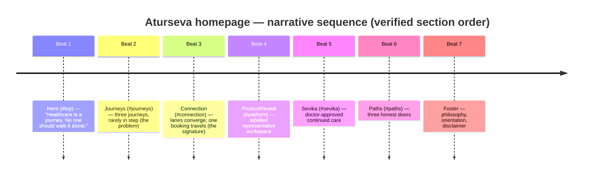
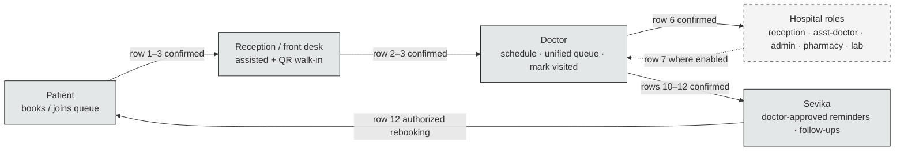

# Aturseva — File 06: Homepage Storyboard

**Status:** `PLANNING — NOT IMPLEMENTED`
**Created:** 2026-10-13 (working-session date; ISO 8601)
**Source baseline:** repository `doctorooms-creator/aturseva-landing`, branch `main`, commit `f407e78` (File 05 merge point). All "verified" claims cite this tree.
**Planning dependencies:** `docs/02_PRODUCT_TRUTH_AND_CAPABILITY_MATRIX.md` (capability truth), `docs/03_BRAND_MISSION_AND_POSITIONING.md` (brand strategy; tagline superseded by owner decision), `docs/04_SITEMAP_AND_NAVIGATION.md` (route/anchor/CTA truth), `docs/05_CREATIVE_DIRECTION_AND_DESIGN_SYSTEM.md` (**mandatory design baseline — this file does not re-open or duplicate its decisions**), `docs/07_MOTION_AND_SCROLL_ANIMATION.md` (companion motion spec; same frame IDs).
**Scope:** the single-page Aturseva homepage (`/`) — narrative and visual storyboard only. No implementation is authorized or performed by this document.
**Owner decision boundaries:** official tagline **"Care that walks with you."** is owner-approved and canonical. Logo asset (embedding "Make healthcare intelligent.") is untouched; interim usage rules per File 05 §10. Story order, monochrome palette, English-copy and claims rules per Files 02–05. Nothing else in this file is owner-approved unless the project history explicitly confirms it.

**Change log:**
| Date | Change | Author context |
|---|---|---|
| 2026-10-13 | Initial creation; 20 sections; frame system N/H/J/C/P/S/R/F; full source audit integrated | File 06+07 combined planning task |

**Backlog cross-reference convention (shared with File 07):** items B1–B8 = File 04 §16 items 1–8; B9 = File 05 §19 item 9 (hardcoded SVG greys). New items discovered by this storyboard take IDs B10+. No backlog item is implemented by this document.

---

## 1. Document control

Covered by the header block above. Additions:

- **Document type:** implementation-ready narrative/visual storyboard for engineers, designers and QA — decisions, frame tables, state descriptions, acceptance criteria, handoffs; no inspiration-board prose.
- **Truth hierarchy:** product truth → File 02; sitemap/CTA truth → File 04; design system → File 05; source code → implementation truth. This document plans; it never claims deployment.
- **Verification method:** source audit of `src/app/page.tsx`, `src/app/layout.tsx`, `src/app/globals.css`, all rendered components, `src/lib/aturseva-anim.js`, `src/components/AnimationProvider.tsx`, `package.json`, `next.config.ts`, `public/` (fonts + favicon only). No browser QA was run for this task; HTTP/CI status is never treated as visual proof.
- **Companion requirement:** every frame below carries a File 07 handoff (matching frame ID). Where a frame is static by design, File 07 says so explicitly.

---

## 2. Story purpose and experience thesis

**Primary audience:** patients and carers first; doctors and hospital/clinic teams as collaborator audiences (File 04 §3). The homepage is the front door for all three, and the story order is locked to File 02 §11.6.

**What a first-time visitor should understand, in one scroll:** healthcare is a journey shared by patients, doctors and hospitals; today those journeys rarely move in step; Aturseva connects them into one calm flow — booking, queue, consultation, records, follow-up — with Sevika continuing doctor-approved care after the visit; and there is a clear door for who you are.

**Emotional movement:** recognition ("this is my waiting room") → relief ("someone is keeping step") → trust earned by restraint (labelled previews, no hype, no promises) → orientation ("here is my path"). Calm, confident, dignified — per File 05 §3.

**Evidence that supports trust:** honest language (no invented numbers, no testimonials); visibly labelled representative previews; doctor-approved attribution on every Sevika element; support-not-replacement framing; monochrome restraint itself as a signal of seriousness (File 05 §13.4 of File 03 differentiation).

**What the page must never imply:** zero waiting or exact wait times; guaranteed outcomes; AI diagnosis/prescription/autonomy; staff replacement; live data in any mock; real customers/partners; pricing; the logo's embedded line as the official tagline.

**Brand promise line (verbatim, owner-approved):** "Care that walks with you."

---

## 3. Audience and intent map

No invented personas, statistics, demographics or conversion assumptions. CTA destination truth from File 04 §10 (single route `/`; anchors only; no external destinations confirmed).

| Audience | Likely question on landing | Information priority | CTA destination — current/verified | CTA destination — future (proposal only) |
|---|---|---|---|---|
| Patients & carers | "Will I know my turn? Can someone help me book and remember follow-ups? What about my parents without smartphones?" | journey empathy → queue clarity → Sevika continued care → patient door | `#paths` (hero secondary, nav "Get started"); Paths patient button → toast (captures nothing — B4) | `/patients` page then a genuine patient destination, only once confirmed (File 04 §18-3) |
| Doctors | "Does this add or remove work? Who controls the queue? What does Sevika do with my patients?" | respect for clinical authority → doctor-day framing → Sevika boundaries stated openly | `#paths`; Paths doctor button → toast (B4) | `/doctors` page (File 04 §6 Phase-1 proposal — **not a live route**) |
| Clinics/hospitals/admin | "Can online + walk-in really share one queue? What do reception/pharmacy/lab get?" | busy-desk empathy → one live queue → six-role story (condensed) | `#paths`; Paths hospital button → toast (B4) | `/hospitals` page (proposal — **not a live route**) |
| Reception / assistant staff (supporting) | "Will self-service remove my role?" | shown assisting walk-ins; staff in charge | none specifically; hospital card + `#connection` narrative | `/hospitals` role sections (proposal) |

---

## 4. Narrative arc and story beats

Locked order (File 02 §11.6; verified live in source — see §5): human story → connected workflow → labelled product previews → Sevika → role pathways.

**Beat handoffs (purpose → handoff):**
1. **Hero** establishes companionship → hands the emotional frame to the problem via "Begin the journey" → `#journeys`.
2. **Journeys** earns the fix by showing fragmentation → hands to Connection via the icon scroll cue + closing line "What if these journeys spoke to each other?" → `#connection`.
3. **Connection** demonstrates the connective value → hands to ProductReveal as *supporting evidence* (the story earned the interface).
4. **ProductReveal** proves the workspace exists (representative) → hands to Sevika as "after the visit" continuation.
5. **Sevika** completes the care loop → hands to Paths ("where do you fit in the journey?").
6. **Paths** routes by identity → hands to Footer for orientation + disclaimers.
7. **Footer** closes quietly; no further push.

Anchors map 1:1 to File 04 §5 (verified: `#journeys`, `#connection`, `#platform`, `#sevika`, `#paths`, plus `#top`, `#main`, `#site-nav`, `#nav-mobile`).

---

## 5. Homepage section inventory and consistency map

Actual render order, verified in `src/app/page.tsx` (all statuses source-audited this task):

| # | Section | Source path | Anchor | Story purpose | Audience need | Main message | Visual device | Content status | Motion relation | Preview/claim risks | Handoff → |
|---|---|---|---|---|---|---|---|---|---|---|---|
| 0 | Skip link + Nav | `page.tsx:14–16`, `Nav.tsx` | `#main`, `#top`, `#site-nav` | orientation | all | "you are here; jump anywhere" | fixed header, wordmark, 4 anchors + CTA | verified | M-N (File 07 §7) | none (honest anchors) | Hero |
| 1 | Hero | `Hero.tsx` | `#top` | open the emotional frame | patients first | "No one should walk it alone." | full-viewport dark stage; Fraunces H1; journey-arc SVG; ECG trace | verified; copy exact | M-H1–H5 | no promise risk; typography-only (no photo — B6/File 08) | Journeys |
| 2 | Journeys | `Journeys.tsx` | `#journeys` | the problem today | all three roles | "Three journeys. Rarely in step." | 3 cards with broken-lane SVGs + problem chips | verified; copy exact | M-J1–J3 | none | Connection |
| 3 | Connection | `Connection.tsx` | `#connection` | signature convergence | all | "Aturseva joins them into one calm flow." | pinned/scrubbed lane diagram + 4 overlay cards | verified; copy exact | M-C1–C6 | **cards unlabelled "Representative preview" (B2); "Tokens today: 42" could read as live (B2)** | ProductReveal |
| 4 | ProductReveal | `ProductReveal.tsx` | `#platform` | supporting evidence | providers + patients | "One workspace. Every side of care." | labelled UI window (schedule + queue panels) | verified; label present | M-P1–P3 | none (label verified) | Sevika |
| 5 | Sevika | `Sevika.tsx` | `#sevika` | continued care | patients (+ doctor reassurance) | "Sevika stays, long after the visit ends." | split: bullets/quote + message thread with approval chips | verified; copy exact (Hinglish inside thread only) | M-S1–S3 | **thread lacks illustrative label (B3); philosophy line could read as testimonial (B3)** | Paths |
| 6 | Paths | `Paths.tsx` | `#paths` | route by identity | all | "Where do you fit in the journey?" | 3 role cards + CTA buttons | verified; copy exact | M-R1–R3 | **"Walk in without the wait" title (B1); toast CTAs imply outreach but capture nothing (B4)** | Footer |
| 7 | Footer | `Footer.tsx` | — | quiet close + orientation | all | "Support that walks with patients, doctors, and hospitals — never in place of them." | full logo, philosophy line, 3 link groups, disclaimer | verified; copy exact | M-F1–F2 | **fixed "© 2025" (B8); logo embedded tagline mismatch (B5); philosophy line unlabelled (B3)** | — |

**Verified differences from planned architecture:** none in section order — the live order matches File 04 §9 exactly. Differences are content-level risks (B1–B9 backlog), not structural. No route exists beyond `/` (verified: `src/app/` contains only `page.tsx`, `layout.tsx`, `globals.css`, `icon.svg`).

---

## 6. Above-the-fold / Hero storyboard

**First-viewport communication hierarchy (verified current state):**

1. Fixed nav (transparent over dark stage): wordmark `Logo variant="word"` left; four anchors; "Get started" pill right (hidden <sm except in mobile menu).
2. Brand moment: mark badge (12×12 rounded square, `Logo variant="mark"`) + eyebrow **"Aturseva · Care in step"** (verified exact).
3. H1 (Fraunces, 2 lines): **"Healthcare is a journey." / "No one should walk it alone."** (verified exact; second line italic accent — File 05 §6 one-accent rule).
4. Lead (Manrope, max-w-2xl): "Aturseva weaves **patients**, **doctors**, and **hospitals** into one calm, coordinated experience — from the first booking to the last follow-up." (verified).
5. CTA pair: primary **"Begin the journey"** → `#journeys` (honest in-page); secondary **"I'm a patient · doctor · hospital"** → `#paths` (honest in-page; wording simplification proposed in File 04 §10-9 — not implemented).
6. Journey-arc SVG (≥md only): three milestones **"Book" / "Wait, informed" / "Consult"** (verified labels; "Wait, informed" is claims-safe).
7. Base: ECG trace with sr-only text "A calm heartbeat line — Aturseva keeps the pulse of every journey." (verified).

**Focal point:** the H1's second line — the emotional promise. **Composition:** left-aligned block, vertically centred (`min-h-svh`, `pt-32/36` clears nav), ambient neutral glows + grain per File 05 §4.4.

**Entrance sequence:** fades cascade (0.15s start, 0.09 stagger), arc draws, milestones pop — exact verified timings in File 07 §8 (M-H1–H5). Headline comprehension is never delayed behind long intros (verified: first fade lands <0.3s).

**First-screen mobile (verified):** arc hidden (<md), CTA pair wraps full-width, ECG shortens, nav collapses to hamburger + "Get started" hidden (menu carries it). H1 at `2.6rem`.

**Honest record:** the hero is typography + abstract SVG only — **no photographic/video asset exists** (verified `public/`: fonts + favicon). Human-imagery planning is File 08's job; this storyboard reserves the composition's negative space (right of text) as a future image moment without fabricating one. No stock-photo clichés, no false promises.

**Proposed copy changes:** none to H1/eyebrow/lead (all claims-safe). Secondary CTA wording simplification remains a File 04 §10 proposal only.

---

## 7. Human journey storyboard

The patient/caregiver story is told with respect and agency — care as a sequence of understandable steps, never a miracle narrative, never distress exploitation (File 05 §3, §12).

**Verified beats as the visitor experiences them:**
- Hero: "No one should walk it alone" — the carer is implicitly included (companionship, not patient-as-problem).
- Journeys patient card — "The long wait": "Books an appointment, then waits — away from work and family, never quite sure when the turn will come." (verified). Chips: "Unclear token status · Hours in waiting rooms · Forgotten follow-ups" — factual frustrations, no dramatized suffering, no medical fear (File 03 §8.5 rule held).
- Connection: the booking travels; Sevika's bubble says "Your token is #14 — about 20 minutes left." with a **"Doctor approved"** chip (verified) — informational estimate language, not a promise.
- Sevika section: the follow-through — reminders, records, follow-up check-in, all attributed (verified chips).
- Paths patient card: honest door (after B1 lands: "Walk in with greater clarity" / "Know where you are in the queue" — proposed options only until an authorized copy pass).

**Illustrative vs product evidence:** the *frustrations* are universally recognizable (safe); the *relief moments* are illustrative UI (Connection cards, Sevika thread) and must stay labelled (B2/B3); the *capabilities* behind them are File 02-verified (rows 1–12). No identifiable real patient story exists or is invented; sample names ("Ramesh S.", "Dr. Mehta") are clearly illustrative placeholders (File 05 §13 rule).

**No-smartphone walk-in inclusion:** the hospital card + `#connection` narrative show front-desk assisted registration (staff in charge) — the story never pushes app-only framing (File 04 §11-D).

---

## 8. Connected workflow storyboard

**People and operational handoffs shown (all File 02-grounded):** patient books → front desk sees the same token list → doctor's day carries the visit (mark-visited) → hospital counters share one queue → Sevika follows the patient home. Video/in-person appear only as capabilities where supported (row 4), never over-generalized.

**Verified visual language:** three lane curves (patient/doctor/hospital greys) draw apart → converge into the Aturseva hub (mark in a ring with `breathe` + `pulse-ring` ambient) → one unified lane → station dots (booking → doctor → hospital → Sevika) → travelling comet highlights the booking. Overlay cards narrate each station (exact copy in §5/§15). Monochrome linework only; no data-sync visuals implying live feeds.

**Workflow diagram (text; edges classified):**

Solid edges = File 02-confirmed capabilities; dashed = conditional ("where the product enables them"). **No edge implies live third-party integration, zero delay, guaranteed service or clinical automation.** Operational caveats preserved: estimates informational; assisted registration keeps staff in charge; pharmacy/lab connectivity bounded by row 7.

---

## 9. Product reveal storyboard

**How product imagery arrives:** only after Connection earned it (story beat 4). The window is *supporting evidence*, never the protagonist (File 05 §11 archetype D).

**Verified current structure (`ProductReveal.tsx`):**
- Intro: eyebrow "The platform" + H2 "One workspace. **Every side of care.**" (italic accent) + lead "The same appointment, living calmly in three places at once — the patient's phone, the doctor's day, and the hospital's desk." (verified).
- **"Representative preview"** badge: pill, uppercase, dot marker — centred above the window (verified; the canonical label pattern).
- Window (`ui-window`): chrome bar (three neutral dots + a blinking status dot); left panel = doctor's schedule (rows: "Ramesh S. #11 In consult", "Priya D. #12 Waiting", "Arun M. #13 Waiting" — verified); right panel = queue ("You #14 · 4 ahead" — verified); all sample data illustrative.
- Status conveyed by text first ("In consult"/"Waiting"/"Next up"/"4 ahead"), never colour-only (File 05 §13 rule held in source).

**Mock hierarchy & readability:** 3–5 rows max, 12px floor for text, active-row elevation — verified compliant. Tilt entrance (`rotateX 10→0` scrub) is the only motion (M-P1). **No false metrics, no analytics charts, no real user data, no unverified screens** — verified absent.

**Existing UI vs conceptual frames:** everything in this section is `CURRENT / VERIFIED`. The only conceptual frames are the future File 08 human-imagery moments reserved (not drawn) beside the window — explicitly **not** in this storyboard's frame tables beyond a noted reservation.

---

## 10. Sevika storyboard

**Introduction timing:** story beat 5 — after the workspace reveal, so Sevika reads as "care continuing" rather than a chatbot feature. Verified eyebrow: "Continuous care"; H2: "Sevika stays, **long after the visit ends.**"

**The illustrative conversation (verified, Hinglish contained inside the thread only):**
- 08:00 "The day begins" — "Good morning, Ramesh. Aapki appointment aaj 11:30 baje hai — Dr. Mehta, OPD 2."
- 11:15 "The wait, eased" — "Token #14 — about 20 minutes left. Aap time nikal sakte hain, main bata dungi."
- 14:10 "After the consult" — "Prescription ready hai — 3 dawaiyan, first dose aaj raat 8 baje, khaana ke baad."
- 20:00 "The gentle nudge" — "Time for your first dose — 1 tablet, after food. Dr. Mehta ki aur se wish you good health."
- +3 days "The follow-up" — "How are you feeling today? Aapka jawab Dr. Mehta tak pahunch jayega."

Every message carries a **"Doctor approved"** chip (verified). Left column bullets (verified): "Doctor-approved before anything goes out · Gentle, plain-language reminders · Follow-up check-ins that close the loop"; blockquote "Aturseva ne hamara saath diya." attributed "— the promise we build by".

**Boundaries (all held in verified copy):** Sevika helps with reminders, booking and authorized care-plan context; she never diagnoses, prescribes, changes doses or triages independently — **no example crosses this line** (verified: the 14:10 message relays a prescription from the doctor's plan, it does not originate one). The 20:00 message attributes the reminder to Dr. Mehta.

**Preventing testimonial misreading (B3 — future item, not fixed now):** the thread currently has no visible illustrative label, and the blockquote could be misread as a customer quote. This storyboard records the required future treatment: a visible "Illustrative Sevika conversation — representative preview" label on the thread; the philosophy line framed as brand philosophy or labelled illustrative dialogue (File 04 §16-3). Until an authorized pass lands, nothing here changes the live text.

**Explanatory copy:** all non-thread copy is professional English (verified). Hinglish appears only inside the thread (File 02 §4.4 rule held).

---

## 11. Role pathway / final CTA storyboard

**Verified current behaviour (`Paths.tsx`):** three cards — Patients ("Walk in without the wait" — **B1 zero-wait wording, future fix**), Doctors ("Keep the day humane"), Hospitals ("One calm front desk"); each ends in a button "I'm a patient/doctor/hospital" that **displays a toast** — "Early access for {role}s opens soon — Team Aturseva will reach out." — and **captures no data, reaches out to no one** (verified: `PathCta` sets local state only). Closing line: "Aturseva supports your doctors and hospitals — it never replaces them." (verified).

**Documented truth:** these are toast-only buttons, not lead forms; they must never be described as submission or callbacks (File 04 §10 rows 12–14; B4). Honest interim presentation is the *current* state; this storyboard does not change it.

**Fallback wording/presentation (proposals for a future authorized pass, B4):** either (a) remove buttons → cards stay informational; or (b) buttons navigate in-page (e.g., to a future role route when it exists). Any future functional CTA requires a confirmed destination and honest success/failure states (File 04 §10 toast policy). `/doctors` and `/hospitals` are File 04 Phase-1 **proposals, not live routes** (verified: no route files exist).

---

## 12. Navigation and footer storyboard

**Navigation (verified, source-evidenced):**
- Fixed header `#site-nav`; wordmark (`word` variant — no embedded tagline) → `#top`; links: The Journeys / How it connects / Platform / Sevika; "Get started" → `#paths`.
- **Scrolled state is live behaviour, not planned:** `nav-scrolled` toggles at `scrollY > 48` (`aturseva-anim.js:39`) → 82% ink-950 translucent surface, 14px blur, hairline white/8 border, deep shadow (`globals.css:273–277`). Matches File 05 §10 pattern.
- Mobile: 44×44 hamburger, `aria-expanded`/`aria-controls`, panel `#nav-mobile` with same links + full-width "Get started", closes on click (all verified).
- "Platform" label clarity note (File 04 §10-4): leads to the labelled preview; self-explaining label proposed for a future pass — not changed now.
- No active-section indication exists (verified) — proposed future enhancement (File 04 §7).

**Footer (verified):** full logo (`full` variant — **embeds "Make healthcare intelligent." lettering; B5 mismatch; asset untouched**); philosophy line "Aturseva ne hamara saath diya." (unlabelled — B3); support line; three link groups (Explore/Care/Paths — Paths trio shares `#paths`, clarity note); fixed **"© 2025"** (B8 — dynamic-year backlog item, not a code change now); "Interface visuals shown are representative previews of the product." disclaimer. Interim logo rules per File 05 §10 (wordmark in header may carry the official tagline as a *separate text line* only in a future pass; embedded lettering never edited, covered or relied upon).

---

## 13. Copy and content hierarchy

**Status legend:** `[E]` existing/verified (exact) · `[P]` proposed (future authorized pass) · `[O]` owner-decision-required.

| Slot | Current copy | Status | Notes |
|---|---|---|---|
| Browser title / OG title | "Aturseva — Care that walks with you" | [E] | matches official tagline verbatim (owner-approved) |
| Hero eyebrow | "Aturseva · Care in step" | [E] | brand moment, not a tagline |
| Hero H1 | "Healthcare is a journey. / No one should walk it alone." | [E] | claims-safe |
| Hero lead | "Aturseva weaves patients, doctors, and hospitals…" | [E] | journey framing, no feature list |
| Hero CTA primary | "Begin the journey" | [E] | honest → `#journeys` |
| Hero CTA secondary | "I'm a patient · doctor · hospital" | [E] | honest → `#paths`; simplification [P] per File 04 §10-9 |
| Journeys H2 | "Three journeys. Rarely in step." | [E] | |
| Journeys close | "What if these journeys spoke to each other?" | [E] | handoff line |
| Connection captions (4) | "Today, three journeys move apart…" etc. | [E] | verified in §5 |
| ProductReveal badge | "Representative preview" | [E] | canonical label |
| Sevika bullets/thread | verified in §10 | [E] | Hinglish contained; "Doctor approved" chips |
| Paths patient title | "Walk in without the wait" | [E] **banned going forward** | B1 — replace in future pass with "Walk in with greater clarity" or "Know where you are in the queue" [P] |
| Paths CTAs | "I'm a patient/doctor/hospital" + toast | [E] | B4 — destination decision [O] |
| Footer philosophy | "Aturseva ne hamara saath diya." | [E] | B3 — framing [P/O] |
| Footer legal | "© 2025 Aturseva. Care, coordinated." | [E] | B8 dynamic year [P] |

**Rules:** official tagline stays **verbatim** — "Care that walks with you." — never the logo's embedded line. No-wait promises banned (incl. "never miss a dose"); CTA verbs describe genuine actions; UI labels quiet and functional; disclaimer/preview labels stay visible at all sizes. Headline = one idea; subheads plain English; footnotes for scope caveats ("where the app displays it").

---

## 14. Art direction and compositional rules

Aligned to File 05 (not re-opened): monochrome only (black/white/neutral greys; no coloured gradients/glows); human-first, respectful, tactile, cinematic; neutral tonal contrast; intentional negative space; section rhythm dark/light per File 05 §4.4; typography per File 05 §6; surfaces/shadows per §8; archetypes per §11.

**Storyboard-specific composition rules:**
- Hero reserves right-of-text negative space as the future human-image moment (File 08 dependency; none exists — verified).
- Framing/dignity/consent/privacy rules for any future imagery: per File 05 §12 (eye-level, credible casting, no melodrama, no identifiable fake endorsement, licensing documented).
- Visual continuity: the three persona lanes use three distinct grey values (verified `#7a8083`/`#565b5e`/`#a5abae`) carried consistently across Journeys → Connection; SVG greys migrate to tokens only in a future pass (B9).
- What to avoid: dashboard-first layouts; alarm colour semantics (none exist — verified); decorative medical symbols; card grids beyond the one Paths grid (verified restraint).

---

## 15. Storyboard frame tables

Frames below are the implementation units; File 07 mirrors every ID. `[E]`=existing verified behaviour described; `[P]`=proposed only.

### 15.1 Navigation frames

| ID | Viewport/context | Start state | Visual focus | On-screen copy (exact) | Action/transition | End state | Meaning | Status | Component | File 07 |
|---|---|---|---|---|---|---|---|---|---|---|
| N-01 | page top, any viewport | transparent fixed header | wordmark + 4 links + Get started | verified §12 | none at rest | transparent over hero | orientation | [E] | `Nav.tsx` | M-N |
| N-02 | scrolled >48px | transparent | condensed surface | unchanged | bg/blur/shadow transition 350ms | 82% ink surface + hairline | "you're moving" | [E] | `Nav.tsx`, `globals.css:273` | M-N |
| N-03 | <lg viewport | n/a | hamburger 44×44 | "Open menu"/"Close menu" (aria) | panel opens/closes, links close it | full nav in panel | mobile orientation | [E] | `Nav.tsx:50–105` | M-N |

### 15.2 Hero frames

| ID | Context | Start state | Visual focus | Copy (exact) | Action/transition | End state | Meaning | Status | Component | File 07 |
|---|---|---|---|---|---|---|---|---|---|---|
| H-01 | load, ≥md | mark badge + eyebrow hidden | "Aturseva · Care in step" | eyebrow row | fade+rise (stagger group) | visible | brand arrives | [E] | `Hero.tsx:22–27` | M-H1 |
| H-02 | load | H1 hidden | H1 two lines | "Healthcare is a journey. / No one should walk it alone." | fade+rise, 0.09 stagger | visible, focal | the promise | [E] | `Hero.tsx:29–34` | M-H1 |
| H-03 | load | lead + CTAs hidden | lead paragraph + CTA pair | verified §6 | same cascade | visible | the offer | [E] | `Hero.tsx:36–60` | M-H1 |
| H-04 | load, ≥md | arc undrawn | journey arc SVG | "Book / Wait, informed / Consult" | line draws; milestones pop | drawn arc | the arc of a visit | [E] | `Hero.tsx:63–104` | M-H2 |
| H-05 | ambient | ECG resting | heartbeat trace | sr-only pulse line | marching dash loop | continuous quiet pulse | presence | [E] | `Hero.tsx:108–131` | M-H3 |

### 15.3 Journeys frames

| ID | Context | Start state | Visual focus | Copy (exact) | Action | End state | Meaning | Status | Component | File 07 |
|---|---|---|---|---|---|---|---|---|---|---|
| J-01 | scroll to `#journeys` | section hidden | eyebrow + H2 + lead | "The problem today" / "Three journeys. Rarely in step." | reveal rise | visible | name the problem | [E] | `Journeys.tsx:54–62` | M-J1 |
| J-02 | scroll | 3 cards hidden | persona cards | "The long wait / The full day / The busy desk" + chips (verified §5) | reveal; broken lanes draw | visible cards | fragmentation | [E] | `Journeys.tsx:63–…` | M-J2 |
| J-03 | section end | transition line hidden | italic question + icon cue | "What if these journeys spoke to each other?" | reveal; cue hover-lift | visible | bridge to connection | [E] | `Journeys.tsx:100–112` | M-J3 |

### 15.4 Connection frames (signature)

| ID | Context | Start state | Visual focus | Copy (exact) | Action | End state | Meaning | Status | Component | File 07 |
|---|---|---|---|---|---|---|---|---|---|---|
| C-01 | enter `#connection` (desktop pin begins) | 3 lanes apart | lanes + labels | caption 1: "Today, three journeys move apart…" | lanes draw; pin engages | phase A done | the status quo | [E] | `Connection.tsx:27–108` | M-C1 |
| C-02 | scrub ~40% | comets visible | comets + hub | caption 2: "Aturseva joins them into one calm flow." | lanes morph to converged; hub breathes | convergence | the connective act | [E] | `Connection.tsx:114–122` | M-C2 |
| C-03 | scrub ~55% | unified hidden | unified lane | caption 3: "One booking travels — doctor and hospital, instantly in step." | unified draws; booking dot lights | one flow | shared journey | [E] | `Connection.tsx:80–107` | M-C3 |
| C-04 | scrub ~65% | cards hidden | booking + doctor cards | "Appointment confirmed / Dr. Mehta · General OPD · 11:30 AM / Token #14" + "Dr. Mehta's OPD / Token 11 in room · 3 waiting" | cards pop in sequence | visible stations | evidence at stations | [E] **+ B2 label gap** | `Connection.tsx:127–155` | M-C4 |
| C-05 | scrub ~80% | hospital card hidden | hospital card + bubble | "One live queue / Online + walk-in, synced across counters / Tokens today: 42" + Sevika bubble "Your token is #14 — about 20 minutes left. [Doctor approved]" | card + bubble pop; hospital dot lights | full circuit | everyone in step | [E] **+ B2 label gap** | `Connection.tsx:157–206` | M-C5 |
| C-06 | scrub ~95% | final caption | Sevika dot + caption 4 | "And Sevika stays beside the patient." | sevika dot lights; caption settles | static finale ready | care continues | [E] | `Connection.tsx` | M-C6 |
| C-01m | mobile <768 | static grid + autoplay | 2-col cards + captions | same copy, condensed | choreographed autoplay once | finale visible | same story, recomposed | [E] | `globals.css:226–248` | M-Cm |
| C-01r | reduced motion | n/a | static finale | last caption only | none | converged lanes, dots visible, final caption | story without motion | [E] | `aturseva-anim.js:288–312` | M-Cr |

### 15.5 ProductReveal frames

| ID | Context | Start state | Visual focus | Copy (exact) | Action | End state | Meaning | Status | Component | File 07 |
|---|---|---|---|---|---|---|---|---|---|---|
| P-01 | enter `#platform` | intro hidden | eyebrow/H2/lead/badge | "The platform / One workspace. Every side of care." + "Representative preview" | reveal rise | visible | evidence intro | [E] | `ProductReveal.tsx:20–41` | M-P1 |
| P-02 | scroll through | window tilted/hidden | UI window | schedule/queue rows (verified §9) | tilt+rise scrub | upright window | the workspace | [E] | `ProductReveal.tsx:43–…` | M-P2 |
| P-03 | ambient | status dot resting | blinking dot | "live" indicator dot only (aria-hidden) | 1.7s blink loop | quiet pulse | a working day | [E] | `ProductReveal.tsx:50,113` | M-P3 |

### 15.6 Sevika frames

| ID | Context | Start state | Visual focus | Copy (exact) | Action | End state | Meaning | Status | Component | File 07 |
|---|---|---|---|---|---|---|---|---|---|---|
| S-01 | enter `#sevika` | left column hidden | eyebrow/H2/lead/bullets | "Continuous care / Sevika stays, long after the visit ends." + bullets (verified §10) | reveal rise | visible | introduce companion | [E] | `Sevika.tsx:35–75` | M-S1 |
| S-02 | scroll | thread hidden | message thread | 5 messages + "Doctor approved" chips (verified §10) | line grows; messages stagger in | full thread | a day of care | [E] **+ B3 label gap** | `Sevika.tsx:77–110` | M-S2 |
| S-03 | end | quote hidden | blockquote | "Aturseva ne hamara saath diya." — "the promise we build by" | reveal | visible | philosophy close | [E] **+ B3 framing gap** | `Sevika.tsx:76–80` | M-S3 |

### 15.7 Paths + Footer frames

| ID | Context | Start state | Visual focus | Copy (exact) | Action | End state | Meaning | Status | Component | File 07 |
|---|---|---|---|---|---|---|---|---|---|---|
| R-01 | enter `#paths` | intro hidden | eyebrow/H2/lead | "Begin / Where do you fit in the journey? / Three paths, one direction — care that moves in step." | reveal | visible | the doors open | [E] | `Paths.tsx:74–84` | M-R1 |
| R-02 | scroll | 3 cards hidden | role cards | "Walk in without the wait / Keep the day humane / One calm front desk" + bodies (verified §5) | reveal | visible | role doors | [E] **+ B1 title risk** | `Paths.tsx:42–107` | M-R2 |
| R-03 | click any CTA | rest | buttons | "I'm a patient/doctor/hospital" → toast (verified §11) | button press → toast 3.8s | rest | interim honest-void | [E] **+ B4** | `Paths.tsx:5–40` | M-R3 |
| F-01 | enter footer | footer static | full logo + philosophy + groups | verified §12 | none (static) | visible | quiet close | [E] **+ B3/B5/B8** | `Footer.tsx` | M-F |
| F-02 | footer bottom | static | legal line | "© 2025 Aturseva. Care, coordinated." + previews disclaimer | none | visible | grounding | [E] **+ B8** | `Footer.tsx:44–47` | M-F |

---

## 16. Responsive storyboard

Narrative changes across widths (mobile is a recomposed story, not a smaller desktop — File 05 §16):

| Width | What changes | What is preserved |
|---|---|---|
| Large desktop ≥1280 | full composition; frame capped 80rem; glows scale | all beats |
| Laptop/desktop 1024–1279 | full nav links; 3-col Paths; split Sevika | all beats |
| Tablet 768–1023 | hamburger nav (links hidden <lg); Connection **pin active** (≥768); splits hold | all beats |
| Large mobile 640–767 | `sm:` type steps; Connection switches to **static 2-col cards + autoplay once**; conn labels/stems hidden | story via captions + cards |
| Small mobile <640 | single column; CTAs full-width; hero arc hidden; conn cards condensed (`p-3`, 11px); product window simplifies | all copy; labels; honest CTAs |

**Pinning/horizontal-looking sequences on touch:** below 768px the pinned stage never engages (verified `mm.add` split at 768/767); mobile autoplay plays once on entry (`top 72%`, `once: true`) — no scroll choreography is forced on touch. **When scroll-linked choreography is disabled** (reduced motion): static finale renders converged lanes + all dots + final caption (verified) — the story remains complete; no content lives only in animation (verified: reveals are progressive enhancement; static state shows everything).

**Product UI readability on mobile:** window keeps the "Representative preview" badge and 12px text floor; connection cards condense to `p-3/11px` (verified) — B2 label must also survive this condensation (future item note).

---

## 17. Accessibility and respectful-care review

- **Meaningful order:** DOM order = story order (verified `page.tsx`); skip link first (verified). Reading without CSS/JS yields the full narrative.
- **Visible keyboard focus:** global `:focus-visible` 2px neutral outline + 3px offset (verified `globals.css:122–126`); all CTAs/links/menu buttons reachable.
- **Headings:** one `<h1>` (hero), `<h2>` per section, `<h3>` cards (verified); Connection's visual heading is sr-only `<h2>` (verified).
- **Accessible names:** icon-only controls labelled (verified: menu toggle, scroll cue); decorative SVG `aria-hidden` (verified pattern); Logo `role="img" aria-label="Aturseva"`.
- **Contrast:** File 05 §17 targets (WCAG 2.2 AA: 4.5:1 / 3:1) — test targets for File 12, not claims.
- **No colour-only state:** queue states are text-first (verified §9); lanes differentiated by label + position + grey value.
- **Non-flashing:** no animation exceeds 3 flashes/second (verified inventory contains none).
- **Reduced-motion completeness:** global CSS kill-switch + GSAP static finale (verified) — all content visible without motion.
- **Captions/transcripts:** reserved requirement for any future File 08 video; Sevika thread is text-first (screen-reader friendly; sr-only alternative not needed since thread is real DOM text — verified).
- **Sensitive imagery:** File 05 §12 dignity rules bind all future assets; current page has none (verified).
- **WCAG 2.2 AA is a test target, not a certification claim.**

---

## 18. Story-to-component mapping

Statuses: `CURRENT / VERIFIED`, `CURRENT / RISK`, `PROPOSED`, `OWNER DECISION REQUIRED`.

| Frames | Section | Current source | Status | Future implementation area |
|---|---|---|---|---|
| N-01–03 | Nav | `src/components/Nav.tsx`; scrolled state `aturseva-anim.js:38–41` + `globals.css:273–277` | CURRENT / VERIFIED | label tweak [P] (File 04 §10-4) |
| H-01–05 | Hero | `src/components/Hero.tsx` | CURRENT / VERIFIED; imagery PROPOSED (File 08) | File 08/09 |
| J-01–03 | Journeys | `src/components/Journeys.tsx` | CURRENT / VERIFIED | — |
| C-01–C-06 (+m/r) | Connection | `src/components/Connection.tsx`; anim `aturseva-anim.js:77–312` | CURRENT / VERIFIED; **B2 label** = CURRENT / RISK | File 09/11 Batch 1 |
| P-01–03 | ProductReveal | `src/components/ProductReveal.tsx` | CURRENT / VERIFIED | — |
| S-01–03 | Sevika | `src/components/Sevika.tsx` | CURRENT / VERIFIED; **B3 labels** = CURRENT / RISK | File 09/11 Batch 1 |
| R-01–03 | Paths | `src/components/Paths.tsx` | CURRENT / VERIFIED; **B1** title RISK; **B4** CTAs RISK | File 09/11 Batches 1–2; destination OWNER DECISION REQUIRED |
| F-01–02 | Footer | `src/components/Footer.tsx` | CURRENT / VERIFIED; **B3/B5/B8** RISK | File 11 Batch 1; B5 asset strategy OWNER DECISION REQUIRED |
| — | All anchors | `page.tsx` + component ids | CURRENT / VERIFIED | — |

No storyboard scene maps to an invented file; every path above exists (verified this audit).

---

## 19. Story QA and acceptance checklist

Run against a future implementation (and as a content-fact check of this document):

**Narrative & structure**
- [ ] Section render order = Hero → Journeys → Connection → ProductReveal → Sevika → Paths → Footer (matches File 04 §9 and this file §5).
- [ ] Anchors resolve: `#top #journeys #connection #platform #sevika #paths #main`.
- [ ] Every beat's handoff (§4) present and functional.

**Claim safety**
- [ ] No "zero waiting"/no-wait phrasing anywhere (incl. "Walk in without the wait" — B1 tracked).
- [ ] No statistics, testimonials-as-real, partners, pricing, compliance claims, launch dates.
- [ ] "Aturseva ne hamara saath diya." presented only as philosophy/illustrative (B3 tracked).
- [ ] Sevika examples never show autonomous diagnosis/prescription/dose-change.
- [ ] All estimates framed informationally.

**Labels & CTAs**
- [ ] "Representative preview" visible on ProductReveal (verified now) and, after B2, on Connection cards + Sevika thread (future).
- [ ] CTA behaviour matches File 04 §10 matrix exactly; toast CTAs not described as submission.

**Brand consistency**
- [ ] Official tagline verbatim where used: "Care that walks with you."
- [ ] Monochrome only (no hue) across all frames.
- [ ] Role distinction clear in Paths; support-not-replacement line present.

**Comprehension**
- [ ] Mobile story complete without pinning (static cards + autoplay once).
- [ ] Reduced-motion story complete (static finale; all content visible).
- [ ] Content-fact check: every [E] row above re-verified against source before sign-off.

---

## 20. Risks, unresolved questions, and handoff

**Material unresolved items (only these):**

| ID | Description | Why it matters | Dependency/owner | Recommendation | Resolved by |
|---|---|---|---|---|---|
| B1 | Zero-wait patient title (live) | claims policy violation risk | owner sign-off on wording | "Walk in with greater clarity" | File 09/11 Batch 1 |
| B2 | Connection cards unlabelled | sample data may read as live | none (pattern approved) | add label matching ProductReveal | File 09/11 Batch 1 |
| B3 | Sevika thread + philosophy line framing | testimonial misreading risk | owner framing preference | explicit illustrative labels | File 09/11 Batch 1 |
| B4 | Toast CTAs with no destination | implied capture without function | owner destination decisions | honest in-page nav or removal | File 04 Phase A → File 11 Batch 2 |
| B5 | Logo embedded tagline mismatch | brand inconsistency | owner asset strategy | tagline-free lockup option | File 08 asset task |
| B6 | No human imagery | cinematic ambition under-realised | owner: direction/sourcing/generated-acceptability | licensed/commissioned first | File 08 |
| B8 | Fixed "© 2025" | staleness | none | dynamic year | File 11 Batch 1 |
| B9 | Hardcoded SVG greys | token-system drift | none (touch-when-edited) | migrate on edit | File 11 |
| B10 (new) | Connection label must survive mobile condensation (11px cards) | label legibility at small sizes | folds into B2 fix | 11px-floor label styling | File 09/11 Batch 1 |

(B7 = File 03 tagline reconciliation — documentation pass, not this file's scope; carried in File 04 §16.)

**Handoff contracts:**
- **Engineering:** implement from §15 frames + File 07 rows; every frame maps to a real component path (§18); batch per File 11.
- **Content:** §13 table is the copy source of truth; [P] items only in authorized passes; tagline verbatim.
- **Asset planning (File 08):** hero negative-space reservation (§6, §14); Sevika/imagery rules File 05 §12; no assets exist today (verified).
- **Motion:** File 07 owns every timing; this storyboard never overrides it.
- **QA:** §19 checklist + File 12 (future) matrix.

**Cross-reference table (compact):**

| File 06 section | Feeds | In |
|---|---|---|
| §4 arc, §5 inventory | page timeline | File 07 §6 |
| §15 frames | motion rows (same IDs) | File 07 §7 |
| §9 product reveal | UI motion rules | File 07 §10 |
| §10 Sevika | chat motion rules | File 07 §11 |
| §16 responsive | touch/breakpoint rules | File 07 §13 |
| §17 accessibility | reduced-motion & a11y | File 07 §14 |
| §19 QA | motion QA matrix | File 07 §17 |
| §20 risks | consolidated backlog | File 07 §19 |

---

**End of File 06.**
