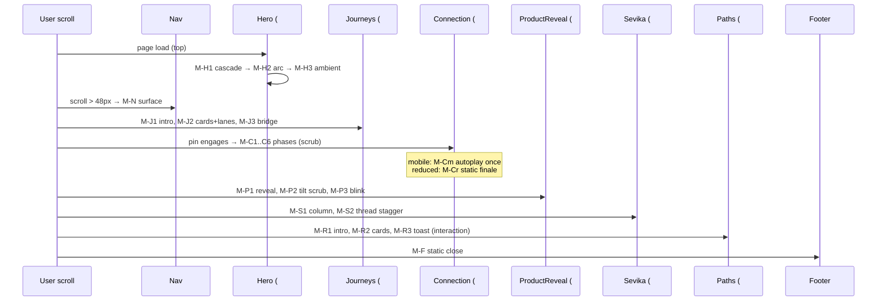

# Aturseva — File 07: Motion & Scroll Animation Specification

**Status:** `PLANNING — NOT IMPLEMENTED`
**Created:** 2026-10-13 (working-session date; ISO 8601)
**Source baseline:** repository `doctorooms-creator/aturseva-landing`, branch `main`, commit `f407e78`. The **source remains the implementation truth**; this file specifies motion behaviour only and authorizes nothing.
**Planning dependencies:** `docs/06_HOMEPAGE_STORYBOARD.md` (frame IDs N/H/J/C/P/S/R/F are defined there and reused here verbatim), `docs/05_CREATIVE_DIRECTION_AND_DESIGN_SYSTEM.md` (design baseline: tokens, easing, §15 motion principles), `docs/04_SITEMAP_AND_NAVIGATION.md` (anchors/CTA truth), `docs/02…03` (claims/brand guardrails).
**Scope:** motion, scroll animation, interaction feedback and their fallbacks across desktop/tablet/mobile/touch/keyboard/reduced-motion. No code, engine or asset change is performed or claimed.
**Backlog convention (shared with File 06):** B1–B8 = File 04 §16 items 1–8; B9 = File 05 §19 item 9; B10 = File 06 §20 (label legibility under mobile condensation). New motion-specific findings take B11+.

---

## 1. Document control and scope

- **Type:** motion specification derived from File 06 and the audited animation engine (`src/lib/aturseva-anim.js`, 454 lines; `src/components/AnimationProvider.tsx`; `src/app/globals.css` keyframes and media blocks).
- **Status flags used throughout:** `VERIFIED CURRENT` (source-cited), `CURRENT RISK` (source-cited defect/fragility), `PROPOSED` (future behaviour, not implemented).
- **Verification method:** direct source reading with symbol/line citations gathered this task (line numbers refer to commit `f407e78`; if lines drift after future edits, the cited symbols remain the reference). No browser QA was run; HTTP/CI success is never treated as visual proof.
- **Non-goals:** re-opening File 05 design decisions; specifying content (File 06 owns copy); implementing anything.

---

## 2. Motion principles

Motion is a tool for **clarity, care and connection — never decoration** (File 05 §15, "presence, not spectacle"):

1. Every animation must explain a relationship or a sequence (a lane converging, a message arriving, a window settling) or provide quiet ambient presence (ECG pulse). If it explains nothing, it does not ship.
2. Motion must never obscure clinical/operational information: no essential copy lives only inside an animation; no illustrative screen may be animated to *seem live* (see §10).
3. Monochrome constraints bind motion: no colour-based effects, no coloured glows; emphasis comes from opacity/position/scale in the neutral system (File 05 §4/§5).
4. Calm timing: `power3.out` default (verified), gentle distances (26px reveal travel — verified), no elastic/bounce except the single 0.45s milestone pop `back.out(2.2)` (verified, Hero only).
5. Avoid: excessive parallax (none exists — verified), motion on every element, scroll hijacking (verified: no hijack; scrub links to natural scroll), dramatic easing implying medical urgency, unnecessary loops (only the five documented ambient loops exist — verified).
6. Typography and spacing principles of File 05 §6/§7 are untouched by motion (no kinetic type beyond the verified fade/rise).

---

## 3. Current engine and verified behaviour audit

**Engine loading & lifecycle — `VERIFIED CURRENT`:**
- `AnimationProvider.tsx` (client component, mounted once in `page.tsx`): `useLayoutEffect` lazily `import("gsap")` + `import("gsap/ScrollTrigger")` (code-split, not in the initial bundle — file header comment verified), then imports the plain-JS side-effect module `@/lib/aturseva-anim.js` and calls `window.initAtursevaAnimations(gsap, ScrollTrigger)`. A `cancelled` flag aborts if the component unmounts mid-load — **but no gsap kill/ScrollTrigger cleanup exists on unmount** (see risks).
- `aturseva-anim.js` is an IIFE exposing `window.initAtursevaAnimations` (line 24). `gsap.registerPlugin(ScrollTrigger)` (line 29); **`gsap.defaults({ ease: "power3.out" })`** (line 30).
- `reactStrictMode: false` set deliberately in `next.config.ts` to avoid double-effect invocation of the imperative module (comment verified).

**Reduced motion & breakpoints — `VERIFIED CURRENT`:**
- `reduceMQ = matchMedia("(prefers-reduced-motion: reduce)")` (line 32); `mobileMQ = matchMedia("(max-width: 767px)")` (line 33).
- CSS kill-switch: `globals.css:127–135` — `animation-duration/transition-duration → 0.01ms`, `animation-iteration-count → 1`, `scroll-behavior: auto` for `*` under `prefers-reduced-motion: reduce`.
- JS branch (line 437): if `reduceMQ.matches` → `setConnectionStatic()` then **return** — hero/reveals/lanes/tilt/sevika builders never run; everything stays visible (elements' pre-animation state is the natural DOM state because builders `gsap.set` hidden states only when they run).

**Connection modes — `VERIFIED CURRENT` (three, mutually exclusive):**
- **Desktop pin/scrub** `buildConnectionPinned` (lines 117–221): timeline `defaults power2.inOut`, ScrollTrigger `{ trigger: "#connection", start: "top top", end: "+=260%", scrub: 1, pin: true, anticipatePin: 1, onRefresh: positionOverlay }`. Phases: A lanes draw apart (comets); B converge (lane `d` morphs to CONVERGED paths, 10s); C unified lane draws (20s); D booking travels + station dots light (booking @33, doctor @41, hospital @49); E Sevika dot (@61); captions crossfade (@13/15/36/40/57/61); cards pop in sequence.
- **Mobile autoplay** `buildConnectionAuto` (lines 223–286): ScrollTrigger `{ trigger: "#connection", start: "top 72%", once: true }` — condensed choreography plays once when the section enters view.
- **Reduced-motion static finale** `setConnectionStatic` (lines 288–312): lanes set to CONVERGED `d`, dasharray removed, unified + all four dots opacity 1, all captions except the last hidden, `positionOverlay()` called.
- Mode selection: `gsap.matchMedia()` (line 448) — `mm.add("(min-width: 768px)", buildConnectionPinned)` / `mm.add("(max-width: 767px)", buildConnectionAuto)` (lines 449–450).

**Nav scroll state — `VERIFIED CURRENT`:** passive scroll listener toggles `nav-scrolled` at **`scrollY > 48`** (lines 38–41); styles at `globals.css:273–277` (82% ink-950, 14px blur, hairline, shadow) with 350ms transition (`globals.css:267–269`).

**Other builders — `VERIFIED CURRENT`:**
- `buildHero` (314–335): `[data-hero-fade]` set `autoAlpha 0, y 26` then timeline `to autoAlpha 1, y 0, duration 0.9, stagger 0.09` at `0.15`; journey arc: `getTotalLength` dash draw `1.6s power2.inOut` at `0.55`; milestones `fromTo {autoAlpha 0, scale 0.4}` → `{1, 1, 0.45, stagger 0.16, back.out(2.2)}` at `1.2`.
- `buildReveals` (337–352): `[data-reveal]` `fromTo {autoAlpha 0, y 26}` → `{1, 0, 0.85s, power3.out}` with `scrollTrigger { start: "top 88%", once: true }`.
- `buildJourneyLanes` (354–366): `.journey-lane` dash draw `1.1s power2.inOut`, `start: "top 92%", once: true`.
- `buildProductTilt` (368–385): `.ui-window` `fromTo {rotateX 10, y 44, scale 0.96, autoAlpha 0}` → `{rotateX 0, y 0, scale 1, autoAlpha 1, power2.out}` scrubbed `start: "top 90%", end: "top 42%", scrub: 1`.
- `buildSevika` (387–413): `.sevika-line` `scaleY 0→1, ease none` scrubbed `start "top 78%", end "bottom 55%"`; `.sevika-msg` `fromTo {autoAlpha 0, x 36, scale 0.97}` → `{1, 0, 1, 0.6s, delay i*0.14}` `start "top 74%", once: true`.

**Ambient loops — `VERIFIED CURRENT` (`globals.css:60–84`):** `breathe 6s` + `pulse-ring 2.6s` on the Connection hub (Connection.tsx:116–117); `ecg-march 7s` on the hero ECG (Hero.tsx:118, dash `180 1300`); `blink 1.7s` on two ProductReveal dots (lines 50, 113); `drift 9s` defined but **unused in any component — dead token** (`CURRENT RISK`, minor: remove or use in a future pass).

**Boot sequence — `VERIFIED CURRENT` (lines 425–451):** `positionOverlay()` immediately + re-run at 350ms + on `resize` + after `document.fonts.ready` (with `ScrollTrigger.refresh()`); then reduce-motion check; then builders; then matchMedia split.

**Overlay positioning — `positionOverlay` (46–75):** reads `data-vx/data-vy` attributes and places `.conn-label/.conn-hub/.conn-card` against the SVG viewBox scale; **`mobileMQ.matches` early-returns card positioning** (line 66) because mobile cards are static grid (`globals.css:226–248`).

**Risks and gaps — `CURRENT RISK` (source-cited; none fixed in this task):**
1. **No ScrollTrigger cleanup/revert on unmount** (AnimationProvider sets only `cancelled`): on a single static page this is benign; if the app ever gains client-side route transitions, triggers would leak. Record for File 11 hardening.
2. **`positionOverlay` depends on fonts/layout timing** — mitigated by the 350ms/resize/fonts-ready re-runs (verified), but a fast scroll before fonts can briefly misplace overlay cards (visual only, cards are `pointer-events: none`).
3. **Dead token `--animate-drift`** (defined, unused).
4. **Hero elements pre-builder visibility:** before JS runs (or if it fails), hero/reveal elements are in natural visible state (good); but if JS runs and the user's viewport is already scrolled past sections, `once: true` triggers with `start "top 88%"` will fire immediately for in-view elements — verified acceptable behaviour (content appears, no blank).
5. **`gsap.set` hidden states are applied only inside builders** — reduced-motion users never get hidden states (verified safe).
6. **Pin + `end: "+=260%"`** means ~3.6 viewport-heights of pinned scroll; acceptable desktop pacing (File 06 C-01…C-06) but must never gate content (it doesn't — captions/cards are the content, and static finale covers reduced motion).
7. **No `ResizeObserver`**; resize handling relies on the window `resize` listener + `ScrollTrigger.refresh` on fonts-ready — adequate for current layout (no dynamic content changes).

---

## 4. Motion vocabulary and terminology

| Term | Definition (this project) | Decorative vs informative |
|---|---|---|
| Reveal | element rises 26px + fades in when entering viewport (once) | informative (draws attention to content) |
| Stagger | timed offset (0.09–0.16s) between sibling elements in one reveal group | informative (sequence) |
| Scrub | timeline progress bound 1:1 to scroll position (Connection pin; product tilt) | informative (scroll = story time) |
| Pin | section fixed while its scrubbed timeline plays (Connection desktop only) | informative |
| Transition | state change ≤350ms (nav surface, hovers) | decorative-functional |
| Progressive disclosure | reveal-on-scroll of already-DOM content | informative |
| State transition | control rest→hover→focus→active→disabled | functional |
| Ambient motion | slow loops (breathe/pulse-ring/ecg/blink) suggesting presence | decorative (never conveys facts) |
| Static fallback | reduced-motion or no-JS end state showing all content | — |
| Reduced-motion alternative | the specific static rendering replacing a sequence (Connection finale) | — |

Anything not in this table (parallax, hijack, elastic, live-data simulation) is **out of vocabulary** and prohibited by §2.

---

## 5. Motion tokens and global limits

Using File 05 §5 architecture (primitives + semantic). **Verified values listed separately from proposals; nothing below is installed in code.**

| Token | Verified current value (source) | Proposed canonical token | Rationale |
|---|---|---|---|
| Default easing | `power3.out` (anim.js:30) | `--ease-calm-out` | keep |
| Stage easing | `power2.inOut` (Connection defaults) | `--ease-stage` | keep |
| Accent pop | `back.out(2.2)` (milestones only) | `--ease-pop` (Hero-reveal only) | keep, scope-restricted |
| Reveal duration | 0.85s (reveals); 0.9s (hero fades) | `--dur-reveal: 450ms` **proposed consolidation** | fewer one-offs; migration in File 11 |
| Reveal distance | 26px (y) | `--dist-reveal: 24px` | round to scale |
| Stagger | 0.09 (hero) / 0.14 (sevika) / 0.16 (milestones) | `--stagger-tight: 90ms`, `--stagger-loose: 140ms` | two values suffice |
| Control transition | 350ms (nav) / ≤200ms hover (proposed) | `--dur-fast: 200ms`, `--dur-nav: 350ms` | keep nav as-is |
| Scrub smoothing | `scrub: 1` (pin + tilt) | keep | stability |
| Trigger offsets | `top 88%` reveals / `top 92%` lanes / `top 72%` mobile conn / `top 78–74%` sevika / `top 90→42%` tilt | `--trig-reveal: 88%`, `--trig-early: 92%` | consolidate where safe in File 11 |
| Ambient loop periods | 6s / 2.6s / 7s / 1.7s | keep as verified | signature pacing |
| Nav threshold | `scrollY > 48` | `--nav-threshold: 48px` | keep |

Rules: units stay ms/px/%; no one-off timings outside the table without a token; easing never depends on colour effects (monochrome); future code maps tokens to GSAP/CSS values at build time — **no code edits now**.

---

## 6. Global choreography and page timeline

**From load to footer** (IDs match File 06 §15; anchors match File 04 §5):

**Competing animations and when not to animate:**
- Only one pinned sequence exists (Connection); no other scrub competes (verified: tilt scrub is short and non-pinned).
- Ambient loops (ECG, hub breathe, blink) continue during other animations by design — they are background presence at low opacity; they never animate content.
- Not animated: footer, connection caption container height, nav link text, all body copy beyond first reveal, Paths toast (simple fade via CSS class toggle — proposed future: none needed).
- **When not to animate:** reduced motion (everything static except nothing); when JS/GSAP fails (natural DOM = fully visible); during keyboard navigation (focus movement triggers no animation beyond reveals already fired by viewport logic).

---

## 7. Section-by-section animation specification

Master table — one row per File 06 frame. Values are **verified** unless marked *(proposed)*. "Once/reset" governs replay behaviour.

| Frame | Trigger | Elements (initial → final) | Movement | Duration/delay/stagger | Once? | Pin/scrub | Desktop / tablet / mobile+touch | Reduced-motion alternative | A11y notes | Perf/QA assertions | Evidence |
|---|---|---|---|---|---|---|---|---|---|---|---|
| M-N (N-01–03) | scroll >48px (passive) | header surface (transparent → 82% ink + blur + hairline) | bg/box-shadow/backdrop-filter transition | 350ms ease | reversible both directions | none | identical all widths | CSS kill-switch → instant state change, content unaffected | aria-expanded menu unaffected | no jank at 60fps scroll; blur ≤14px | anim.js:38–41; globals.css:267–277 |
| M-H1 (H-01–03) | load | `[data-hero-fade]` (hidden y26 → visible) | fade+rise | 0.9s, stagger 0.09, start 0.15 | once | none | same (arc excluded <md via markup, not JS) | skipped — visible from first paint | content readable <0.3s | first fade lands before LCP assertion | anim.js:314–335 |
| M-H2 (H-04) | load, ≥md (markup) | `#hero-journey` arc + `.hero-milestone` | dash draw; scale-pop | 1.6s draw @0.55; pop 0.45s stagger 0.16 @1.2 | once | none | hidden <md (verified markup) | skipped | milestones are labels — decorative `aria-hidden` | draw uses one path; cheap | anim.js:322–333 |
| M-H3 (H-05) | ambient | `#hero-ecg` dash | marching dash loop | 7s linear infinite | loop | none | shorter path mobile | CSS kill-switch freezes | sr-only description present (verified) | stroke-dash only; no repaint cost concern | globals.css:62,74–76; Hero.tsx:108–131 |
| M-J1 (J-01) | viewport `top 88%` | section intro | reveal | 0.85s power3.out | once | none | same | skipped (visible) | — | one trigger | anim.js:337–352 |
| M-J2 (J-02) | viewport `top 92%` (per path) | `.journey-lane` ×6 | dash draw | 1.1s power2.inOut | once | none | same (lanes visible mobile — verified) | skipped | decorative `aria-hidden` | 6 cheap draws | anim.js:354–366 |
| M-J3 (J-03) | viewport `top 88%` | bridge line + cue | reveal | 0.85s | once | none | same | skipped | cue has aria-label (verified) | — | anim.js:337–352 |
| M-C1 (C-01) | pin start `top top` | lanes (apart) + comets + caption 1 | draw + comet glide | phase A within scrub `+=260%` | scrub (reversible) | **pin: true**, scrub 1, anticipatePin 1 | desktop/tablet ≥768 only | M-Cr static finale | sr-only h2 (verified) | pin spacer stable; no layout shift | anim.js:117–135 |
| M-C2 (C-02) | scrub ~40% | lanes morph to converged; hub breathe | `attr d` tween + ambient | 10s within scrub | scrub | same | ≥768 | static converged | hub is decorative | lane morph = single attr tween ×3 | anim.js:167–181; Connection.tsx:114–122 |
| M-C3 (C-03) | scrub ~55% | unified lane + booking dot | draw + dot fade | 20s draw @22; dot @33 | scrub | same | ≥768 | static | — | one long draw, GPU-cheap | anim.js:181–194 |
| M-C4 (C-04) | scrub ~65% | `#card-booking`, `#card-doctor` | pop (y18, scale .94 → 1) | within scrub | scrub | same | ≥768 (absolute overlay) | visible in finale | **B2 label gap** — cards read as live data risk | overlay positioned by `positionOverlay` (fonts-aware) | anim.js:184–194; Connection.tsx:127–155 |
| M-C5 (C-05) | scrub ~80% | `#card-hospital` + Sevika bubble + dots | pop + fades | within scrub | scrub | same | ≥768 | visible | **B2** | `pointer-events: none` on cards (verified) | anim.js:196–220; Connection.tsx:157–206 |
| M-C6 (C-06) | scrub ~95% | Sevika dot + caption 4 | fade in | @61 | scrub | same | ≥768 | final caption visible | — | — | anim.js:74 (Phase E) |
| M-Cm (C-01m) | viewport `top 72%` (<768) | full condensed sequence | choreographed autoplay | ~6s total *(verified sequence; exact per-phase timings in anim.js:223–286)* | **once: true** | none | mobile/touch only | M-Cr | cards static grid (CSS) — **B10** label legibility | plays once, no replay on revisit (by design) | anim.js:223–286; globals.css:226–248 |
| M-Cr (C-01r) | n/a (reduce) | lanes→CONVERGED, dots opacity 1, last caption | none (set styles) | instant | — | none | all | **this is the reduced state** | complete story readable | called once at boot (anim.js:437–439) | anim.js:288–312 |
| M-P1 (P-01) | viewport `top 88%` | section intro + badge | reveal | 0.85s | once | none | same | skipped | badge is content (label!) — must be visible pre-JS | — | anim.js:337–352 |
| M-P2 (P-02) | scrub `top 90%→42%` | `.ui-window` | tilt/rise/scale | scrub 1 | scrub (reversible) | none | same | skipped (visible) | text inside stays ≥12px during scale (0.96 floor) | perspective 1200; transform-only | anim.js:368–385 |
| M-P3 (P-03) | ambient | status dots ×2 | blink | 1.7s infinite | loop | none | same | CSS kill-switch freezes | aria-hidden (verified) | opacity-only keyframe | globals.css:63,77–79 |
| M-S1 (S-01) | viewport `top 88%` | left column blocks | reveal | 0.85s | once | none | same | skipped | — | — | anim.js:337–352 |
| M-S2 (S-02) | `top 74%` (msgs) / `top 78%→bottom 55%` (line) | `.sevika-msg` ×5 + `.sevika-line` | stagger in + line grow | 0.6s, delay i×0.14; line scrub | msgs once; line scrub | none | same (single column mobile) | skipped | thread is real DOM text — SR-friendly; **B3 label gap** | x-translate only | anim.js:387–413 |
| M-S3 (S-03) | viewport `top 88%` | blockquote | reveal | 0.85s | once | none | same | skipped | **B3 framing** | — | anim.js:337–352 |
| M-R1 (R-01) | viewport `top 88%` | intro | reveal | 0.85s | once | none | same | skipped | — | — | anim.js:337–352 |
| M-R2 (R-02) | viewport `top 88%` | 3 role cards | reveal | 0.85s | once | none | same | skipped | **B1 title risk** (content, not motion) | — | anim.js:337–352 |
| M-R3 (R-03) | click (interaction) | toast (fixed bottom) | appear 3.8s, auto-dismiss | CSS transition *(proposed token: 200ms)* | per click | none | same | toast is DOM text — visible without motion | `role="status" aria-live="polite"` (verified) | **B4: no data captured** — document, don't fix | Paths.tsx:5–40 |
| M-F (F-01–02) | none | footer | **static by design** | — | — | — | same | static | — | — | Footer.tsx |

**Frames that stay static:** M-F (footer) — explicitly no motion. All "skipped" reduced-motion rows mean the element's natural visible state renders.

---

## 8. Hero motion

**First-viewport sequence (M-H1→H3):** verified cascade — brand/eyebrow, H1, lead, CTAs rise within 0.15–0.6s; arc draws by ~2.2s; milestones settle by ~1.8s. Headline comprehension is never behind a gate: the H1 fade completes ~0.5s after JS boot; **if JS/GSAP never loads, hero renders fully visible at first paint** (verified: hidden states are applied only inside `buildHero`, which only runs after GSAP loads).

**Stable final state:** all elements `autoAlpha: 1, y: 0`; arc fully drawn; milestones full scale; ECG looping quietly.

**Refresh midway down the page:** browser restores scroll; ScrollTrigger evaluates triggers on refresh — in-view reveals fire immediately (content appears without blank sections); the hero cascade may play off-screen (harmless; `once` semantics keep state stable). Pin state recalculates correctly (ScrollTrigger default refresh behaviour — verified pattern via `onRefresh: positionOverlay`).

**Reduced motion:** JS branch never runs builders (verified) → hero static and complete from first paint. CSS kill-switch additionally freezes the ECG loop.

**No video, no missing asset dependencies** — hand any future hero media to File 08; current hero needs zero assets (verified).

---

## 9. Human journey and connection choreography

**Linked steps and care-team handoffs** are communicated by the Connection sequence (M-C1–C6): three lanes (three grey values + labels — never colour alone) converge into the hub; the unified lane carries the booking past station dots (doctor → hospital → Sevika); overlay cards narrate each station in the verified copy. Motion says "these steps connect", **never** "these systems sync live / instantly / guaranteed": no counters tick, no data streams, no live-feeds (verified: `#token-counter` is a static "42"). The word "instantly" appears once in caption 3 ("doctor and hospital, instantly in step") — a narrative-phrasing flag carried as content note B11 *(new, minor)*: future copy pass may soften to "in step" — **not changed now**.

**Verified modes & collapse rule:** desktop pin/scrub (`top top`→`+=260%`, scrub 1); mobile autoplay once (`top 72%`); reduced-motion static finale (converged + dots + last caption). Every mode collapses to the same readable diagram; **no forced horizontal scroll, no scroll hijacking** (verified absent).

---

## 10. Product UI and representative previews

- The **"Representative preview" label must remain readable throughout all movement and at all sizes**: during M-P2 tilt (label sits above the window, unaffected by the window's transform — verified DOM placement), on mobile (badge centred, 12px text floor — verified), and in the static/no-JS state (natural DOM — visible).
- **Never animate sample tokens, timers, counts or personal data** to imply operational activity: verified compliant — the queue rows, "Token #14", "Tokens today: 42", the doctor-card progress bar are all static; `animate-blink` dots are chrome decoration (`aria-hidden`), not data signals. **B2** (Connection cards lack the label) and **B10** (label legibility under mobile card condensation) remain future fixes.
- **No simulated loading/spinning states**: none exist (verified); prohibited going forward — a spinner would make an illustrative screen look live.
- **UI scaling/cropping safety:** transform-only motion (tilt), scale floor 0.96, 12px text minimum, tertiary columns hidden rather than shrunk on mobile (File 05 §16 rule; verified current simplification).

---

## 11. Sevika motion and conversation

**Introduction timing:** Sevika's section enters at story beat 5; messages stagger in (0.6s, 0.14 offsets) only when the thread reaches `top 74%` — comprehension first, animation second.

**Anti-"live chatbot" rules (verified compliant; binding for the future):**
- **No typing animation** — messages arrive as settled bubbles; a typing indicator would imply a live service.
- The thread is real DOM text in reading order — screen-reader-friendly; no motion-gated content.
- "Doctor approved" chips are static content on every medical reminder (verified).
- **The illustrative label must stay visible at all times** (future B3 fix): any label added in the authorized pass must sit outside the animated elements so it never fades with a message.
- She never appears to act independently: motion presents messages as *arriving reminders*, not decisions; no autonomous-response visuals.

**Static fallback:** without JS/reduced-motion, the full thread renders (verified natural DOM); the line connector stays at natural scaleY (visible).

---

## 12. Navigation, anchor scrolling and CTA feedback

- **Nav scrolled behaviour (verified):** threshold `scrollY > 48`; 350ms surface transition; reversible; content never obscured (blur ≤14px, 82% opacity surface over dark stages; header sits over light sections during Journeys→ProductReveal band — contrast reviewed in File 12 QA, target per File 05 §17).
- **Anchor scrolling:** `html { scroll-behavior: smooth }` (verified globals.css:111–113); reduced-motion CSS forces `auto` (verified:127–135). Anchors verified: `#top/#journeys/#connection/#platform/#sevika/#paths/#main`.
- **Sticky-header offset:** anchors currently rely on section padding (`py-24/32`) rather than `scroll-margin-top`; a future `scroll-margin-top` token (e.g. 72px — *(proposed)*) belongs to File 09/11 — recorded, not implemented.
- **Focus management:** in-page anchor jumps move visual focus; keyboard users tab into the target section naturally (no JS trapping — verified none). Mobile menu closes on link activation (verified) and returns focus to the toggle implicitly via DOM order *(proposed future refinement: explicit focus return in File 09)*.
- **CTA feedback truth:** the Paths toast (M-R3) is the **current behaviour** — it displays text and captures nothing (B4). This spec documents it; it does not change it. Any future CTA feedback must visibly succeed/fail honestly; no fake success toasts (File 04 §10 policy). No new CTA actions are created here.

---

## 13. Responsive and touch interaction rules

**Breakpoints** (from File 05 §16 / current code — not a competing system): `<640` small mobile · `640–767` large mobile · `768–1023` tablet · `1024–1279` desktop · `≥1280` wide; the anim module's own split is `≥768` / `≤767` (verified `mm.add`), and the CSS Connection recomposition block is `max-width: 767px` (verified globals.css:226).

| Rule | Behaviour |
|---|---|
| Pinning | desktop/tablet ≥768 only (verified); never on touch widths |
| Scrubbing | Connection scrub ≥768; product tilt all widths (light, non-pinned) |
| Touch | mobile Connection = autoplay-once + static cards (verified); no touch choreography demands; taps trigger only M-R3 toast |
| Orientation/resize | `positionOverlay` re-runs on resize; `ScrollTrigger.refresh()` after fonts (verified); pin recalculates on ScrollTrigger's native resize handling |
| Viewport changes mid-pin | ScrollTrigger re-pins on refresh (native); overlay repositioned via `onRefresh` (verified) |
| Device performance fallback *(proposed)* | if frame budget suffers on low-end mobile, drop tilt scrub first, then autoplay → static finale (priority order for File 11) |
| User-triggered interaction | none required for story completion — all sequences are scroll/viewport-driven or ambient |

**Touch devices must not be forced to reproduce desktop scroll choreography** — verified compliant (they don't).

---

## 14. Reduced motion and other accessibility states

**When `prefers-reduced-motion: reduce` is active (all verified):**
- No scroll scrub, no pinning: JS branch calls `setConnectionStatic()` and returns before any builder runs (anim.js:437–439).
- No essential content hidden: builders never apply hidden initial states; natural DOM = complete page.
- No unneeded autoplay: mobile autoplay is also skipped (branch precedes it).
- A meaningful static final state renders: converged lanes, all station dots visible, final caption ("And Sevika stays beside the patient."), overlay cards placed (positionOverlay runs).
- CSS kill-switch additionally freezes ambient loops and smooth scroll (globals.css:127–135).

**Additional states:**
- **Focus/keyboard:** visible focus ring on all controls (verified global rule); keyboard navigation triggers no additional motion; skip link available (verified).
- **Assistive-technology order:** DOM order = story order; decorative SVG `aria-hidden`; sr-only headings/labels where visuals carry meaning (verified patterns).
- **Pause/stop for future long-running animation:** any future >5s foreground loop must ship with a visible pause control *(proposed requirement for File 09)*; current ambient loops are background-scale and CSS-frozen under reduced motion.
- **Captions/transcripts for future media:** required by File 08 handoff; none exist now.
- **No flashing:** nothing exceeds 3 flashes/second (verified inventory).
- **Accessible status changes:** the only live region is the Paths toast (`role="status" aria-live="polite"` — verified), announcing honest text.
- **Compliance:** WCAG 2.2 AA is a test target for File 12 — **not claimed compliant here**.

---

## 15. Performance, stability and lifecycle

**Source-verified facts:**
- GSAP + ScrollTrigger are dynamically imported (code-split) after first paint (AnimationProvider — verified); the 454-line module is plain JS, no build cost.
- No animation blocks initial render: hero is visible pre-JS; hidden states applied only when builders run.
- Resize + font-load refresh handled (verified); `document.fonts.ready → ScrollTrigger.refresh()` prevents stale triggers after Fraunces/Manrope swap.
- All tweens are transform/opacity/attr-based (no layout-thrashing properties; verified inventory) — GPU-friendly.
- Pin uses `anticipatePin: 1` (verified) to reduce pin-spacer jump.
- No images/videos exist in the animation path (verified) — nothing to lazy-load today.

**Requirements/recommendations for future implementation *(proposed)*:**
- Add ScrollTrigger kill/revert on provider unmount before any client-side routing lands (audit risk #1).
- Keep animation code out of the initial bundle (maintain the dynamic-import pattern).
- Prevent duplicate triggers if the module ever boots twice (guard `window.initAtursevaAnimations` idempotency — currently single-boot by construction).
- Avoid CLS: pin spacer is the only layout change; verify zero CLS from reveals (opacity/transform only).
- Performance **test targets** (future, File 12 — not current claims): 60fps scroll on desktop; ≥50fps on mid-tier mobile; main-thread animation frames <8ms; LCP unblocked by JS.
- Graceful no-JS: page fully readable (verified) — keep this invariant in every future change.

---

## 16. Failure and interruption states

| Failure | Verified/proposed behaviour | Result |
|---|---|---|
| JavaScript fails entirely | natural DOM renders everything; nav links are plain anchors; no hidden states | full content, zero motion *(verified by construction)* |
| GSAP unavailable (CDN/module error) | `initAtursevaAnimations` never called; same as above | full content *(verified by construction)* |
| Image/video missing (future assets) | none exist today; future spec (File 08/09) must define alt/placeholder per frame | n/a now |
| Viewport changes during pinned sequence | ScrollTrigger refresh re-pins/repositions; `onRefresh: positionOverlay` re-places cards *(verified mechanism)* | sequence re-syncs |
| Fast scroll past a section | `once: true` reveals fire as elements pass the trigger line even if already off-screen; content visible when scrolled back | no blank states *(verified)* |
| Direct anchor load (e.g. `/…#sevika`) | browser jumps; ScrollTrigger initializes and evaluates triggers after `positionOverlay` + fonts refresh; in-view sections render settled | complete page *(verified pattern)* |
| Fonts arrive late | `document.fonts.ready` → re-position + `ScrollTrigger.refresh()` *(verified)* | overlay cards correctly placed |
| Reduced motion toggled after load | current build samples the media query once at boot *(verified — line 32/437)*; a mid-session toggle requires reload — **recorded as B12** *(new, minor: listen to `change` event in a future pass)* | acceptable; documented |
| User scrolls quickly through the pin | scrub follows scroll velocity; `scrub: 1` smooths jumps | no stuck pin *(verified)* |

---

## 17. Motion QA matrix

**Coverage *(proposed — none of these have been executed)*** — project support statement: modern evergreen browsers + iOS/Android touch; keyboard + SR spot-checks per File 05 §17:

| # | Test | Environment | Expected outcome | Pass criteria | Severity if failing |
|---|---|---|---|---|---|
| 1 | Load homepage top | desktop Chrome/Safari/Firefox | M-H1 cascade <1s; LCP not blocked; hero visible pre-JS | headline readable ≤1s; no CLS | blocker |
| 2 | Scroll full page | desktop ×3 browsers | reveals fire once; pin engages at `#connection`; no horizontal scroll | 60fps; no stuck pin | blocker |
| 3 | Pin scrub forward/back | desktop | phases C1→C6 reversible; captions crossfade; cards placed | no misplacement after fonts | high |
| 4 | Mobile autoplay | iOS Safari + Android Chrome | autoplay once at `top 72%`; static card grid; no pin | plays once; replay on revisit absent or harmless | high |
| 5 | Reduced motion (OS-level) | desktop + mobile | static finale; all content visible; no loops | zero transform animation on scroll | blocker |
| 6 | Keyboard-only nav | desktop | focus ring visible on all controls; menu toggle announces; skip link works | full nav without mouse | blocker |
| 7 | Screen reader spot-check | NVDA/VoiceOver | story reads in DOM order; toast announces politely; decorative SVG silent | no orphan labels | high |
| 8 | 200% zoom / reflow | desktop | no clipped labels; conn cards legible (B10 target) | all text visible | high |
| 9 | Slow connection / asset failure | throttled | page readable with JS delayed/failed | full content without motion | blocker |
| 10 | Resize/rotation mid-pin | desktop + tablet | re-pin correct; cards repositioned | no overlay drift | medium |
| 11 | Direct anchor load | `#sevika`, `#paths` | settled state at anchor; upward scroll shows earlier sections complete | no blanks | high |
| 12 | Rapid scroll + revisit | desktop/mobile | no stuck reveals; content visible on return | stable | medium |
| 13 | Nav scrolled threshold | all | surface changes at >48px, reverts below | symmetric | low |
| 14 | Toast behaviour | all | appears, announces, dismisses 3.8s; no capture claim wording beyond current copy | matches File 04 §10 row 12–14 truth | high (B4 tracked) |

---

## 18. Engineering implementation checklist

Phased future checklist *(planning only — no code changes now)*; modules cited are verified to exist:

**Phase 1 — Foundation (File 11 batch: token consolidation)**
- [ ] Consolidate reveal timings/staggers to §5 tokens (touches `aturseva-anim.js` buildReveals/buildHero/buildSevika only).
- [ ] Remove or adopt `--animate-drift` dead token.
- [ ] Add `scroll-margin-top` token for anchors (with File 09).
- [ ] Guard `initAtursevaAnimations` against double-boot.

**Phase 2 — Section choreography (only if storyboard changes are authorized)**
- [ ] Any new frame inherits the §7 row format before build.
- [ ] B2/B3 label additions stay outside animated elements.

**Phase 3 — Responsive/reduced-motion hardening**
- [ ] B12: listen to `reduceMQ.change` (and `mobileMQ.change`) and re-evaluate modes live.
- [ ] Low-end fallback order (tilt → autoplay → static) per §13.
- [ ] ScrollTrigger kill/revert on unmount (pre-routing invariant).

**Phase 4 — QA/performance (File 12)**
- [ ] Execute §17 matrix; record results; measure §15 targets.
- [ ] Visual regression on both dev (:3005) and preview (:3006) artifacts — the preview inlines the same anim module (verified header note); keep parity.

**Standing invariants:** stable semantic final states for every animation; cleanup exists before routing; no duplicated triggers; no fake-live UI; no product-repo changes; source/plan parity re-checked each batch.

---

## 19. Known risks and consolidated backlog

Integrated motion-relevant items (common IDs; nothing claimed fixed):

| ID | Item | Source evidence | Priority (trust > a11y > function > visual) | Downstream |
|---|---|---|---|---|
| B1 | Zero-wait patient title | `Paths.tsx:48` | P0 trust | File 09/11 Batch 1 |
| B2 | Connection cards lack "Representative preview" | `Connection.tsx:127–206` | P0 trust | File 09/11 Batch 1 |
| B3 | Sevika thread + philosophy line labelling | `Sevika.tsx:76–110`, `Footer.tsx:15` | P0 trust | File 09/11 Batch 1 |
| B4 | Toast CTAs imply outreach, capture nothing | `Paths.tsx:5–40` | P0 trust | File 04 Phase A → File 11 |
| B5 | Logo embedded tagline mismatch | `Logo.tsx` full variant | P1 brand | File 08 asset task |
| B6 | No human imagery | `public/` (fonts+favicon only) | P2 (File 04) | File 08 |
| B8 | Fixed "© 2025" | `Footer.tsx:45` | P2 | File 11 Batch 1 |
| B9 | Hardcoded SVG greys outside tokens | `Hero.tsx`/`Connection.tsx` attrs | P2 | File 11 |
| B10 | Label legibility under mobile card condensation | `globals.css:246–247` | P1 (folds into B2) | File 09/11 Batch 1 |
| B11 | "instantly in step" caption phrasing (soften future copy) | `Connection.tsx:42` (caption 3) | P2 copy | File 09 copy pass |
| B12 | Reduced-motion/media-query changes need reload to re-evaluate | `aturseva-anim.js:32–33,437` | P2 | File 11 Phase 3 |
| B13 | No ScrollTrigger cleanup on unmount (pre-routing risk) | `AnimationProvider.tsx` | P2 (latent) | File 11 Phase 3 |
| B14 | Dead token `--animate-drift` | `globals.css:64` | P3 | File 11 Phase 1 |

(B7 = File 03 tagline reconciliation — docs pass, outside motion scope; carried from File 04 §16.)

---

## 20. Traceability and handoff

**Traceability table (File 06 frame → section/anchor → motion → reduced-motion state → evidence → phase → QA):**

| File 06 frame | Section / anchor | Motion behaviour (§7) | Reduced-motion state | Source evidence | Future phase | QA (§17) |
|---|---|---|---|---|---|---|
| N-01–03 | nav / `#site-nav` | M-N surface @48px | instant surface change | anim.js:38–41; globals.css:267–277 | — (current) | #13 |
| H-01–05 | hero / `#top` | M-H1..H3 cascade+ambient | fully visible, ECG frozen | anim.js:314–335; globals.css:62 | — (current) | #1, #5 |
| J-01–03 | journeys / `#journeys` | M-J1..J3 reveals+lane draws | fully visible | anim.js:337–366 | — (current) | #2 |
| C-01–C-06 | connection / `#connection` | M-C1..C6 pin+scrub phases | M-Cr static finale | anim.js:77–312 | B2 label → File 11 Batch 1 | #3, #5, #10 |
| C-01m | connection mobile | M-Cm autoplay once | M-Cr | anim.js:223–286; globals.css:226–248 | B10 → Batch 1 | #4 |
| P-01–03 | product reveal / `#platform` | M-P1..P3 reveal+tilt+blink | fully visible, label present | anim.js:337–385; ProductReveal.tsx:33 | — (current) | #2, #8 |
| S-01–03 | sevika / `#sevika` | M-S1..S3 stagger thread | fully visible (DOM text) | anim.js:387–413 | B3 → Batch 1 | #6, #7 |
| R-01–03 | paths / `#paths` | M-R1..R3 reveals + toast | fully visible; toast announces | anim.js:337–352; Paths.tsx:5–40 | B1/B4 → Batch 1/2 | #14 |
| F-01–02 | footer | M-F static | static | Footer.tsx | B8 → Batch 1 | #8 |

**Genuinely open owner decisions:** B4 destinations (File 04 §18-3), B5 logo asset strategy (File 08), B6 imagery direction/sourcing/generated-acceptability (File 08). Tagline is **not** open — "Care that walks with you." is approved.

**Handoff notes:** File 08 receives §8/§10/§11 media-dependency rules (pause controls, captions, label-outside-animation); File 09 receives §5 tokens, §7 row format, §12 anchor-offset proposal; File 11 receives §18 phases and B9–B14; File 12 receives §15 targets and the §17 matrix. None of those files are created by this task.

**Cross-reference table (compact):**

| File 07 section | Consumes | From |
|---|---|---|
| §6 timeline | §4 arc, §5 inventory, frame IDs | File 06 |
| §7 master rows | §15 frames (same IDs) | File 06 |
| §9–§11 | §7–§10 storyboards | File 06 |
| §13 | §16 responsive storyboard | File 06 |
| §14 | §17 accessibility review | File 06 |
| §17 matrix | §19 story QA | File 06 |
| §5 tokens, §2 principles | §15 motion principles, §5 tokens | File 05 |
| §19 backlog | §20 risks + IDs B1–B10 | Files 04/05/06 |

---

**End of File 07.**
