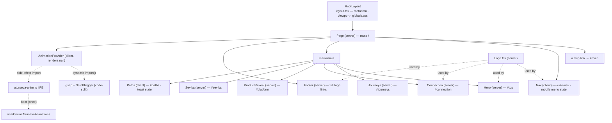
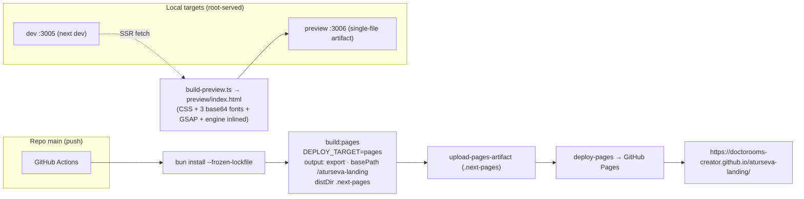

# Aturseva — File 10: Architecture & Technical Design

**Status:** `PLANNING — NOT IMPLEMENTED`
**Created:** 2026-10-13 (working-session date; ISO 8601)
**Source baseline:** repository `doctorooms-creator/aturseva-landing`, branch `main`, commit `7c3fbb6` (Files 08+09 merge point; `src/`, `public/`, and all build/deploy configuration verified unchanged since `e30dcc8`/`f407e78` — docs-only commits since). All "verified" claims cite this tree. Line numbers refer to `7c3fbb6`; stable symbol names remain the reference if lines drift.
**Planning dependencies:** `02_PRODUCT_TRUTH_AND_CAPABILITY_MATRIX.md` (capability/claims truth — authority 1), owner decisions in project history (authority 2 — canonical tagline **"Care that walks with you."**), `04_SITEMAP_AND_NAVIGATION.md` (route/anchor/CTA truth — authority 3), `05_CREATIVE_DIRECTION_AND_DESIGN_SYSTEM.md` (locked creative direction/design system — authority 4), `06_HOMEPAGE_STORYBOARD.md` (narrative/frame IDs — authority 5), `07_MOTION_AND_SCROLL_ANIMATION.md` (motion lifecycle/M-IDs — authority 6), `08_VISUAL_ASSET_PLAN.md` (asset strategy/VS-scene IDs — authority 7), `09_PAGE_AND_COMPONENT_SPECIFICATIONS.md` (component contracts/backlog crosswalk — authority 8), current source code (implementation truth — authority 9, evidence only).
**Companion plan:** `11_COMPREHENSIVE_IMPLEMENTATION_PLAN.md` (created in the same batch as this file — batch sequencing, B1–B18 mapping, owner gates).

**Out of scope:** implementing, patching, or generating anything; editing source, tokens, components, copy, assets, workflows, configs, or existing docs; creating File 12/13, ADR sidecars, README, worklog, or any third file. This document describes architecture; it authorizes no change.

**Change log:**
| Date | Change | Author context |
|---|---|---|
| 2026-10-13 | Initial creation; 23 sections; current-architecture audit with symbol/line citations; B15 solution families compared (none selected); ADR-style decision table; B1–B18 architecture crosswalk | Files 10+11 combined planning task |

---

## 1. Document control, status, authority, and source baseline

- **Type:** engineering architecture document for the existing single-page Aturseva marketing/landing site — what exists today (verified) and what the recommended target architecture is (proposed, clearly labelled).
- **Audit method:** full source read at `7c3fbb6` of `src/app/page.tsx`, `src/app/layout.tsx`, `src/app/globals.css`, `src/app/icon.svg`, all nine `src/components/*.tsx`, `src/lib/aturseva-anim.js`, `src/types/global.d.ts`, `package.json`, `bun.lock` (resolved versions), `next.config.ts`, `tsconfig.json`, `postcss.config.mjs`, `.github/workflows/deploy-pages.yml`, `scripts/` (preview tooling, read-only), and the complete `public/` tree. No browser QA, build, or deploy was performed for this document; live-site measurements referenced below are **inherited evidence from File 08's audit** (§11 cites them as such), not new measurements.
- **Status vocabulary (shared with File 11):** `VERIFIED CURRENT`, `CURRENT RISK`, `PROPOSED`, `OWNER DECISION REQUIRED`, `NOT IMPLEMENTED`, `NOT RUN`.
- **Anti-invention rule:** no route, integration, backend, analytics, metric, or capability is described as existing unless the repository proves it. Proposed items are always labelled `PROPOSED` / `NOT LIVE`.

---

## 2. Executive technical summary

**What this is:** a static, single-route marketing/landing page for Aturseva, built as a Next.js 16 static-export-capable app, deployed to GitHub Pages from `main` on every push, with a second self-contained single-file preview artifact for gateway-safe user preview.

| Dimension | Current state (verified at `7c3fbb6`) |
|---|---|
| Framework | Next.js **16.4.0** (App Router) + React **19.3.0** (`bun.lock` resolved; `package.json` ranges `^16.1.1` / `^19.0.0`) |
| Styling | Tailwind CSS **4.3.3** via `@tailwindcss/postcss` (`@import "tailwindcss"` + `@theme` custom properties, `globals.css:1–85`) |
| Motion | GSAP **3.15.0** + ScrollTrigger, lazily code-split (`AnimationProvider.tsx:14–22`); engine is a no-imports plain-JS IIFE (`src/lib/aturseva-anim.js`, 454 lines) shared verbatim with the preview artifact |
| Route surface | exactly one route: `/` (`src/app/page.tsx`; no other route files) |
| Deploy | GitHub Actions → static export (`output: "export"`, `basePath: /aturseva-landing`) → GitHub Pages; live at `https://doctorooms-creator.github.io/aturseva-landing/` |
| Local targets | dev `:3005` (`bun run dev`, root-served); self-contained preview `:3006` (`bun run preview`) |
| State/data | zero backend, zero database, zero API, zero analytics; all data is illustrative static markup |
| Major strengths | minimal dependency set; lazy-loaded animation engine with verified no-JS/reduced-motion fallbacks; monochrome token discipline; single-file preview artifact with parity to the app engine |
| Highest-risk constraints | **B15** (production font 404 on the Pages build — root-absolute `@font-face` URLs vs `basePath`, §11); trust-copy defects B1–B4 (owner-gated wording/CTA decisions); motion lifecycle gaps B12/B13 (latent); legacy token names + hardcoded SVG greys (B9, §10) |

**Current vs proposed target — compact table** (details in §5–§22):

| Area | Current (verified) | Target (proposed — File 11 batches) |
|---|---|---|
| Fonts | `@font-face` in `globals.css` with root-absolute `/fonts/…` URLs — **broken on Pages (B15)** | basePath-safe font loading (family not yet selected — §11) |
| Trust labels | ProductReveal labelled; Connection cards/Sevika thread unlabelled (B2/B3) | "Representative preview"/illustrative labels on all mock surfaces |
| CTAs | toast-only Paths CTAs implying outreach (B4) | honest destinations or removal — owner-gated |
| Tokens | legacy names `ink/brand/gold/ivory` (neutral values) + hardcoded SVG greys (B9) | semantic aliases (`graphite/paper`) migrated opportunistically (File 05 §5.3) |
| Motion lifecycle | no cleanup on unmount; MQ changes need reload (B12/B13) | revert/kill guard + live re-evaluation before any routing exists |
| Imagery | zero photographic/video assets | optional, owner-gated (File 08 VS-01…VS-08) |
| Metadata | title/description/OG text + canonical/robots-meta/sitemap (SEO-hygiene pass, owner-delegated) | og:image, twitter cards and analytics remain owner-gated additions |

---

## 3. Product and system boundary

- **This repository is the Aturseva landing site only.** It explains the Aturseva product (patient app + provider software, per File 02); it is not that product.
- **Verified absent from this repo:** backend, database, authentication, booking/transaction APIs, form-submission endpoints, analytics pipeline, CRM, email routing, webhooks, env-var secrets, third-party integrations. Searches of `src/`, `scripts/`, and config reveal no `fetch`/XHR to external services, no secret material, no tracking pixels.
- **Marketing/storytelling vs product capability:** the illustrated queue, schedule, workspace mock, and Sevika thread are **static illustrative UI** (representative previews per File 02 §8/§9.1). Nothing in this repo is connected to a live Aturseva system; no code path implies such a connection.
- **The separate product repository** (`/home/z/my-project/`, Doctorooms2 on GitHub) is **out of scope and read-only at most** — never modified by landing work. No instruction in this file or File 11 may touch it.
- **No PHI, real patient records, or real customer data** may ever enter this repo (File 08 §14; §15 below).

---

## 4. Architecture principles and non-negotiable invariants

Binding for all future work on this codebase (sources in parentheses):

1. **Monochrome only** — black, white, neutral greys; no coloured accents/gradients/glows; legacy token names (`brand/gold/ivory`) carry neutral values and must not be reinterpreted as approved hues (File 05 §4; File 02 §11.3).
2. **Canonical tagline** — `Care that walks with you.` verbatim; owner-approved, never re-opened; the logo-embedded "Make healthcare intelligent." lettering is never quoted as the tagline (File 04 §4; owner decision).
3. **Factual capability claims only** — everything traceable to File 02 §8 matrix rows; no invented numbers, testimonials, partners, pricing, dates, compliance, or integration claims (File 02 §9–§10).
4. **Support, not replacement** — doctors/staff are collaborators, never "automated away" (File 02 §10; File 03 §5).
5. **Labelled representative UI** — every non-live mock surface carries a visible "Representative preview"-class label; no mock may read as live data (File 02 §9.1; File 09 §17).
6. **No fictitious routes/CTAs** — a link exists or it does not; no CTA implies success/outreach that does not happen (File 04 §10).
7. **No live-looking fake data** — sample names/tokens/counters stay static; no animated "live" simulation (File 07 §10).
8. **Accessibility/reduced-motion** — every animation has a visible static end state; reduced-motion never hides essential content; dual insurance (CSS kill-switch + GSAP branch) is preserved (File 07 §14).
9. **Graceful no-JS/static fallback** — the page renders completely without JS (verified: hidden states are applied only inside builders that run after GSAP loads).
10. **Minimal dependencies** — no new package without demonstrated need; the current set (next/react/gsap + tailwind + fontsource dev-deps) is the baseline.
11. **Explicit approval gates** — B4 CTA destinations, B5/B16 logo strategy, B6 imagery/sourcing, any analytics, any backend/integration: all owner decisions; documenting them is not approval (File 09 §26–§27).
12. **Repository isolation** — all landing work stays in `/home/z/landing-v2/`; the product repo is untouched.

---

## 5. Repository layout and ownership map

Verified tree at `7c3fbb6` (57 tracked files; paths marked **[C]** = verified current, **[P]** = proposed only):

| Path | Responsibility | Status |
|---|---|---|
| `src/app/page.tsx` (30 lines) | the single route `/`; composes skip link → Nav → `main#main` (Hero, Journeys, Connection, ProductReveal, Sevika, Paths) → Footer → AnimationProvider | [C] |
| `src/app/layout.tsx` (30 lines) | root layout; metadata (title/description/OG), viewport (`themeColor #0a0a0b`), `lang="en"`; imports `globals.css` | [C] |
| `src/app/globals.css` (278 lines) | Tailwind 4 `@theme` tokens; 3 `@font-face` blocks; base layer (kill-switch, focus ring, selection); component layer (eyebrow, skip-link, grain, glass, conn-* system, ui-chip/row, sevika-msg, approval-chip, nav states) | [C] |
| `src/app/icon.svg` | favicon — Aturseva symbol on ink rounded square (App Router convention) | [C] |
| `src/components/` (10 files) | `Nav.tsx`, `Hero.tsx`, `Journeys.tsx`, `Connection.tsx`, `ProductReveal.tsx`, `Sevika.tsx`, `Paths.tsx`, `Footer.tsx`, `Logo.tsx` (server components except Nav/Paths which are `"use client"`), `AnimationProvider.tsx` (client, lazy GSAP boot) | [C] |
| `src/lib/aturseva-anim.js` (454 lines) | the whole animation engine — vanilla IIFE, no imports, exposes `window.initAtursevaAnimations(gsap, ScrollTrigger)`; shared verbatim with the preview artifact | [C] |
| `src/types/global.d.ts` | ambient declaration for the side-effect anim module + `Window.initAtursevaAnimations` | [C] |
| `public/fonts/` (3 files) | Manrope-Variable.woff2 (24,836 B), Fraunces-Variable.woff2 (36,620 B), Fraunces-Variable-Italic.woff2 (45,656 B) — self-hosted variable fonts | [C] |
| `public/assets/logo-primary.svg` | owner-approved primary logo master (10,460 B) — **deployed but unreferenced by any component (B16)**; the inline `Logo.tsx` is the render source | [C] |
| `scripts/build-preview.ts` | builds the self-contained preview artifact (fetch SSR from :3005, strip `_next` refs, compile CSS via `@tailwindcss/cli`, inline fonts base64 + gsap + ScrollTrigger + anim module) | [C] |
| `scripts/serve-preview.ts` | serves `preview/index.html` on :3006 (per-request re-read) | [C] |
| `preview/` (generated) | `index.html` ≈380 KB single file — git-tracked artifact, rebuilt via `bun run build:preview` | [C] |
| `qa/` (45 PNGs) | historical QA evidence screenshots — **not site assets**, not deployed, never referenced | [C] |
| `docs/` (Files 02–09 + this file + File 11) | the planning corpus (authority chain §1) | [C] |
| `package.json`, `bun.lock` | dependency + script manifest (§8) | [C] |
| `next.config.ts`, `tsconfig.json`, `postcss.config.mjs`, `.github/workflows/deploy-pages.yml`, `.gitignore`, `README.md` | build/deploy configuration (§7, §8, §18) | [C] |
| `public/media/{hero,journeys,sevika,paths}/` | future asset directory — **[P]** File 08 §11.1; does not exist | [P] |
| `src/app/{doctors,hospitals,patients,…}/` | future role routes — **[P]** File 04 §6; do not exist | [P] |

---

## 6. Runtime/component architecture

**Render tree (verified, `src/app/page.tsx:11–29`):**



- **Client/server boundary (verified):** exactly three `"use client"` modules — `Nav.tsx` (menu open state), `Paths.tsx` (toast state), `AnimationProvider.tsx` (lazy engine boot). Everything else is a server component rendered to static markup.
- **`AnimationProvider` relationship:** mounted last in the page (`page.tsx:27`), renders `null`, and in `useLayoutEffect` dynamically imports GSAP + ScrollTrigger, then the side-effect anim module, then calls `window.initAtursevaAnimations(gsap, ScrollTrigger)` (`AnimationProvider.tsx:11–31`). A `cancelled` flag aborts a mid-load unmount; there is **no engine teardown on unmount** (B13, §13).
- **No new components are introduced as current facts by this document.** The two preview tooling scripts are build-time utilities, not runtime components.

---

## 7. Rendering and execution model

- **Verified behaviour:** the page is a single static route with no dynamic data, no `generateStaticParams`, no route handlers, no middleware — a default `next build` prerenders `/` to static HTML. Client components hydrate (menu, toast, animation boot); everything meaningful renders without JS (File 07 §16 failure table: "JavaScript fails entirely → full content, zero motion").
- **Two build modes (verified, `next.config.ts:8–22`):**
  1. **Root-served default** — `next dev -p 3005`, `next build` (Vercel-compatible: zero-config import), and the preview pipeline (build-preview fetches SSR HTML from :3005). Assets resolve from site root (`/fonts/…` works — verified dev healthy, 3 loaded font faces, File 08 §11.4 inherited evidence).
  2. **`DEPLOY_TARGET=pages`** — `output: "export"`, `basePath: "/aturseva-landing"`, `distDir: ".next-pages"`, `images: { unoptimized: true }`. This is what GitHub Actions builds (§18). **This is where B15 lives:** root-absolute CSS `url()` strings are *not* rewritten by Next's basePath handling — the deployed CSS still requests `/fonts/…`, which 404s under the project-site subpath (§11).
- **Vercel is NOT deployed** — no Vercel account/CLI/token exists in the environment (verified during the deployment task; worklog Task 9). The repo is Vercel-ready (standard build script, framework auto-detected) but nothing beyond GitHub Pages is live.
- **`reactStrictMode: false`** is a deliberate, commented decision to avoid double-invocation of the imperative animation module in dev (`next.config.ts:11–13`).
- **Execution sequence on load (verified):** static HTML paints fully visible → `AnimationProvider` effect fires → GSAP/ScrollTrigger/anim module lazy-load → boot guard `window.__atursevaAnimBooted` (`aturseva-anim.js:26–27`) ensures single init → `positionOverlay()` + deferred re-runs (350 ms, resize, `document.fonts.ready`) → reduced-motion check (early return with static finale) → builders → `gsap.matchMedia()` 768/767 split for Connection modes.

---

## 8. Build, dependency, and configuration inventory

**Resolved versions (`bun.lock`, verified):**

| Package | Resolved | Role |
|---|---|---|
| `next` | 16.4.0 | framework (App Router, static export, basePath) |
| `react` / `react-dom` | 19.3.0 | UI runtime |
| `gsap` | 3.15.0 | animation engine (+ ScrollTrigger plugin, same package) |
| `@tailwindcss/postcss` / `@tailwindcss/cli` | 4.3.3 | app CSS pipeline / preview-artifact standalone compile |
| `typescript` | 5.9.3 | type-checking (`next build` type-check gate) |
| `@fontsource-variable/manrope`, `/fraunces` | 5.3.0 | **devDependencies, unused by app code** (verified: no imports; fonts were copied into `public/fonts/` at scaffold time) — package-hygiene note, no backlog ID (File 09 §5) |
| `@types/node`, `@types/react`, `@types/react-dom` | ^24 / ^19 | type support |

**Scripts (verified, `package.json:6–12`):** `dev` (port 3005, `--webpack`, tee dev.log), `build`, `build:pages` (`DEPLOY_TARGET=pages next build`), `preview` (`bun --hot scripts/serve-preview.ts`, port 3006), `build:preview` (`bun scripts/build-preview.ts`).

**Config roles:** `next.config.ts` — deploy-target switch + strict-mode rationale; `tsconfig.json` — strict TS, `@/*` alias, **excludes `scripts/`** (bun-only preview tooling, `tsconfig.json:38–41`); `postcss.config.mjs` — `@tailwindcss/postcss` plugin only; `src/types/global.d.ts` — ambient module + `Window` typing for the plain-JS engine; `.gitignore` — excludes `.next/`, `.next-pages/`, `.preview-tmp/`, logs.

**No dependency upgrade is proposed by this document.** The stack is current and minimal; nothing in the audit demands a version change, and upgrades are explicitly out of scope until evidence requires them.

---

## 9. Route, navigation, and CTA model

- **`/` is the only current route** (verified: `src/app/` contains `page.tsx`, `layout.tsx`, `globals.css`, `icon.svg` — nothing else). File 09 §2 is the route inventory of record.
- **Anchors (verified owners):** `#top` → Hero (`Hero.tsx:10`); `#main` → skip-link target (`page.tsx:18`); `#site-nav`/`#nav-mobile` → Nav (`Nav.tsx:17,79`); `#journeys` → Journeys; `#connection` → Connection; `#platform` → ProductReveal; `#sevika` → Sevika; `#paths` → Paths.
- **Proposed routes — `PROPOSED / NOT LIVE`:** `/doctors`, `/hospitals` (File 04 §6 Phase 1), `/patients`, `/sevika`, `/how-it-works`, `/faq`, legal/contact pages (Phase 2, conditional). No route file exists for any of them; no doc, CTA, or test may describe them as working.
- **CTA truth:** every current interactive element resolves to an in-page anchor (18-row matrix, File 09 §14, reconciled with File 04 §10). The only non-navigation CTAs are the three Paths persona buttons, which display a toast ("Early access … Team Aturseva will reach out.") while **capturing no data and reaching out to no one** — the B4 honesty defect, owner-gated (File 04 §18-3). No real outbound CTA destination exists today; an owner decision is required before any is built (File 11 Batch 2).

---

## 10. Styling, theme-token, and typography architecture

- **Organization (verified):** one stylesheet, `globals.css`, with Tailwind 4 `@import "tailwindcss"` + `@source` directives + a single `@theme` block defining: font families (`--font-sans` Manrope, `--font-display` Fraunces with full fallback stacks), four colour scales, three shadows, five `--animate-*` tokens with keyframes. Components consume Tailwind utility classes (`bg-ink-950`, `text-ivory-50`, …) plus a small `@layer components` vocabulary (`.eyebrow`, `.skip-link`, `.grain`, `.glass`, `.conn-*`, `.ui-chip/.ui-row`, `.sevika-msg`, `.approval-chip`, `#site-nav` states).
- **Legacy names, neutral values (verified):** `ink` (950→100, near-black scale), `brand` (50→900, primary grey accent), `gold` (100→700, second grey accent), `ivory` (50→300, paper lights) — every value is a neutral grey (R≈G≈B). The names are historical (pre-monochrome palette); they are **not** an approved hue vocabulary (File 05 §5.3).
- **Proposed, not current:** the `graphite-*`/`paper-*` primitive naming + semantic alias layer (File 05 §4.2/§5.1), migrated via safe aliases first, opportunistic component migration, legacy removal last (File 05 §5.3). This is tracked as the **no-B-ID File 05 §19-1 task** in File 11 — deliberately unnumbered to preserve B-ID history.
- **Hardcoded SVG greys (B9, verified):** inline diagram attributes outside Tailwind's reach — hero gradient stops `#9aa0a3/#bfc4c6/#d0d2d4`, milestones `#c9cdd0/#bfc4c6`, ECG `#8b9093` (`Hero.tsx:78–126`); journey lane greys `#7a8083/#565b5e/#a5abae` (`Journeys.tsx:12–41`); connection lanes/comets/dots `#9aa0a3/#d5d8da/#b0b5b8/#bfc4c6/#c9cdd0/#e9ebed/#c3c8cb/#d0d2d4` (`Connection.tsx:58–105`); conn-card stems `rgb(200 205 208 / 0.55)` (`globals.css:193–207`). Migration rule: `currentColor`/CSS vars when components are touched (touch-when-edited; File 05 §14; File 11 Batch 3).
- **Typography (verified):** self-hosted variable fonts (§11 covers the delivery defect); Fraunces for display/H1/H2/quotes with a one-italic-accent-per-heading rule; Manrope for body/UI; `.eyebrow` 11–12px extrabold uppercase `0.26em`; body floor 16px; 12px minimum for non-essential chips/footnotes; `font-display: swap` on all three faces (`globals.css:88–108`). Full scale/roles: File 05 §6.

---

## 11. Critical static-export asset-path issue — B15

**B15 is the top technical delivery risk of this architecture.** Status: `CURRENT RISK` — open, unfixed; a fix belongs to a future authorized implementation batch (File 11 Batch 1, §10 there).

**Verified current code (this audit, `7c3fbb6`):** `globals.css:88–108` declares three `@font-face` blocks whose `src` uses **root-absolute** URLs:

```css
@font-face { font-family: "Manrope";  src: url("/fonts/Manrope-Variable.woff2") … }
@font-face { font-family: "Fraunces"; src: url("/fonts/Fraunces-Variable.woff2") … }
@font-face { font-family: "Fraunces"; src: url("/fonts/Fraunces-Variable-Italic.woff2") … }
```

**Verified deployment configuration:** `next.config.ts:14–21` sets `basePath: "/aturseva-landing"` for the Pages export. Next.js does **not** rewrite raw root-absolute `url()` strings inside CSS to the basePath; the deployed CSS chunk therefore still requests origin-root paths.

**Reported live measurement (inherited evidence from File 08 §11.4 — measured at that audit, not re-measured for this document):** on the live Pages site, `/fonts/Manrope-Variable.woff2` → **404** while `/aturseva-landing/fonts/Manrope-Variable.woff2` → **200 (24,836 B)**; a browser-level check returned `document.fonts.check('16px Manrope')` = false and `document.fonts.check('16px Fraunces')` = false with **zero loaded font faces — the live site renders with fallback fonts** (Georgia / system sans). Dev (:3005, root-served) and the preview artifact (:3006, fonts inlined as base64 data URIs) are unaffected (dev verified healthy: 3 loaded faces, both checks true).

**Why every asset URL must be validated under both targets:** this is the first instance of a systemic pattern — any future `public/` reference written as a root-absolute URL in CSS/JSX will work in dev and 404 in production exactly the same way. File 08 §11.4 makes the rule binding: *no root-absolute `public/` URLs unless proven basePath-safe; every reference strategy must be proven against both deploy targets by live fetch before merge.* A GitHub Pages project site cannot serve at the domain root, so "make the root path work" is not an option — the reference strategy must change.

**Proposed solution families (compared; NOT selected — selection belongs to the future implementation batch after inspecting project patterns; this architecture does not mandate one):**

| Family | Mechanism | Pros | Cons / risks | Verification criteria |
|---|---|---|---|---|
| **F1 — basePath-aware URL construction** | keep `@font-face` in CSS but make the URL prefix target-aware at build time (e.g., a pages-build transform/PostCSS step rewriting `/fonts/` → `/aturseva-landing/fonts/`, or an env-driven template) | preserves current CSS structure, font-family names, `font-display` swap, and the preview pipeline unchanged; minimal diff | introduces a build step keyed to the deploy target; must stay in sync if basePath changes; two CSS variants to reason about | built CSS for each target contains the correct absolute URL; live fetch 200 at the **actual URL requested by built CSS** on both targets; `document.fonts.check` true for both families on the live site |
| **F2 — `next/font/local` (Next-native self-hosting)** | declare local fonts in `layout.tsx` via `next/font/local`; Next emits hashed `_next/static/media` URLs that respect `basePath` by design | framework-native; automatic preload/font-display handling; immune to future path drift; removes the hand-maintained `@font-face` | moves font config from CSS to TS; generated family names/CSS variables must be wired into the Tailwind theme; the preview builder (`build-preview.ts` inlines fonts + relies on `@font-face` in compiled CSS) must be updated in the same batch; variable-font weight axes must be declared correctly | same live-fetch + FontFaceSet criteria; plus: preview artifact still renders correct fonts inlined; heading/body display and layout do not regress |
| **F3 — relative-URL depth hack** | `url("../../../fonts/…")` relying on the stable `_next/static/css` chunk depth resolving to root in mode 1 and basePath in mode 2 | no build step | brittle against Next internal chunk-path changes; hard to read; fails silently if depth shifts | only acceptable if a compile-time assertion guarantees the depth; otherwise avoid |

**Not viable:** serving fonts at the domain root (impossible for a project Pages site); CSS-variable interpolation inside `@font-face src` (invalid CSS). **Do not claim B15 fixed** by any docs-only or build-only change — File 11 §10 defines the full regression plan (both-target builds, per-URL 200 at the *requested* URL, browser FontFaceSet + computed `font-family` + network inspection, no root-absolute `/fonts/` request in the basePath deployment, heading/body non-regression, `font-display` preserved; a docs-only Actions success is explicitly not evidence).

---

## 12. Asset architecture and lifecycle

Consumes File 08 (authority); this section records the architectural contract, not the plan detail.

- **Current inventory (verified):** 3 self-hosted woff2 fonts in `public/fonts/`; `public/assets/logo-primary.svg` (owner master, **unreferenced — B16**); favicon at `src/app/icon.svg`; all other visuals are inline SVG/CSS/typography. **Zero photographic/video assets** — a current-state fact, not a gap to fill (File 08 §2).
- **Register-first lifecycle (File 08 §14 schema, proposed):** every future asset enters via the asset register (`asset_id`, creator/source, licence, consent/model releases, dates/restrictions, channels, modification/grade recipe, attribution, `ai_generated`, privacy review, removal contact) *before* integration; replacements retire, never overwrite silently; git-LFS decision above ~300 KB binaries (File 08 §11.3 — current repo has no LFS objects, verified).
- **Delivery contract (proposed, binding for future media):** `width`/`height` (or CSS aspect-ratio) reservation on every image; responsive `srcset`/`sizes`; posters + reduced-motion frozen states for any film; AVIF/WebP (`<picture>`) for photos, MP4+WebM silent loops for film; naming `aturseva-{section}-{scene}-{role}-{ratio}.{ext}` under `public/media/{section}/`; **no PHI**; **both-deploy-target fetch 200 proof** (B15 lesson — File 08 §11.4 rule).
- **Optional and owner-gated:** every new asset slot (VS-01 hero still/film, VS-02/03/04 journey inserts, VS-05 Sevika split, VS-08 role portraits — restraint default: omit) is `OWNER DECISION REQUIRED` (sourcing model A/B/C/D, generated-imagery acceptability, hero route 1/2/3 — File 08 §4/§9/§20). **Zero-asset hero remains a valid permanent fallback** (File 08 §9 Route 1).
- **No-asset zones (architectural decisions, not omissions):** Connection, ProductReveal, Footer — protect diagram comprehension, evidence honesty, and the quiet close (File 08 §7). Not to be reopened without owner instruction.

---

## 13. Motion architecture and lifecycle

Consumes File 07 (authority for all timings/M-IDs); architectural facts:

- **Engine (verified):** GSAP 3.15 + ScrollTrigger, dynamically imported and code-split out of the initial bundle by `AnimationProvider.tsx:14–22`; the engine itself is `aturseva-anim.js` — a plain-JS IIFE with zero imports, exposing `window.initAtursevaAnimations(gsap, ScrollTrigger)`. The same file is inlined verbatim into the preview artifact, keeping app/preview parity by construction.
- **Boot & idempotency (verified):** `window.__atursevaAnimBooted` guard at `aturseva-anim.js:26–27` prevents double-boot (File 09 §18 status correction: the File 07 §18 "guard double-boot" checklist item is already satisfied in source). `gsap.registerPlugin(ScrollTrigger)` + `gsap.defaults({ ease: "power3.out" })` follow.
- **Media-query sampling (verified — B12 risk):** `reduceMQ` (`prefers-reduced-motion: reduce`) and `mobileMQ` (`max-width: 767px`) are captured **once** at boot (`aturseva-anim.js:32–33`); there is no `change` listener, so a mid-session toggle or crossing the 768px boundary requires a reload to re-evaluate modes. Known risk, recorded (File 07 §16; File 11 Batch 3).
- **Connection modes (verified):** desktop ≥768 — pinned scrub (`trigger: "#connection", start: "top top", end: "+=260%", scrub: 1, pin: true, anticipatePin: 1, onRefresh: positionOverlay`, `aturseva-anim.js:117–135`) with five phases (lanes draw → converge → unified lane → booking travels + station dots + cards → Sevika dot) and caption crossfades; mobile <768 — static 2-col card grid (CSS `globals.css:226–248`) + choreographed autoplay **once** at `top 72%` (`aturseva-anim.js:223–286`); reduced-motion — `setConnectionStatic()` static finale: converged lanes, all dots visible, last caption only, overlay placed (`aturseva-anim.js:288–312`), and the boot path returns before any builder runs (`aturseva-anim.js:437–439`).
- **Reduced-motion dual insurance (verified):** global CSS kill-switch (`globals.css:127–135` — animation/transition durations → 0.01ms, iteration-count → 1, `scroll-behavior: auto`) **plus** the GSAP early-return branch. Both must be preserved in all future work.
- **Lifecycle gap (B13, verified):** no ScrollTrigger kill/revert, no `gsap.matchMedia().revert`, no listener removal on unmount — `AnimationProvider`'s cleanup only sets `cancelled`. Benign on a single static page; becomes a leak the moment client-side routing or repeated mounting exists. Hardening is a File 11 Batch 3 requirement **before any routing lands** (File 07 §18 Phase 3).
- **Dead token (B14, verified):** `--animate-drift` defined (`globals.css:64`) with `drift` keyframes (`globals.css:81–84`) but used by no component — remove or adopt in a future pass.
- **Do not claim a fix** for B12/B13/B14 in any planning document; they are open.

---

## 14. Component state and interaction boundaries

- **Static UI (verified):** Hero, Journeys, Connection, ProductReveal, Sevika, Footer, Logo are server components — zero client state; their "interactivity" is scroll-triggered animation only, and all content renders without JS.
- **Interactive UI (verified):** exactly three client state surfaces — (1) `Nav` menu `open` boolean (`Nav.tsx:14`) controlling `#nav-mobile` panel visibility; (2) `Paths` toast string + timeout ref (`Paths.tsx:6–17`) — the **present toast state**, distinct from any future form/data state (none exists, none may be invented); (3) `AnimationProvider` cancelled flag.
- **B17 (verified, `ProductReveal.tsx:137–143`):** the "Doctor-approved reminders" row is a `<label class="… cursor-pointer">` wrapping two decorative `aria-hidden` spans with **no associated form control** — it implies a toggle that does not exist (cursor suggests click; nothing happens) and is semantically a label without a control. Future fix direction (File 11 Batch 1): neutral non-interactive presentation (static row with a state glyph) or a genuinely disabled control — never a fake interactive control, and the illustrative classification stays intact.
- **No state-management library, form, API route, or database** may be introduced without an explicit architecture need and owner approval — none is proposed by this document (see §22 guardrails).

---

## 15. Content/data boundary, privacy, and security

- **All names, tokens, counts, and queue values are illustrative static UI** (verified: "Dr. K. Mehta", "Ramesh S.", "Priya D.", "Arun M.", "You"; tokens #11–#14; "Tokens today: 42", "11 / 42", "+38", "3 waiting"; times 08:00–20:00/+3d) — authored markup constants, never animated to imitate live feeds (File 09 §16).
- **No PHI or real patient records** may appear in mock data, comps, or assets (File 08 §14; File 09 §21).
- **No secrets/credentials in browser source** (verified: no env-var reads in `src/`, no tokens in client bundles; the GitHub deploy credential lives only in the git remote URL of this workspace, never in site code — and is redacted in all reports).
- **No compliance/regulatory claims** (HIPAA etc.) anywhere — status not verified, therefore not stated (File 02 §9.2).
- **Analytics: absent** (verified: no tracking scripts, no pixels, no measurement code). Adding any analytics is an explicit owner approval gate — not proposed here (§20 ADR-8; §22 guardrail).
- **No invented commercial terms** — pricing, plans, trials, launch dates (File 02 §9.2).

---

## 16. Metadata and SEO architecture

**Verified present (`layout.tsx:4–20`):** title + OG title `"Aturseva — Care that walks with you"` (canonical tagline, verbatim); meta description + OG description; `openGraph.type: "website"`; viewport `themeColor #0a0a0b`, `width: device-width`, `initialScale: 1`; `<html lang="en">`; favicon via `src/app/icon.svg` (App Router convention).

**Verified absent at this file's authoring (do not invent; each addition is an owner-gated task):** canonical URL; robots directives; twitter-card metadata; `og:image` (text-only OG preview today — a future OG image is itself a File 08 §20-5 asset decision); structured data (`JSON-LD`); `sitemap.xml`/`robots.txt` files; analytics. File 04 §15 records the metadata framework (title/description conventions, canonical-under-basePath caveat, slug stability); File 12 owns the measurable SEO checks. **No SEO conformance is claimed by this document — no checks were run.** **Update (post-roadmap SEO-hygiene pass, owner-delegated):** canonical URL, robots meta directives and `sitemap.xml` have since been implemented per that framework (T-SEO-02/03/04; File 12 §16 addendum) — `src/lib/site.ts` holds the origin constants. Twitter-card metadata, `og:image`, structured data and analytics remain owner-gated and absent.

---

## 17. Accessibility and inclusive design architecture

**Verified current semantics:** skip link first in DOM → `#main`; one `<h1>` (hero) + `<h2>` per section (Connection's is sr-only) + `<h3>` cards; landmarks (`header/nav/main/footer`); `aria-label` on nav, wordmark link, menu toggle (dynamic open/close), scroll cue, Logo (`role="img" aria-label="Aturseva"`); decorative SVGs `aria-hidden`; toast `role="status" aria-live="polite"`; global `:focus-visible` 2px neutral outline + 3px offset (`globals.css:122–126`); DOM order = reading order; text-first status (never colour-only); no flashing >3/s; reduced-motion dual insurance (§13); touch targets ≥44px (44/48px verified inventory).

**Architectural commitments (future work must preserve):** labels ("Representative preview", "Illustrative conversation") are real text, visible at all sizes/states, placed outside animated elements (B2/B3/B10 placement contracts, File 09 §9/§11); keyboard operability throughout; zoom/reflow survival at 200%; no motion-only information; screen-reader order intact.

**Known gaps (verified absent, proposed for future batches):** mobile-menu Escape-close; explicit focus return after menu close; active-section nav indication; `scroll-margin-top` for anchor offset under the fixed header (File 07 §12 proposal). **WCAG 2.2 AA is a File 12 test target, not a current conformance claim** — no conformance is asserted anywhere in this corpus.

---

## 18. Deployment and release architecture

**Verified pipeline (`.github/workflows/deploy-pages.yml`):** on push to `main` (+ `workflow_dispatch`); permissions `contents: read`, `pages: write`, `id-token: write`; concurrency group `pages` with `cancel-in-progress`; build job = checkout@v4 → oven-sh/setup-bun@v2 → `bun install --frozen-lockfile` → `bun run build:pages` (`DEPLOY_TARGET=pages`) → upload-pages-artifact@v3 from `.next-pages`; deploy job = actions/deploy-pages@v4 to the `github-pages` environment. Live URL: `https://doctorooms-creator.github.io/aturseva-landing/`.



- **Two deploy shapes, one source:** root-served (dev/preview; Vercel-compatible but **not deployed to Vercel** — no Vercel credentials exist; owner-side import documented in README) vs basePath static export (Pages). Every asset/URL decision must hold in **both** (§11; File 08 §11.4 binding rule).
- **Docs-only deploys are not implementation evidence:** a green Actions run after a docs commit proves the pipeline works, not that B15 is fixed, not that visuals are correct, not that any source change occurred (source unchanged in such runs — as in this task).
- **Proposed future release gate (for File 11 §23 / File 13):** before any release containing source changes — both-target build passes; B15 regression checks green (fonts 200 at requested URLs on Pages + dev root); P0 trust fixes approved & verified; CTA behaviour matches the File 09 §14 matrix; no broken anchors/routes; type/lint/build clean; motion/reduced-motion/no-JS paths pass; asset rights complete for any new media; diff scope matches the approved batch. Rollback = revert commit on `main` (Pages redeploys automatically); evidence retained in `qa/` + worklog. No deployment system, monitoring product, or scheduled monitor is proposed (§19, §22).

---

## 19. Failure modes and observability

| Failure mode | Static fallback (verified) | Detection available today | Regression check (future, File 11/12) |
|---|---|---|---|
| Font 404 on Pages (**B15**) | `font-display: swap` → fallback families render; page readable | live HTTP fetch of the URL in built CSS; `document.fonts.check` per family | both-target font fetch 200 at requested URL + FontFaceSet check (File 11 §10) |
| Missing media (future assets) | none exist today; future slots must define poster/alt/fallback (File 08 §17) | 404 in network panel | per-asset both-target fetch + poster render |
| GSAP import failure / JS failure | natural DOM = complete visible page; nav = plain anchors; no hidden states (verified by construction) | console errors; visual blank-check | no-JS render pass (File 07 §17 #9) |
| Direct anchor load (`/#sevika`) | browser jumps; triggers evaluate on refresh; in-view sections render settled (verified pattern) | — | anchor-load QA (File 07 §17 #11) |
| Reduced motion | static finale + full content; CSS kill-switch (verified) | OS toggle + reload | reduced-motion pass (File 07 §17 #5) |
| Stale UI preview (:3006 artifact) | artifact is regenerated by `build:preview`; per-request file re-read (verified) — staleness only if not rebuilt after source change | rebuild step; size report | preview parity check after batches (File 07 §18 Phase 4) |
| Deploy/basePath mismatch (B15-class) | readable page, wrong brand typography | live URL inspection | both-target asset sweep (§11 rule) |
| Mid-session reduced-motion/breakpoint toggle (**B12**) | current: requires reload (acceptable, documented) | manual toggle | post-B12-fix live re-evaluation check |

**Observability stance:** no monitoring/analytics products, error-tracking SaaS, uptime probes, or scheduled monitors exist or are proposed — detection today is manual (HTTP checks, browser devtools, QA screenshots in `qa/`). Any observability addition is an owner-approved architecture change, not something this document may infer (§20 ADR-8; §22).

---

## 20. Architecture decisions / ADR-style records

Decision table (inside this document by design — no separate ADR files). Statuses: `CURRENT`, `PROPOSED`, `OWNER DECISION REQUIRED`.

| # | Decision | Status | Context | Chosen/current direction | Alternatives considered | Consequence | Evidence | Review trigger |
|---|---|---|---|---|---|---|---|---|
| 1 | Single-route static marketing site | CURRENT | one narrative page; no backend permitted | single `/` + anchors; static export; no server runtime | multi-page from day one; SPA router | zero backend surface; all "pages" are future owner-gated routes | `src/app/` tree; File 04 §5–§6 | owner approves Phase-1 role routes |
| 2 | GitHub Pages static export as production host | CURRENT | free, public, push-to-deploy; owner has no Vercel presence wired | Actions workflow → `output: "export"` + `basePath` | Vercel import (ready but not deployed); custom domain | basePath constraint governs all asset URLs (B15) | `deploy-pages.yml`; `next.config.ts` | hosting change (custom domain/Vercel) |
| 3 | Self-hosted variable fonts via CSS `@font-face` | CURRENT (delivery BROKEN on Pages — B15) | brand typography, no CDN dependency | `public/fonts` + `globals.css:88–108` | `next/font/local`; build-time basePath rewrite | root-absolute URLs 404 under basePath | §11; File 08 §11.4 | File 11 Batch 1 selects fix family |
| 4 | GSAP lazily code-split + shared plain-JS engine | CURRENT | keep initial bundle lean; app/preview parity | `AnimationProvider` dynamic import → `aturseva-anim.js` IIFE | CSS-only animations; eager import | single engine to maintain; no cleanup yet (B13) | `AnimationProvider.tsx`; `aturseva-anim.js` header | any routing/multi-page work |
| 5 | Tailwind 4 `@theme` with legacy token names | CURRENT (naming debt) | monochrome conversion kept names, changed values | `ink/brand/gold/ivory` neutral scales | immediate rename to `graphite/paper` | zero-visual-change baseline; semantic migration is future no-B-ID task | `globals.css:13–54`; File 05 §5.3 | File 11 Batch 3 alias strategy |
| 6 | Media optionality (zero-asset site) | CURRENT + OWNER DECISION REQUIRED | no photographic assets exist; brand ambition under-realised | zero-asset routes are valid fallbacks | add imagery now | no asset/licence risk today; VS-01…VS-08 gated | `public/` tree; File 08 §2/§9 | owner resolves sourcing/hero route |
| 7 | Logo strategy (embedded "Make healthcare intelligent." vs canonical tagline) | OWNER DECISION REQUIRED | approved asset embeds a non-canonical line | interim: asset untouched; header `word` variant; footer `full` as-is | tagline-free lockup; new owner-approved asset | mismatch visible in footer until decided (B5/B16) | `Logo.tsx:46–75`; File 08 §16 | owner asset decision (File 11 Batch 5) |
| 8 | No analytics/tracking | CURRENT (absent) + approval gate | none approved; claims/privacy restraint | no measurement code in repo | GA4/Plausible/etc. | zero privacy surface; detection is manual | `src/` audit; §15 | explicit owner approval only |
| 9 | CTA destinations | OWNER DECISION REQUIRED | Paths toasts imply outreach, capture nothing (B4) | interim: honest in-page anchors + documented toast defect | real destination; in-page nav; removal | trust risk while unresolved | `Paths.tsx:5–40`; File 04 §10 | File 04 §18-3 decision (File 11 Batch 2) |
| 10 | Motion lifecycle hardening before routing | PROPOSED | B12/B13 latent on single page | revert/kill + MQ-change listeners in a future batch | leave as-is (acceptable while single-page) | safe to add routes later without leaks | §13; File 07 §19 | File 11 Batch 3 execution |

---

## 21. Known architecture risks and backlog crosswalk

Canonical IDs preserved B1–B18 (never renumbered; source-of-truth crosswalk = File 09 §26; File 11 §5 is the execution crosswalk). Architecture relevance added here:

| ID | Issue (verified) | Priority | Authority/source section | Architecture relevance | File 11 batch |
|---|---|---|---|---|---|
| B1 | Zero-wait patient title | P0 | File 04 §16-1; `Paths.tsx:48` | copy defect — no structural impact | Batch 1 (owner sign-off) |
| B2 | Connection cards lack "Representative preview" | P0 | File 04 §16-2; `Connection.tsx:127–206` | label must live outside animated elements (placement contract) | Batch 1 |
| B3 | Sevika thread + philosophy line framing | P0 | File 04 §16-3; `Sevika.tsx:76–110`, `Footer.tsx:14–16` | same outside-animation placement rule | Batch 1 |
| B4 | Toast CTAs imply outreach | P0 | File 04 §16-4; `Paths.tsx:5–40` | only client-state defect; blocks honest conversion | Batch 2 (owner-gated) |
| B5 | Logo embedded tagline mismatch | P1 | File 04 §16-5; `Logo.tsx:46–75` | asset strategy; header/footer variants | Batch 5 (owner-gated) |
| B6 | Human imagery absent | P2 | File 04 §16-6; `public/` | asset architecture §12; zero-asset fallback valid | Batch 4 (owner-gated) |
| B7 | File 03 tagline documentation reconciliation | P2 | File 04 §16-8; File 03 §14/§16 | docs-only; does **not** reopen approved tagline | Batch 6 (docs) |
| B8 | Fixed "© 2025" | P2 | File 04 §16-7; `Footer.tsx:45` | trivial copy; group with shell pass | Batch 1 |
| B9 | Hardcoded SVG greys outside tokens | P2 | File 05 §19-9 | token architecture §10; touch-when-edited | Batch 3 |
| B10 | Label legibility under mobile condensation | P1 | File 06 §20 | folds into B2 (11px floor) | Batch 1 |
| B11 | "instantly in step" phrasing | P2 | File 07 §19; `Connection.tsx:43` | copy-only | Batch 1 (owner sign-off) |
| B12 | Reduced-motion/MQ change requires reload | P2 | File 07 §19; `aturseva-anim.js:32–33,437` | motion lifecycle §13 | Batch 3 |
| B13 | No ScrollTrigger cleanup on unmount | P2 (latent) | File 07 §19; `AnimationProvider.tsx` | pre-routing invariant §13 | Batch 3 |
| B14 | Dead `--animate-drift` token | P3 | File 07 §19; `globals.css:64` | token hygiene | Batch 3 |
| **B15** | **Live Pages font 404 (fallback fonts in production)** | **P1 — top technical delivery risk** | File 08 §2/§11.4; `globals.css:88–108` | **§11 of this file; blocks confident media delivery** | **Batch 1 (priority gate)** |
| B16 | `public/assets/logo-primary.svg` unreferenced | P3 | File 08 §2/§16 | asset disposition folds into B5 | Batch 5 (owner-gated) |
| B17 | Mock toggle `<label>` without control | P3 | File 09 §10; `ProductReveal.tsx:137–143` | false affordance §14 | Batch 1 |
| B18 | Footer `mt-auto` inert (body not flex) | P3 (latent) | File 09 §5; `Footer.tsx:5` | shell architecture — needs flex-column wrapper if sticky-footer criterion confirmed | Batch 1 (scope-confirmed) |
| — (no B-ID) | Legacy token-name migration (`brand/gold/ivory` → semantic aliases) | P2 | File 05 §19-1/§5.3 | token architecture §10 | Batch 3 |

**No B-ID was invented, renumbered, or resolved by this document.**

---

## 22. Target-state guardrails and acceptance gates

Rules all future code work must follow (enforced at File 11 batch acceptance; violations block merge):

1. **No root-absolute `public/` asset URLs** in CSS/JSX unless proven basePath-safe by live fetch on both targets (B15 rule; File 08 §11.4).
2. **No unlabelled mock UI** — "Representative preview"/illustrative labels visible in all states, sizes, and reduced-motion renderings (B2/B3/B10).
3. **No links to nonexistent routes** — every href resolves to an existing anchor or route (File 09 §14 matrix is binding).
4. **No secret values** in browser source; no PHI in any data/asset.
5. **Every animation has a visible/static end state**; no content lives only inside an animation.
6. **Reduced-motion never hides essential content** — dual insurance (CSS kill-switch + GSAP branch) stays intact.
7. **No new external integrations** (analytics, fonts CDN, APIs, CRMs) without explicit owner approval — the default answer is none.
8. **No owner-gated assets before consent/licence/registration** (File 08 §14/§18 gates).
9. **No claims of tests not run** — QA/performance/conformance statements only from executed File 12 checks.
10. **Batch diff scope discipline** — a commit contains exactly its approved batch's files; anything else stops the release (File 11 §23).

---

## 23. Handoffs and open decisions

**Handoffs:**
- **To File 11** (`11_COMPREHENSIVE_IMPLEMENTATION_PLAN.md`, same batch): batch order, B1–B18 execution mapping, B15 fix-family selection procedure + regression plan, owner gates, acceptance and rollback per batch. File 11 is the *how/when*; this file is the *what/why*.
- **To File 12 (future — QA/performance/SEO)**: the measurable test matrix — both-target font/asset fetches, motion QA (File 07 §17), accessibility targets (WCAG 2.2 AA as target, not claim), performance targets, metadata checks. Not created by this task.
- **To File 13 (future — deployment/handover)**: release gates (§18), rollback procedure, evidence retention. Not created by this task.

**Genuine owner decisions (complete list; nothing else blocks):**
1. B4 — genuine CTA destination/process (or explicit "no destination yet" → honest in-page navigation/removal).
2. B5 + B16 — logo/tagline asset strategy (incl. disposition of `public/assets/logo-primary.svg`).
3. B6 + File 08 — imagery inclusion, sourcing model (A/B/C/D), generated-imagery acceptability, hero media route (1/2/3).
4. Exact final copy for B1/B11 (proposals exist; sign-off required where File 04/09 say so).
5. B18 scope — whether the sticky-footer-on-short-pages criterion is a confirmed acceptance requirement.

**The tagline is not open:** `Care that walks with you.` is owner-approved and canonical (File 04 §4). B7 is a documentation reconciliation, never a re-opening.

---

**End of File 10.**
