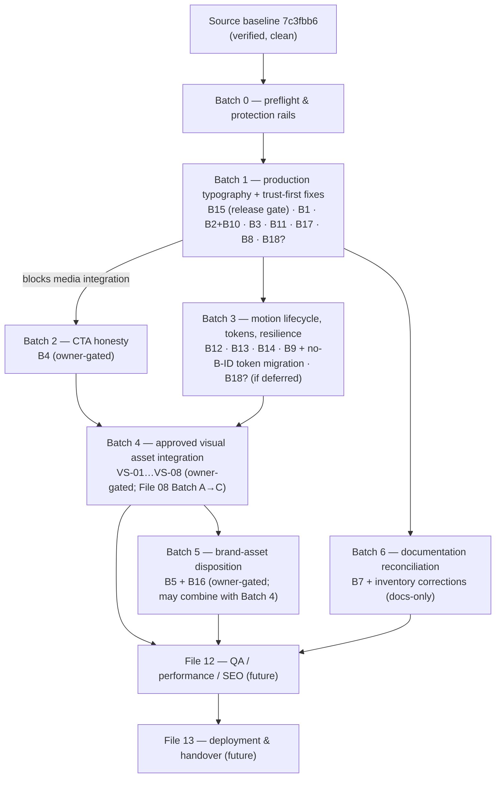

# Aturseva — File 11: Comprehensive Implementation Plan

**Status:** `PLANNING — NOT IMPLEMENTED`
**Created:** 2026-10-13 (working-session date; ISO 8601)
**Source baseline:** repository `doctorooms-creator/aturseva-landing`, branch `main`, commit `7c3fbb6` (Files 08+09 merge point; source tree identical to `e30dcc8`/`f407e78` — verified docs-only commits since). Line citations refer to `7c3fbb6`; stable symbol names remain the reference if lines drift.
**Companion architecture:** `10_ARCHITECTURE_AND_TECHNICAL_DESIGN.md` (created in the same batch — current architecture, B15 analysis, ADR table, guardrails). This file converts the verified backlog **B1–B18** plus the remaining design-system work into a small number of substantial, dependency-aware implementation batches.
**Planning dependencies:** `02_PRODUCT_TRUTH_AND_CAPABILITY_MATRIX.md` (claims truth), owner decisions (canonical tagline **"Care that walks with you."** — approved, never re-opened), `04_SITEMAP_AND_NAVIGATION.md` (CTA/backlog origin, §18 decisions), `05_CREATIVE_DIRECTION_AND_DESIGN_SYSTEM.md` (design system, §5.3/§19 token tasks), `06_HOMEPAGE_STORYBOARD.md` (frame IDs), `07_MOTION_AND_SCROLL_ANIMATION.md` (M-IDs, lifecycle phases), `08_VISUAL_ASSET_PLAN.md` (VS scene IDs, rights gates, B15 evidence), `09_PAGE_AND_COMPONENT_SPECIFICATIONS.md` (component contracts, canonical §26 crosswalk), current source (implementation truth).

**Out of scope:** executing any batch; implementing, patching, or generating anything; creating File 12/13, assets, routes, forms, or automations; editing existing docs or the product repo. **No task in this file is authorized for execution merely by being documented.**

**Change log:**
| Date | Change | Author context |
|---|---|---|
| 2026-10-13 | Initial creation; 28 sections; B1–B18 canonical crosswalk; 6 implementation batches + preflight; B15 decision & regression plan; owner approval register | Files 10+11 combined planning task |

---

## 1. Document control, authority, and planning-only status

- **Type:** future execution plan — the batching, sequencing, gating, acceptance and rollback contract for all known backlog work. It plans; it does not execute.
- **Audit basis:** source read at `7c3fbb6` (all components, styles, engine, configs, `public/`, workflow) plus Files 02–09. Live-site browser measurements referenced (B15) are **inherited evidence** from File 08 §11.4's audit — not re-measured for this document.
- **Planning-only sentence (explicit):** no task, batch, copy change, label, asset, route, CTA, or fix described in this file is authorized for execution merely because it is documented here; every batch requires a separate, explicit implementation authorization from the owner (or their standing instruction), and owner-gated batches additionally require the listed decisions.
- **Status vocabulary (shared with File 10):** `VERIFIED CURRENT`, `CURRENT RISK`, `PROPOSED`, `OWNER DECISION REQUIRED`, `NOT IMPLEMENTED`, `NOT RUN`. Backlog statuses in this file are `OPEN`, `PROPOSED`, or `OWNER DECISION REQUIRED` only — see §4.

---

## 2. Implementation principles

1. **Integrated changes across related components** — one authorized prompt/task delivers a coherent phase (e.g., all trust labels + copy + shell in Batch 1), not one prompt per defect. This file exists to make that possible without rediscovery.
2. **Protect approved truth:** File 02 claims policy; monochrome-only direction; canonical tagline `Care that walks with you.` verbatim; no fabricated anything (numbers, testimonials, partners, pricing, compliance, integrations).
3. **Protect accessibility:** every change keeps the no-JS static page complete, reduced-motion complete, labels visible in all states, keyboard operability, focus visibility.
4. **Protect static export:** both deploy targets (root-served dev/preview/Vercel-ready and basePath Pages) stay green; no asset strategy lands without both-target fetch proof (B15 rule).
5. **Source traceability:** every batch records the SHA it started from, the files it touched, and evidence it produced; line citations use stable symbol names.
6. **Mobile behavior preserved:** desktop pin/scrub, mobile once-only autoplay, reduced-motion static finale — verified patterns that must survive every batch (File 07 §13).
7. **Preview labels and CTA honesty:** labels are content (never decoration); CTAs do exactly what their labels state or are removed.
8. **Rollback:** every batch is one revertible commit-set on `main`; `git revert` + automatic Pages redeploy restores the prior live state.
9. **No speculative product functionality:** no forms, APIs, backends, state libraries, or integrations without explicit architecture need and owner approval (File 10 §14/§22).
10. **One prompt = one phase, tests finished before proceeding:** a batch completes its acceptance criteria (§17–§21) before the next begins, except where §7 marks explicit parallelism.

---

## 3. Starting state and acceptance baseline

**Verified facts only (at `7c3fbb6`):**

- Single route `/`; render order skip-link → Nav → Hero → Journeys → Connection → ProductReveal → Sevika → Paths → Footer → AnimationProvider (File 09 §3).
- Stack: Next.js 16.4.0 / React 19.3.0 / Tailwind 4.3.3 / GSAP 3.15.0 (resolved per `bun.lock`).
- Two build modes (root default; `DEPLOY_TARGET=pages` export with `basePath: /aturseva-landing`); GitHub Actions deploys Pages on push to `main`.
- Local: dev `:3005`; self-contained preview `:3006` (`preview/index.html`, rebuilt via `bun run build:preview`).
- No real CTA destination exists (18-row matrix, File 09 §14); Paths CTAs are toast-only (B4).
- Current font issue: **B15** — root-absolute `@font-face` URLs (`globals.css:88–108`) 404 on the Pages build; live site renders fallback fonts (inherited evidence: File 08 §11.4 — live fetch 404 at `/fonts/…` vs 200 at `/aturseva-landing/fonts/…`; `document.fonts.check` false for both families; dev `:3005` healthy with 3 loaded faces).
- Zero photographic/video assets; monochrome token system with legacy names; animation engine with verified boot guard, no unmount cleanup; reduced-motion dual insurance.
- **Inherited vs newly tested:** any baseline browser/test measurement cited in this file comes from prior documented audits (File 08 §11.4 live font check; worklog QA rounds 4/6/9/10 — screenshots in `qa/`); **nothing was re-measured for this planning task**. Future batches re-verify what they touch.

---

## 4. Backlog and status vocabulary

- `OPEN` — verified defect/gap, no owner dependency blocking an authorized pass (e.g., B8).
- `OWNER DECISION REQUIRED` — blocked on an explicit owner decision (B4, B5, B6, B16; copy sign-offs for B1/B11; B18 scope confirmation).
- `READY` — an authorized implementation batch exists and all gates are cleared (none today).
- `IN PROGRESS` — only during an authorized execution (never set by planning).
- `VERIFIED` — fix implemented AND acceptance checks executed green (none today).
- `DEFERRED` — consciously postponed by the owner (none today).

**In this planning-only task, every B-ID is recorded as `OPEN`, `PROPOSED`, or `OWNER DECISION REQUIRED`. No defect is marked resolved, fixed, or verified by the creation of this document.**

---

## 5. Canonical B1–B18 crosswalk

Source of truth: File 09 §26 (which resolves the legacy File 04 §16 item-number ordering — see the nuance note below). IDs preserved exactly; no renumbering, no duplication, no silent resolution.

| B-ID | Exact issue | Severity | Owner dependency | Affected paths (verified) | Dependencies | Proposed phase | QA gate | Current status |
|---|---|---|---|---|---|---|---|---|
| **B1** | Zero-wait patient title — "Walk in without the wait" | P0 (claims) | **Yes** — final wording sign-off ("Walk in with greater clarity" / "Know where you are in the queue" proposed) | `src/components/Paths.tsx:48` | none | Batch 1 (copy) | copy guardrail review; claims check vs File 02 row 3 | OPEN — `OWNER DECISION REQUIRED` (wording) |
| **B2** | Connection cards missing "Representative preview" label | P0 (trust) | No — pattern already approved (File 02 §8 row 3) | `src/components/Connection.tsx:127–206` | pairs with B10 | Batch 1 | label visible in all states/modes; outside animated elements | OPEN |
| **B3** | Sevika thread + philosophy line need illustrative/brand-philosophy framing | P0 (trust) | Framing preference (philosophy vs labelled dialogue) | `src/components/Sevika.tsx:76–110`, `src/components/Footer.tsx:14–16` | none | Batch 1 | "Illustrative Sevika conversation — representative preview" label present; quote never reads as testimonial | OPEN |
| **B4** | Toast CTAs imply outreach but capture nothing | P0 (trust) | **Yes** — destination/process decision (File 04 §18-3) | `src/components/Paths.tsx:5–40` | File 04 Phase A | Batch 2 (owner-gated) | each CTA does exactly what its label states; no fake success | OPEN — `OWNER DECISION REQUIRED` |
| **B5** | Logo-embedded tagline mismatch ("Make healthcare intelligent." vs canonical) | P1 (brand) | **Yes** — asset strategy | `src/components/Logo.tsx:46–75` (full variant; used `Footer.tsx:13`) | B16 disposition | Batch 5 (owner-gated) | chosen strategy implemented; asset never edited without authorization | OPEN — `OWNER DECISION REQUIRED` |
| **B6** | Human imagery absent | P2 | **Yes** — imagery optional; direction/sourcing/generated-acceptability (File 08 §4/§20) | `src/components/Hero.tsx` et al.; `public/` | File 08 Batch A | Batch 4 (owner-gated) | File 08 §18 per-asset acceptance; both-target fetch | OPEN — `OWNER DECISION REQUIRED` |
| **B7** | File 03 tagline documentation reconciliation | P2 (docs) | Owner review of the doc revision | `docs/03_BRAND_MISSION_AND_POSITIONING.md` §14/§16 | none — **does not reopen the approved tagline** | Batch 6 (docs) | File 03 reflects "Care that walks with you." as approved; candidates archived | OPEN |
| **B8** | Fixed "© 2025" footer year | P2 | No | `src/components/Footer.tsx:45` | none | Batch 1 | dynamic year (or corrected static) renders current year | OPEN |
| **B9** | Hardcoded SVG greys outside token system | P2 | No (alias strategy from Batch 3) | `Hero.tsx`, `Journeys.tsx`, `Connection.tsx` inline attrs | token migration (no-B-ID task) | Batch 3 (or touch-when-edited) | hex sweep clean on touched components; zero visual diff | OPEN |
| **B10** | Preview-label legibility under mobile card condensation | P1 | No — folds into B2 | `src/app/globals.css:226–248` (11px card condensation) | B2 | Batch 1 (with B2) | label legible at 390px/360px and 200% zoom | OPEN |
| **B11** | Soften "instantly in step" wording | P2 (copy) | **Yes** — copy sign-off | `src/components/Connection.tsx:43` (caption 3) | none | Batch 1 (copy, after approval) | claims-safe phrasing | OPEN — `OWNER DECISION REQUIRED` (wording) |
| **B12** | Reduced-motion/media-query change requires reload to re-evaluate | P2 | No | `src/lib/aturseva-anim.js:32–33,437` | B13 (same lifecycle work) | Batch 3 | live toggle re-evaluates modes without reload; content never hidden | OPEN |
| **B13** | GSAP/ScrollTrigger cleanup/revert on unmount missing | P2 (latent) | No | `src/components/AnimationProvider.tsx` | keep verified boot guard (`__atursevaAnimBooted`, `aturseva-anim.js:26–27`) | Batch 3 | unmount → all triggers killed, one init, no duplicates (pre-routing invariant) | OPEN |
| **B14** | Dead `--animate-drift` token | P3 | No | `src/app/globals.css:64,81–84` | usage evidence | Batch 3 | token removed (or genuinely adopted); no dead tokens remain | OPEN |
| **B15** | **Production GitHub Pages font URL 404 / fallback fonts** | **P1 — highest technical delivery priority** | No (fix authorized by any implementation pass) | `src/app/globals.css:88–108`; `next.config.ts:14–21`; live CSS chunk | solution-family selection (§10) | **Batch 1 (merge/release gate)** | **§10 regression plan — both targets, FontFaceSet, non-regression** | OPEN — `CURRENT RISK` |
| **B16** | `public/assets/logo-primary.svg` deployed but unreferenced | P3 | **Yes** — folds into B5 decision | `public/assets/logo-primary.svg` | B5 | Batch 5 (owner-gated) | disposition executed (keep as canonical copy / remove); register records it | OPEN — `OWNER DECISION REQUIRED` |
| **B17** | Decorative reminder toggle `<label>` implies interactivity, no control | P3 | No | `src/components/ProductReveal.tsx:137–143` | none | Batch 1 | no false affordance; static presentation or genuinely disabled control; illustrative classification intact | OPEN |
| **B18** | Footer `mt-auto` inert — shell/body not flex; sticky-footer intent not implemented | P3 (latent) | **Yes** — scope confirmation (is sticky-footer-on-short-pages an acceptance requirement?) | `src/components/Footer.tsx:5`; body block flow (`globals.css:114–117`) | none | Batch 1 (if confirmed; else deferred) | short-page flex-shell test; long-page natural push; no overlap | OPEN — `OWNER DECISION REQUIRED` (scope) |

**No-B-ID task (carried separately, exactly as File 09 does):** legacy semantic token-name migration (`brand`/`gold`/`ivory` neutral scales → `graphite-*`/`paper-*` primitives + semantic aliases) — File 05 §19-1/§5.3 strategy: aliases first (zero visual change), opportunistic component migration, legacy names removed last. **Deliberately carries no B-ID** to preserve B-ID history. Proposed phase: Batch 3. QA gate: zero visual diff after alias swap; no raw hex in newly touched components.

**File 04 §16 item 7/8 crosswalk nuance (preserved accurately):** File 04's original backlog listed item 7 = tagline documentation consistency and item 8 = copyright year. The canonical B-ID mapping (from File 09 §26) is **B7 = File 03 tagline documentation reconciliation** and **B8 = fixed "© 2025"** — i.e., B7/B8 swap positions relative to File 04's item numbers 7/8. IDs are stable from File 06 onward; the File 04 numbering is historical context only. B7's meaning is fixed: a documentation pass that reconciles File 03 to the **already-approved** tagline — it never re-opens the brand decision.

---

## 6. Owner decisions and hard gates

These decisions are **explicit and unresolved**; nothing in this file resolves them by being written:

1. **B4 — true CTA action/destination/process.** Options: real owner-confirmed destination/action; honest in-page navigation; remove/disable CTAs pending a genuine process. Prohibited in all cases: invented forms, improvised API/CRM/email routing, false "Team Aturseva will reach out" promises, links to nonexistent routes. (File 04 §18-3.)
2. **B5 + B16 — logo/tagline asset strategy.** Options: (a) tagline-free lockup (`word` variant) + separate canonical tagline text line; (b) newly commissioned/owner-approved asset carrying the official tagline. Until decided: existing logo and embedded lettering stay untouched — never cropped, covered, recoloured, retraced, or replaced; the unreferenced `public/assets/logo-primary.svg` stays as-is. (File 08 §16.)
3. **B6 + File 08 — imagery inclusion, sourcing model, generated-asset acceptability.** Options A (commissioned) / B (licensed) / C (generated, per class) / D (hybrid); recommended-if-any: A/B for faces, C only for abstract texture if approved at all. Hero media route 1 (zero-asset — valid permanent fallback) / 2 (VS-01 still) / 3 (short muted film). (File 08 §4/§9.)
4. **Hero asset route** — folded into decision 3 (File 08 §9 matrix).
5. **B1/B11 exact final copy** — proposed alternatives exist ("Walk in with greater clarity" / "Know where you are in the queue"; soften "instantly in step" → "in step") but remain **pending required sign-off** wherever File 04/09 require owner approval. Recommending is not approving.
6. **B18 shell correction scope** — implement the flex-column shell only if the intended sticky-footer criterion is confirmed in acceptance scope; if done, it ships with proper short-page acceptance tests (§18).

Decision requests should be **bundled into a single concise owner-review checkpoint** (one message listing decisions 1–6 with options and recommendations), not one prompt per item. **Writing this file is not approval of any of them.**

---

## 7. Dependency map and batch overview

**Parallelism:** Batch 6 (docs-only) may proceed any time after Batch 1 content decisions are stable. Batch 5's *decision* may be gathered in the same owner checkpoint as Batch 4's; its *implementation* may combine with Batch 4 if the owner directs. Batch 2's decision work (owner) can proceed in parallel with Batch 1 implementation. **Blocked:** Batch 4 implementation is blocked by B15 landing first (File 08 §19 Batch C: "B15 path fix lands first or together so the delivery pattern is proven") and by the File 08 Batch A owner gate; Batch 2 implementation is blocked by the B4 decision; Batch 5 implementation by the B5/B16 decision.

---

## 8. Batch 0 — implementation preflight and protection rails

**Planning specification only — run before any future code-writing task:**

1. Validate the repo: `git status` clean (or fully understood); record current `main` SHA; confirm the working tree contains no unrelated changes. **If state is unsafe or unknown: stop and report — never reset, stash blindly, or discard unknown work.**
2. Preserve work: note the starting SHA in the batch's evidence; ensure `qa/` and worklog conventions continue.
3. Confirm only the landing repo (`/home/z/landing-v2/`) is touched — the product repo (`/home/z/my-project/`) is never modified.
4. Document the source baseline (SHA + date) in the batch's commit message and worklog entry.
5. Create before/after evidence: the affected surfaces captured pre-change (screenshots at 1440×900 and 390×844 minimum, plus the specific states the batch touches — e.g., reduced-motion, mobile grid, no-JS).
6. Agree target environments for the batch: dev `:3005`, preview `:3006` (rebuilt), Pages live URL — all three must be verified for release-relevant batches.
7. **Explicitly prohibited:** destructive git commands when state is unclear; scheduling/cron/background automation of any kind (none is part of any batch; creating one requires separate explicit owner permission); running visual QA "as a side project" beyond the batch's defined checks.
8. Read this file's batch section + the relevant File 09 component contracts before editing; re-audit the exact lines (they may have drifted).

---

## 9. Batch 1 — production typography and trust-first fixes (coherent initial release)

**Goal:** the first authorized implementation pass makes production typography real (B15) and clears the P0/P1 trust backlog in one integrated, QA-shared release. Status: `NOT IMPLEMENTED` — plan only.

**Contents (integrated, not separate prompts):**

| # | Item | Affected areas (verified) | Sub-step notes | Risks | Acceptance | Rollback |
|---|---|---|---|---|---|---|
| 1 | **B15 basePath-safe font loading** | `globals.css:88–108`; possibly `layout.tsx`/font files location; `scripts/build-preview.ts` if family F2 chosen; `next.config.ts` untouched unless F1 needs a transform hook | solution selected **only after inspecting project patterns** — compare F1 (basePath-aware URL construction) vs F2 (`next/font/local`) vs F3 (relative-depth) per File 10 §11; do not assume one is correct | wrong family choice re-breaks dev or preview; preview pipeline desync | §10 regression plan fully green | revert commit; Pages auto-redeploys prior state |
| 2 | **B1 truthful patient pathway title** | `Paths.tsx:48` | only after owner wording sign-off (§6-5); replace "Walk in without the wait" | copy sign-off missing | claims-safe title; guardrail review | revert |
| 3 | **B2 + B10 Representative-preview labels on Connection mock cards** | `Connection.tsx:127–206` (cards/bubbles), label placed at stage level; `globals.css:226–248` (mobile 11px context) | label **outside animated/faded elements** — persistent caption-area/stage-level label, never inside a `.conn-card` (autoAlpha pop) or crossfading caption; must survive mobile static grid + reduced-motion finale | label collides with overlay geometry; illegibility at 11px | label visible in all three Connection modes + mobile + finale; 11px floor respected | revert |
| 4 | **B3 Sevika illustrative + philosophy framing** | `Sevika.tsx:76–110` (thread label header-row), `Sevika.tsx:74–79` + `Footer.tsx:14–16` (philosophy framing) | "Illustrative Sevika conversation — representative preview" persistent header above thread (outside `.sevika-msg` stagger); blockquote framed as brand philosophy or labelled illustrative dialogue — never a testimonial | label reads as decoration; framing preference undecided | label persistent in all states; quote cannot be misread as a customer quote | revert |
| 5 | **B11 soften "instantly in step"** | `Connection.tsx:43` (caption 3) | only after copy approval; "in step" default proposal | sign-off missing | claims-safe caption | revert |
| 6 | **B17 remove false control affordance** | `ProductReveal.tsx:137–143` | static row with state glyph, or genuinely disabled control; no `cursor-pointer` on non-controls; never claim toggle functionality | semantic regressions | no interactive affordance without behaviour; a11y clean | revert |
| 7 | **B8 dynamic copyright year** | `Footer.tsx:45` | current-year rendering (static export: year resolved at build — acceptable and honest; note in batch evidence) | none material | renders current year post-deploy | revert |
| 8 | **B18 shell correction (scope-conditional)** | `Footer.tsx:5`, `layout.tsx`/`globals.css` shell, `page.tsx` wrapper | only if §6-6 confirms the sticky-footer criterion; flex-column shell (`min-h-screen flex flex-col` on body or wrapper + keep `mt-auto`); grouped with shell/a11y checks — not a standalone micro-task | long-page regressions | short-page footer at bottom; long-page natural push; no overlap; both viewports | revert |

**Parallelisable sub-steps:** items 3+4 (labels) share one QA pass; item 6 independent; item 1 (B15) is the critical path and the **merge/release gate for the whole batch** — no merge until §10 is green. **Shared QA:** labels visible in every state/mode; copy guardrail sweep (§19); both-target checks (§10/§17); mobile 390px + desktop 1440px; reduced-motion + no-JS passes.

---

## 10. B15 font-path technical decision and regression plan

**Decision procedure (future, inside Batch 1):** inspect the project's actual patterns before choosing — confirm the built CSS's requested URL on both targets (build each, read the emitted `url(...)`), then weigh File 10 §11 families:

- **F1 — basePath-aware URL construction** (build-time rewrite for the pages target; keeps CSS structure, family names, preview pipeline).
- **F2 — `next/font/local`** (Next-native basePath-correct hashed URLs; requires rewiring font-family into the Tailwind theme and updating `build-preview.ts` in the same batch so the preview artifact still inlines correct fonts).
- **F3 — relative-URL depth** (works in both targets only with a compile-time depth assertion; brittle — avoid unless proven).

Selection criteria: correctness on **both** targets with the smallest blast radius across `globals.css`, `layout.tsx`, `scripts/build-preview.ts`, and the preview artifact's self-containment audit. **Do not assume `next/font/local` is automatically correct for this repo's preview pipeline; do not assume a rewrite hack is safe without an assertion.**

**Exact regression checks (execute only in the future implementation/QA batch; record target + result then, not now):**

1. Root-served mode (dev `:3005` or standard build): each font file returns HTTP 200 at the **actual URL requested by the built CSS**.
2. GitHub Pages `basePath` build: same check on the live deployed CSS — **200 at the requested URL**, not merely at some reachable path.
3. Browser confirmation on the live Pages URL: `document.fonts.check('16px Manrope')` and `document.fonts.check('16px Fraunces')` (and italic) return **true**; `document.fonts` shows the loaded faces; **computed `font-family`** on a heading and a body element resolves to the brand faces; network panel shows the woff2 requests succeeding (CSS declarations alone are not proof).
4. No root-absolute `/fonts/…` request appears in the basePath deployment's network log (unless a strategy intentionally proves one correct — none is expected to).
5. Heading/body display and layout do not regress (visual pass vs pre-fix evidence; metric: Fraunces/Manrope glyph shapes visibly present).
6. `font-display` behaviour and graceful fallback preserved (swap; fallback stacks intact).
7. Preview artifact `:3006` still renders correct inlined fonts (rebuild + self-containment audit green).
8. **A docs-only build/Actions success is never accepted as evidence B15 is fixed** (source must actually change and live checks must pass).

---

## 11. Batch 2 — CTA honesty and conversion destination (owner-gated)

**Gate:** explicit owner decision from File 04 §18-3 (decision 1 in §6). No implementation before the decision; the decision itself may be requested in the bundled checkpoint (§6).

**Permitted implementations (post-decision):**

| Decision outcome | Implementation | Acceptance |
|---|---|---|
| Real destination confirmed (URL/process) | CTAs link/submit to exactly that destination; visible honest success/failure states; no invented intermediate steps | each CTA does what its label states, desktop + mobile; no completion claim without actual processing |
| Honest in-page navigation | buttons become links to the relevant section/route (only existing anchors today; future routes when built) | destinations exist; labels match |
| "No destination yet" | remove the buttons (cards stay informational) or disable with honest presentation | zero capture-implying affordances remain |

**Always prohibited:** fake data capture; "Team Aturseva will reach out" promises without a real process; non-existent routes; improvised API/CRM/email integration; fake success toasts (File 04 §10 toast policy). **Acceptance:** the File 09 §14 matrix rows 12–14 updated to truth; every CTA behaviour matches its label on desktop and mobile; toast (if any remains) announces honestly. **Rollback:** revert commit-set.

---

## 12. Batch 3 — motion lifecycle, responsiveness, semantic tokens, and resilience

**Goal:** harden the engine and the token system so future work (routes, assets) lands on safe foundations. Status: `NOT IMPLEMENTED`.

| # | Item | Verified current behaviour | Planned change (future) | Acceptance |
|---|---|---|---|---|
| 1 | **B12** live media-query re-evaluation | `reduceMQ`/`mobileMQ` sampled once at boot (`aturseva-anim.js:32–33,437`); toggle needs reload | listen to `change` on both queries; re-evaluate Connection mode + builders safely; all essential content stays visible during transition | OS-level toggle mid-session flips to correct mode without reload; no hidden content; no duplicate triggers |
| 2 | **B13** cleanup/revert on unmount | no ScrollTrigger kill / context revert; `cancelled` flag only | proper teardown in `AnimationProvider` cleanup: kill triggers, revert matchMedia/timelines, remove listeners; **preserve the verified `__atursevaAnimBooted` guard** and single-init semantics | unmount → zero live triggers; re-mount boots cleanly once; no duplicates (pre-routing invariant before any route exists) |
| 3 | **B14** dead token | `--animate-drift` defined (`globals.css:64,81–84`), used by no component | remove (default) or adopt based on real usage evidence found at implementation time | no dead animation tokens; zero visual diff if removed |
| 4 | **B9 + no-B-ID token migration** | hardcoded SVG greys in Hero/Journeys/Connection attrs; legacy `brand/gold/ivory` names | agree semantic aliases (`graphite-*`/`paper-*` + semantic layer per File 05 §4.2/§5.3); migrate hardcoded SVG greys on touched components to `currentColor`/CSS vars; **avoid a broad risky rename** — check every use first; alias-first, zero-visual-change | hex sweep clean on touched components; alias swap produces zero visual diff; no raw hex in newly touched components |
| 5 | **B18 (optional)** | inert `mt-auto` | if deferred from Batch 1, execute the shell fix here with the §9 acceptance tests | short-page/long-page footer behaviour correct |
| 6 | Low-end mobile fallbacks | tilt scrub light; autoplay once | define/verify the degradation order (tilt → autoplay → static finale) on mid-range devices | mid-range device pass; no jank regressions |

**Root/basePath regression:** every build-touching change re-runs the both-target asset sweep (§10 checks 1–2 generalized to all referenced assets). **Do not claim "no lifecycle issues" unless actually tested** — the acceptance rows above are the tests that would justify such a claim, executed only then.

---

## 13. Batch 4 — approved visual asset integration (owner-gated)

**Gates:** File 08 Batch A owner decisions (sourcing model, generated-acceptability, hero route) **and** B15 landed (or landing together, per File 08 §19 Batch C). No media integration starts before both. Consumes File 08/09 contracts; this section does not repeat asset planning.

**Shape:** one integrated batch implementing File 09 §17 media contracts for the owner-approved subset of:

| Scene | File 06 frames | File 07 M-IDs | Integration contract highlights |
|---|---|---|---|
| VS-01 hero still/film | H-01–H-05 | M-H1–H3 | never delays H1 (<0.3s comprehension budget); poster + reduced-motion frozen state; decorative alt=""; `width`/`height` reserved; both-target fetch |
| VS-02/03/04 journey inserts | J-01–J-03 | M-J1–J3 | consistent set grade; static inserts; stacks on mobile |
| VS-05 Sevika split | S-01–S-03 | M-S1–S3 | 60/40 text rule; static; decorative |
| VS-08 role portraits | R-01–R-03 | M-R1–R3 | restraint default: **omit** unless owner explicitly reopens |

**No-asset zones stay closed:** Connection (VS-06), ProductReveal (VS-07), Footer — not reopened unless the owner explicitly instructs. Every asset carries: registered provenance/licence/consent (File 08 §14 schema), dimensions/crops/`srcset`/`sizes`, reserved aspect ratios (zero CLS), decorative-vs-informative classification, reduced-motion poster/frozen state, no-JS fallback (current zero-asset layout), and both-deployment URL checks (B15 rule). **Zero-asset hero remains a valid final outcome** (Route 1).

---

## 14. Batch 5 — approved brand-asset disposition (owner-gated; may combine with Batch 4)

**Gate:** B5 + B16 owner decision (§6-2). Until the decision: **the existing logo and its embedded "Make healthcare intelligent." lettering are preserved exactly** — never cropped, covered, recoloured, retraced, or replaced; `public/assets/logo-primary.svg` stays deployed-but-unreferenced.

**Post-decision implementation (only the chosen option):**

| Option | Implementation scope | Acceptance |
|---|---|---|
| (a) tagline-free lockup | footer switches to `word` variant + separate canonical tagline text line ("Care that walks with you." — verbatim, once per page pairing rule); B16 disposition of the master file executed (keep as canonical copy or remove) | official tagline unmistakable in footer; embedded lettering no longer displayed; asset file handled per decision; no ad-hoc overlays ever used |
| (b) owner-approved updated asset | new asset integrated per File 08 rights/consent/register gates; old asset retired through the register | register records provenance; live renders the approved lockup |

**If no decision:** keep current interim behaviour (footer `full` variant as-is) and defer — Batch 5 simply does not run. Nothing is changed "while waiting".

---

## 15. Batch 6 — documentation reconciliation and clean handoff

**B7 = reconcile File 03's tagline documentation with the already-approved canonical tagline `Care that walks with you.`** This is a documentation sub-step in a later authorized batch — it is **not** a reason to reopen the brand decision (which is settled). Concretely (when authorized): File 03 §14/§16 updated so the tagline is recorded as approved-canonical (candidates archived as history, decision provenance cited), matching File 04 §4 and File 09 §13.

**Inventory corrections carried for the same authorized docs pass (only if the owner authorizes editing those existing documents):** File 06 §1's prior "fonts + favicon only" wording vs the corrected record in File 08 §2 (public tree = fonts + `assets/logo-primary.svg`, favicon at `src/app/icon.svg`). **File 03 and File 06 are not edited in the current task.** Docs-only changes of this kind never touch source, never claim implementation, and deploy as docs-only Actions runs (not evidence of any fix).

---

## 16. Cross-component work packets

Minimum linked sets per batch (avoid "one component, one prompt" except where truly independent and low risk — e.g., B8 year inside Footer is grouped into Batch 1's shared QA anyway):

| Batch | Work packet (change together) | Shared assets of the pass |
|---|---|---|
| 1 | `globals.css` (font URLs + any label CSS) + `Connection.tsx` + `Sevika.tsx` + `Footer.tsx` + `Paths.tsx` (copy) + `ProductReveal.tsx` (+ `layout.tsx`/`build-preview.ts` if F2) | one QA sweep (labels/copy/both-targets/mobile/reduced-motion); one evidence set; one commit-set |
| 2 | `Paths.tsx` (+ route files only if they exist by then) + File 09 §14 matrix rows 12–14 truth update in the batch evidence | CTA acceptance sweep |
| 3 | `aturseva-anim.js` + `AnimationProvider.tsx` + `globals.css` (tokens) + touched SVG components (B9) | lifecycle test pass; token zero-diff pass |
| 4 | approved subset of Hero/Journeys/Sevika/Paths components + `public/media/**` + register | File 08 §18 per-asset acceptance |
| 5 | `Footer.tsx`/`Logo` usage + (a) tagline line or (b) new asset + register/B16 disposition | brand review pass |
| 6 | `docs/03…md` (+ `docs/06…md` if authorized) | docs-only validation (links, section integrity) |

Each packet carries its own: source audit (re-read the drifted lines), implementation, type/build checks, affected-environment verification (§3 targets), and concise results recorded for the handover.

---

## 17. Verification strategy by layer

Layered checks; **detailed QA execution belongs to future File 12 — nothing below has been run for this planning task (`NOT RUN`)**:

1. **Code-level:** TypeScript (`next build` type gate), ESLint, hex/token sweep on touched files, diff-scope review vs the batch contract.
2. **Build/static-export:** both `bun run build` (root) and `bun run build:pages` (basePath) succeed; export artifact contains expected files; `bun run build:preview` self-containment audit green.
3. **Route/link:** every interactive element resolves (File 09 §14 matrix rows re-verified); anchors `#top/#main/#site-nav/#nav-mobile/#journeys/#connection/#platform/#sevika/#paths` all present; no link to a nonexistent route.
4. **Browser visual:** desktop 1440×900 + mobile 390×844 (+360px for condensation); section-by-section comparison vs before-evidence; label visibility in every state; footer position on short/long pages.
5. **Motion/accessibility:** reduced-motion pass (static finale, kill-switch), no-JS pass (content complete), keyboard pass (focus ring, menu, skip link), zoom/reflow 200%.
6. **Asset delivery:** per-asset both-target fetch 200 at requested URLs; FontFaceSet checks for fonts (§10); poster/fallback states for media.
7. **Deployment smoke:** live Pages URL loads; deployed CSS/JS/font assets 200; console error-free; preview `:3006` parity after rebuild.

---

## 18. Desktop, mobile, touch, keyboard, reduced-motion, and no-JS acceptance

Per-phase acceptance rules (binding for every batch; verified patterns that must survive):

- **Desktop pin/scrub preserved:** Connection pinned sequence (`top top` → `+=260%`, scrub 1) behaves identically after any batch touching it; phases reversible; captions crossfade; no stuck pin.
- **Mobile once-only choreography preserved:** <768px static 2-col grid + autoplay once at `top 72%`; no pin on touch widths; no replay on revisit.
- **Reduced-motion static finale preserved:** converged lanes, all dots, final caption; nothing essential hidden; CSS kill-switch + JS branch both intact.
- **No-JS completeness:** with JS disabled (or GSAP failed), the entire page renders — every batch proves this still holds.
- **No scroll-jacking; no crucial copy only within animation** — content lives in DOM; motion is enhancement.
- **Label placement persists outside animated regions** (B2/B3 placement contracts) across all modes and sizes.
- **No clipped labels at 200% zoom** (B10 acceptance); conn cards legible at 390/360px.
- **Keyboard:** visible focus everywhere; menu toggle announces (aria-expanded); skip link first; anchors reachable; (post-Batch-1: Escape-close + focus return if implemented then).
- **Touch targets ≥44px** on primary controls at every width.

---

## 19. Content/claims/trust review gate

Run against the **whole route** (not only changed lines) at the end of every content-touching batch:

- Zero-wait language absent (post-B1: no "Walk in without the wait"-class phrasing anywhere; "never miss a dose"-class promises absent).
- No implied real-time values in fake UIs: sample tokens/counters/timers static and clearly illustrative; blink dots remain chrome.
- No testimonial-like phrasing: philosophy line framed (B3); no invented customer voice.
- No Sevika autonomous medical implications (diagnosis/prescription/dose-change) — attribution intact on every reminder.
- Tagline correctness: only "Care that walks with you." used as tagline; embedded logo line never quoted as tagline.
- No unsupported claims (File 02 §9.2 inventory: stats, partners, pricing, compliance, outcomes, integrations, dates).
- No nonexistent CTAs (File 09 §14 matrix truth).
- Sample data stays static and clearly illustrative (names "Ramesh S."/"Dr. K. Mehta" class).

---

## 20. Performance and delivery gates

Planned measurable targets for future File 12 — **not claimed compliant now (`NOT RUN`)**:

- No avoidable LCP/CLS regressions per batch (media batches: hero image budget ≤ ~180 KB AVIF / ≤ ~250 KB WebP proposal; film ≤ ~2.5 MB combined; `width`/`height` reserved; zero CLS from media).
- Lazy-load media where justified (non-hero); hero-critical asset preloaded only when provably not delaying LCP.
- Avoid unnecessary packages (zero new dependencies unless a batch proves need).
- Both deploy targets serve every referenced asset (200 at requested URL — generalized B15 rule).
- Connection pin performance verified on supported desktop; mobile fallback verified on mid-range devices (Batch 3 degradation order).
- LCP unblocked by JS (lazy GSAP pattern preserved); 60fps desktop / ≥50fps mid-tier mobile scroll targets (File 07 §15).
- **File 12 owns actual measurements**; batches record only their own layer-1/2 checks (§17).

---

## 21. Accessibility acceptance gate

Per-batch minimum (detailed execution: File 12; `NOT RUN` today):

- Semantic controls: every interactive element is a real control; **B17 fixed** → no `<label>`-without-control patterns; valid label/control associations where controls exist.
- Focus visibility + return behaviour (menu focus return if implemented; focus ring global rule intact).
- Mobile menu Escape handling (if implemented in the batch).
- Screen-reader order: DOM order = story order; decorative SVGs `aria-hidden`; labels real text; toast (if retained) `role="status"`.
- Alt text per classification once media exists (decorative → `alt=""`; informative → descriptive, claim-free).
- Contrast within the monochrome system (targets: 4.5:1 normal / 3:1 large+UI — **File 12 test targets, not claims**).
- 200% zoom/reflow survival; keyboard control complete; reduced motion complete (§18).
- Live-region honesty: only honest status text is ever announced.
- **WCAG 2.2 AA remains a future test target — no conformance is claimed anywhere in this plan.**

---

## 22. Data, privacy, security, and integration restrictions

Absolute restrictions for every batch (violations block release):

- **No real patient data or PHI** in any mock, asset, comp, or test fixture.
- **No secrets/credentials** in browser source or client bundles.
- **No invented backend endpoints** — no `fetch` to fictional APIs, no stub integrations presented as real.
- **No analytics, tracking pixels, CRMs, contact forms, or email routing** — each is a separate owner-approved architecture change; this plan may not infer one.
- Existing illustrative data (names/tokens/counts) stays clearly illustrative; no dataset of "real-looking" records may be added.
- The product repo (`/home/z/my-project/`) is never read-modified by landing work; automation never touches it.
- No scheduled jobs/cron/background automations are created or manipulated by any batch (requires separate explicit owner permission).

---

## 23. Release gates and rollback

**Go/no-go per release (a batch's commit-set merged to `main` and deployed):**

1. **Critical B15 URLs/fonts pass on the target** — live Pages font checks green (§10) for any batch that touched delivery paths; generalized both-target asset sweep for media batches.
2. **P0 trust fixes approved and validated** — copy sign-offs recorded; labels verified in all states.
3. **CTA owner decisions implemented honestly** (Batch 2) — matrix rows 12–14 truthful.
4. **No broken anchors/routes** — full link sweep (§17-3).
5. **No build/type/lint regression** — both build modes + type-check + lint clean.
6. **Motion/reduced-motion/no-JS paths pass** (§18).
7. **Asset rights/consent complete** for any new media (register rows complete; no `unknown` rights fields).
8. **Diff scope matches the approved batch** — `git diff --name-only` vs the batch contract; unexpected files → stop, report, do not stage/reset unrelated work.

**Rollback:** revert the batch's commit-set on `main` (`git revert`); Pages redeploys automatically; local dev/preview rebuilt from the reverted tree. **Evidence retained:** batch evidence set (before/after captures, check results, SHA range) in `qa/` + worklog entry — no deployment system, artifact store, or monitoring product is introduced.

---

## 24. File 12 / File 13 handoff

**File 12 (future — QA/performance/SEO) receives:**

- Test matrix: §17 layers 1–7; §18 acceptance rules; File 07 §17's 14-row motion QA matrix; File 05 §17 contrast measurement list; File 08 §18 per-asset `T` checks; §10 B15 regression (post-fix verification); File 09 §25 acceptance checklist.
- Evidence conventions: per-check target + actual result recorded when executed; screenshots to `qa/`; `NOT RUN` until run.
- Environment details: dev `:3005`, preview `:3006`, live Pages URL; desktop 1440×900, mobile 390×844 (+360); browser set (Chrome/Safari/Firefox + iOS/Android spot-checks per File 07 §17); keyboard + SR spot-check tooling per File 05 §17.
- Deploy smoke tests: live URL HTML/CSS/JS/font fetches; console error-free; anchor loads (`/#sevika`); preview parity.

**File 13 (future — deployment/handover) receives:** §23 release gates + rollback procedure; §18 of File 10 (deployment architecture + proposed release gate); evidence-retention conventions; the open-decision register state at that time. **Neither file is created by this task.**

---

## 25. Batch status board

One table — all implementation batches remain `NOT IMPLEMENTED`:

| Batch | B-IDs | Owner gate | Main paths | Dependencies | Acceptance gate | Rollback trigger | Status |
|---|---|---|---|---|---|---|---|
| 0 — preflight | — | none | (process only) | clean tree | baseline SHA + evidence recorded | n/a | `NOT IMPLEMENTED` (spec) |
| 1 — typography + trust | B15, B1, B2+B10, B3, B11, B17, B8, B18? | B1/B11 wording sign-off; B18 scope | `globals.css`, `Connection.tsx`, `Sevika.tsx`, `Paths.tsx`, `ProductReveal.tsx`, `Footer.tsx`, (F2: `layout.tsx`, `build-preview.ts`) | Batch 0 | §10 green + labels/copy sweep + both builds + §18 states | any §23 gate failure | `NOT IMPLEMENTED` — B15 `CURRENT RISK` |
| 2 — CTA honesty | B4 | **B4 destination decision** | `Paths.tsx` (+ routes if existing) | Batch 1 released | CTA matrix rows 12–14 truthful | gate failure | `NOT IMPLEMENTED` — `OWNER DECISION REQUIRED` |
| 3 — lifecycle + tokens | B12, B13, B14, B9, no-B-ID token migration, (B18?) | none (alias strategy agreed in-batch) | `aturseva-anim.js`, `AnimationProvider.tsx`, `globals.css`, touched SVG components | Batch 1 | lifecycle tests + zero-visual-diff token pass | gate failure | `NOT IMPLEMENTED` |
| 4 — asset integration | B6 (VS-01…VS-05, VS-08?) | **sourcing/hero-route/generated decisions; B15 landed** | approved subset of components + `public/media/**` + register | Batches 1+3; File 08 Batch A | File 08 §18 per-asset acceptance + both-target fetch | rights gap or gate failure | `NOT IMPLEMENTED` — `OWNER DECISION REQUIRED` |
| 5 — brand-asset disposition | B5, B16 | **B5/B16 asset decision** | `Footer.tsx`/Logo usage + asset files + register | decision only (may combine with 4) | strategy implemented; asset integrity rules held | gate failure | `NOT IMPLEMENTED` — `OWNER DECISION REQUIRED` |
| 6 — docs reconciliation | B7 (+ File 06 inventory correction if authorized) | owner review of doc edits | `docs/03…md` (+ `docs/06…md`) | Batch 1 content decisions stable | tagline recorded approved in File 03; links/sections intact | review rejection | `NOT IMPLEMENTED` |

---

## 26. Risks, anti-patterns, and explicit non-goals

| Risk | Prevention |
|---|---|
| **B15 remains unfixed** (production renders fallback fonts indefinitely) | Batch 1 gate: no merge without §10 green; §23 release gate 1; B15 never marked fixed by docs/build success |
| Incorrect basePath asset URLs (new B15-class defects) | File 10 §11 binding rule: no root-absolute `public/` URLs; both-target live-fetch proof for every new asset |
| Premature imagery before approval | Batch 4 owner gates; File 08 §18 pre-production gate; zero-asset fallbacks valid |
| Mock UI mistaken for live data | B2/B3 labels + §19 review gate; static sample values; no animated counters |
| Unsupported CTA promises | Batch 2 decision gate; File 04 §10 toast policy; §11 prohibited list |
| Logo changes without permission | Batch 5 owner gate; asset-integrity rules (never crop/cover/recolour/retrace/replace) |
| Reduced-motion lifecycle regressions | §18 preserved-pattern acceptance in every batch; B12 fix tests included |
| Cleanup/duplicate triggers (routing era) | B13 pre-routing invariant; Batch 3 acceptance |
| Unapproved analytics | §22 restrictions; ADR-8 approval gate |
| Edits to the product repo | Batch 0 rails; §22; hard workspace isolation |
| **Recurring jobs created without approval** | Explicit prohibition in every batch (§8, §22); no automation exists or is proposed; creating any requires separate explicit owner permission |
| Micro-task fragmentation (one prompt per defect) | §2/§16 batch discipline; §25 board is the only work list |

**Explicit non-goals of this plan:** implementing anything now; creating File 12/13; inventing routes, integrations, forms, analytics, or automations; renumbering or resolving B-IDs by documentation; claiming QA/performance/conformance results (`NOT RUN`); reopening the approved tagline; touching the product repo; scheduling any cron/background task.

---

## 27. Open owner decisions — concise approval register

Only genuine unresolved decisions (bundle into one review checkpoint — §6):

| # | Decision | Options | Recommendation (non-binding) | Unblocks |
|---|---|---|---|---|
| 1 | CTA destination/process (B4) | real destination · in-page navigation · removal | honest in-page navigation until a real process exists | Batch 2 |
| 2 | Imagery sourcing + generated-asset acceptability (B6/File 08 §4) | A commissioned · B licensed · C generated (per class) · D hybrid | A/B for faces; C only for abstract texture if at all | Batch 4 |
| 3 | Hero media route (File 08 §9) | 1 zero-asset · 2 VS-01 still · 3 short film | restraint: Route 1 or 2 | Batch 4 |
| 4 | Logo/tagline asset strategy + `logo-primary.svg` disposition (B5/B16) | a tagline-free lockup + text line · b new approved asset | owner's call; either is implementable | Batch 5 |
| 5 | Exact copy sign-offs (B1 patient title; B11 caption wording) | proposed alternatives on file | proposed defaults pending approval | Batch 1 items |
| 6 | B18 scope — sticky-footer acceptance requirement? | confirm · drop (keep latent) | confirm only if short-page behaviour matters to owner | Batch 1 item 8 |

**The tagline itself is already approved and is NOT listed** — `Care that walks with you.` is canonical (File 04 §4); B7 is documentation reconciliation only.

---

## 28. Definition of done and final checklist

- [x] Files 10 and 11 exist, are cross-linked (repository-relative links), and are the only files created by this task.
- [x] Architecture (File 10) reflects the actual current source at `7c3fbb6` — verified facts cited with paths/symbols; proposals labelled `PROPOSED`; current-vs-proposed boundary maintained throughout.
- [x] B15 treated as the priority production gate (Batch 1 + §10 regression plan + release gate 1); never marked fixed; solution family explicitly not selected here.
- [x] B1–B18 preserved, mapped once each in the §5 canonical crosswalk; no ID renumbered, duplicated, or resolved by documentation; B7 semantics preserved (no tagline reopening); no-B-ID token migration carried separately; File 04 item 7/8 nuance preserved accurately.
- [x] Batches are substantial and cross-component (§16), dependency-ordered (§7), owner-gated where required (§6/§25), with acceptance criteria and rollback guidance (§9–§14, §23).
- [x] No invented routes, integrations, forms, analytics, or CTAs anywhere; static-export and B15 tested as future gates only.
- [x] No implementation occurred; no QA/performance/conformance claims (`NOT RUN`).
- [x] No cron job, scheduled task, or background automation was created, enabled, edited, deleted, or otherwise manipulated by this task; none is part of any batch without separate explicit owner permission.
- [x] The product repo (`/home/z/my-project/`) was not modified; all work stayed in `/home/z/landing-v2/`.
- [x] The canonical tagline appears verbatim — `Care that walks with you.` — and is never marked unresolved.
- [ ] Git scope check + commit/push + GitHub verification — performed after this document per the task's validation sequence; the completion report records the outcome (docs-only commit; not visual QA; not a B15 fix).

---

**End of File 11.**
