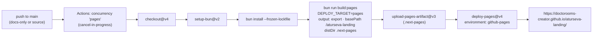
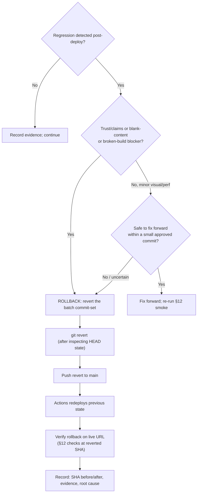

# Aturseva — File 13: Deployment & Handover Plan

> **PLANNING DOCUMENT — NOT A RUNBOOK EXECUTION.** This file defines the release, deployment, rollback,
> evidence-retention, and handover contract for *future authorized changes*. Nothing in it was deployed,
> rolled back, monitored, or handed over by the authoring task. A normal docs-only push (including the one
> publishing this file) may trigger the existing GitHub Actions workflow — that only proves the pipeline
> publishes documentation; it is **not** evidence of code, visual, performance, accessibility, SEO, or B15
> correctness.

---

## 1. Document control, scope, dependencies, and authority

| Field | Value |
|---|---|
| Document | `docs/13_DEPLOYMENT_AND_HANDOVER_PLAN.md` (File 13) |
| Source baseline at authoring | commit `6a4a6d2` (`6a4a6d215f12bf500cd69e00cbb581253ffedcd5`), branch `main`, clean working tree — verified at task start |
| Companion | `docs/12_QA_SEO_AND_PERFORMANCE_PLAN.md` (File 12 — owns the test catalogue, acceptance criteria, and evidence schema referenced throughout this file) |
| Task scope | Documentation only. No workflow, config, hosting, DNS, secret, permission, or deployment-environment changes; no deploys triggered beyond the normal docs-only push this task is authorized for; no automation created or manipulated |
| Status vocabulary | Inherited from File 11 §4 / File 12 §1: `VERIFIED CURRENT`, `CURRENT RISK`, `PROPOSED`, `OWNER DECISION REQUIRED`, `NOT IMPLEMENTED`, `NOT RUN`; outcomes `PASS/FAIL/BLOCKED/NOT RUN` |

**Current deployment facts (all `VERIFIED CURRENT` at baseline):** production is the GitHub Pages project
site `https://doctorooms-creator.github.io/aturseva-landing/`, deployed by `.github/workflows/deploy-pages.yml`
on every push to `main` (+ manual `workflow_dispatch`); the static export uses
`DEPLOY_TARGET=pages` → `output: "export"`, `basePath: "/aturseva-landing"`, `distDir: ".next-pages"`,
`images.unoptimized` (source: `next.config.ts`, workflow). **B15 is open**: the live site currently renders
fallback fonts because the emitted CSS requests root-absolute `/fonts/*.woff2`, which 404s under the basePath
(inherited browser evidence: File 08 §11.4; not re-measured by this task).

**Approval authority:** the owner approves every source-changing batch, every owner-gated decision
(§10), and any change to workflow/config/hosting/permissions. No document's existence implies approval.

---

## 2. Current environments and boundaries

| Environment | Definition | Status |
|---|---|---|
| GitHub Pages production | project site under `/aturseva-landing/` base path; the only live environment | `VERIFIED CURRENT` |
| Local dev | `bun run dev` → Next.js dev server, root path, port 3005 | `VERIFIED CURRENT` (workspace-only) |
| Self-contained preview | `bun run preview` → single-file `preview/index.html` on port 3006 (CSS + 3 base64 fonts + GSAP + engine inlined; zero external requests) | `VERIFIED CURRENT` (workspace-only) |
| Root-served static build | `bun run build` output; Vercel-compatible | **build target only — `PROPOSED`, not live.** No Vercel credentials or deployment exist; README documents an owner-side import path. Never describe Vercel as deployed/live without new verifiable evidence |
| Product workspace | `/home/z/my-project/` | strictly separate, read-only; never touched by landing work (except reading its `upload/` prompts) |

Boundary rules: release claims are proven only on the Pages production URL; dev/preview are build/parity
targets; any new environment (custom domain, Vercel, other host) is an owner-approved architecture change
(File 10 §22 guardrails), not an implementation convenience.

---

## 3. Current Git / GitHub Actions workflow (verified, read-only)

`.github/workflows/deploy-pages.yml` at baseline, in full detail (do not edit while planning):

- **Triggers:** `push` to `main`; `workflow_dispatch`.
- **Permissions:** `contents: read`, `pages: write`, `id-token: write` (OIDC for Pages deploy).
- **Concurrency:** group `pages`, `cancel-in-progress: true` (a newer push cancels an in-flight deploy).
- **Job `build`** (ubuntu-latest): `actions/checkout@v4` → `oven-sh/setup-bun@v2` →
  `bun install --frozen-lockfile` → `bun run build:pages` (env `DEPLOY_TARGET=pages`) →
  `actions/upload-pages-artifact@v3` with `path: .next-pages`.
- **Job `deploy`** (needs build; environment `github-pages`): `actions/deploy-pages@v4`, exposing the page URL.

Smoke-check lifecycle (verified pattern from prior docs-only deploys): after a push, the Actions run reaches
green and the Pages site serves the new content at the live URL. A green run after a **docs-only** commit
proves the pipeline works and the docs are published — nothing more (source is unchanged; File 10 §18).

---

## 4. Permissions, secrets, and least privilege

Documented facts only (no secret names/values exposed; nothing invented): the workflow uses GitHub's
built-in `GITHUB_TOKEN` with the three declared permissions (`contents: read` for checkout,
`pages: write` + `id-token: write` for the Pages deployment via OIDC). No custom secrets, environment
secrets, deploy keys, third-party tokens, or credentials exist in the workflow at baseline, and the repo
credentials used for `git push` from the workspace are outside this document's scope (never record them in
evidence; see §18).

Least-privilege principles for any future workflow change (owner-approved only): keep permissions exactly as
narrow as the job requires; never widen to `contents: write` for deploys; add no secrets unless a batch
provably needs one; prefer OIDC over long-lived tokens; changes to this file follow §6's commit model with
the workflow diff visible in the batch scope.

---

## 5. Pre-deploy preflight (per future release)

Before any source-changing push to `main`:

1. **Worktree state:** clean, or containing only the authorized batch's files; branch is `main` (or a
   reviewed branch per owner instruction — today the repo is single-branch `main` by practice).
2. **Current SHA recorded** (the release record starts from the pre-batch SHA).
3. **Authorized batch prompt:** an owner-issued task (or recorded decision) defines the batch scope
   (File 11 §5/§25). No batch, no release.
4. **Source diff audit:** `git diff --name-only` matches the batch's allowed paths exactly (§6).
5. **Lockfile/dependency discipline:** `bun.lock` unchanged unless the batch contract explicitly includes a
   dependency change (none is currently planned; `--frozen-lockfile` in CI enforces this).
6. **Owner gates fulfilled** for everything the batch touches (§9–§10); wording sign-offs recorded verbatim.
7. **Tests/evidence reviewed:** File 12 suite results for the batch's targeted smoke exist and are green;
   known-open defects that the batch does not address are listed (no silent scope expansion).
8. **No unrelated files** — stop and report if anything else appears; never blind `reset`/`stash`/`clean`
   (state ambiguity ⇒ stop and request review).

---

## 6. Approved batch commit model

- Each authorized batch = **one coherent, reviewable, revertible commit-set** on `main` (single commit
  preferred; a small series acceptable if each step builds green).
- **Changed paths must exactly match that batch's allowed scope** (File 11 §25 “Main paths” column). If the
  diff contains unrelated changes: stop, explain, do not stage/commit the extras; do not discard them either.
- Commit message states the batch, its B-IDs, and “nothing else” scope (project convention: descriptive
  `docs:`/`feat:` prefixes as seen in history).
- Docs-only commits (like Files 12/13's own publication) follow the same model: exactly the intended files,
  nothing else. A docs-only push may trigger the workflow — explicitly **not** QA evidence (§1, §7).
- **Never:** force-push, history rewrites, pushes with mixed scopes, “drive-by” fixes inside a batch commit.

---

## 7. Build/deploy target matrix & asset-path handling

| Target | Command | Path shape | Gate |
|---|---|---|---|
| Pages static export (production) | `bun run build:pages` | basePath `/aturseva-landing`; app assets prefixed; `public/` files served under the base path | release target — every referenced URL verified at its **requested** location |
| Root build (dev-shape/Vercel-compatible) | `bun run build` | root-relative | compatibility gate — asset strategies must hold here too |
| Dev server | `bun run dev` (:3005) | root | iteration only |
| Self-contained preview | `bun run build:preview` + `bun run preview` (:3006) | zero external requests | parity target (rebuild after source changes) |

**Asset-path rule (binding, from File 08 §11.4 / File 10 §11 / File 12 §7):** no root-absolute URL references
for `public/` assets in CSS or JSX; every new asset must be proven by a live fetch on **both** the Pages and
root targets before a release is called complete. **B15 remains the open priority instance of this class** —
the current docs-only publication changes nothing about it: the live font URLs still 404 (inherited evidence,
File 08 §11.4) and all live font checks stay `NOT RUN` until an authorized implementation batch executes
File 12's T-FONT-01…09 and records results. Do not release an asset-delivery change (or any Batch 4 media)
as “complete” while requested URLs are unverified on the live basePath build.

---

## 8. B15 release gate (explicit)

Status: **OPEN / UNFIXED / `CURRENT RISK`** — inherited evidence only; nothing re-measured by this planning
task; all checks below `NOT RUN` until an authorized batch executes them.

- **Pre-release (Batch 1 merge):** both-target builds pass; the fix's emitted CSS `url(...)` read verbatim on
  both targets (T-FONT-01); requested font URLs return 200 on dev-root and in the Pages-shaped build
  (T-FONT-02/07); no stray origin-root `/fonts/...` request under the Pages shape (T-FONT-03).
- **Post-deploy (live Pages):** T-FONT-02…06 executed on
  `https://doctorooms-creator.github.io/aturseva-landing/` — requested URLs 200; `document.fonts` shows the
  3 loaded faces; `document.fonts.check('16px Manrope'|'16px Fraunces'|italic)` true; computed
  `font-family` on H1/body resolves to brand faces; network panel clean; headings/body layout match the
  design (not Georgia/system fallback). Record before/after specimens (File 12 T-FONT-09).
- **Preview parity:** `bun run build:preview` report shows the 3 inlined fonts; :3006 typography matches
  (T-FONT-08).
- **Not evidence of a fix:** green Actions runs, HTTP 200 on the homepage, docs commits, dev-server health,
  or the passage of time. Only the measured checks above, recorded per File 12 §19 at the release SHA.

---

## 9. Batch-specific release gates (File 11 Batches 0–6)

Preserving File 11's dependency order and conditions exactly (no reordering, no execution):

| Batch | Content (B-IDs) | Release gate beyond the standard §11 checks | Rollback trigger |
|---|---|---|---|
| 0 — preflight & protection rails | process only | baseline SHA + evidence recorded; clean tree | n/a |
| 1 — production typography + trust-first fixes | **B15 (release gate)**, B1, B2+B10, B3, B11, B17, B8, B18? | §8 B15 gate green (T-FONT-01…09 PASS on live); labels/copy sweep (T-COPY-01/02/03/08/10) green; both builds + §12 smoke green; B1/B11 wording sign-offs recorded; B18 scope decision recorded | any §11 check FAIL; any gate regression |
| 2 — CTA honesty (owner-gated) | B4 | **owner decision (destination/process) recorded first**; CTA matrix rows 12–14 truthful (T-NAV-06/07); no fake-success copy remains | gate failure or dishonest CTA discovered post-deploy |
| 3 — motion lifecycle, tokens, resilience | B12, B13, B14, B9 + no-B-ID token migration, (B18? if deferred) | lifecycle tests green (T-MOT-02/05/06); zero-visual-diff token pass; hex sweep clean on touched files | motion regression; visual diff from token pass |
| 4 — approved visual asset integration (owner-gated) | B6 (VS-01…VS-08 subset) | owner sourcing/hero-route/generated decisions recorded; rights/consent register complete; **B15 pattern proven first** (File 08 §19 Batch C); per-asset both-target fetch 200 (T-ASSET-04); media budgets respected (T-PERF-08) | rights gap; any new 404; CLS regression |
| 5 — brand-asset disposition (owner-gated) | B5 + B16 | owner asset strategy recorded; asset-integrity rules held (never crop/cover/recolour/retrace/replace without authorization); logo-embedded line never quoted as tagline (T-COPY-06) | unauthorized asset change discovered; brand regression |
| 6 — documentation reconciliation | B7 (+ File 06 inventory correction if authorized) | docs-only; link/consistency audit; owner review of edits | review rejection (revert docs commit) |

---

## 10. Owner approval workflow

**One bundled checkpoint for all open decisions** (do not dribble decisions; do not infer approval from a
document's existence, a deploy's success, or silence). Known open decisions at baseline (File 11 §27,
unchanged by this file; the **tagline is approved and is NOT an open decision**):

1. **B4 CTA destination/process** — real destination · in-page navigation · removal.
2. **Imagery sourcing + generated-asset acceptability (B6 / File 08 §4).**
3. **Hero media route** (File 08 §9: zero-asset · VS-01 still · short film).
4. **Logo/tagline asset strategy + `logo-primary.svg` disposition (B5/B16).**
5. **Exact copy sign-offs — B1 patient title; B11 caption wording.**
6. **B18 scope — is sticky-footer-on-short-pages an acceptance requirement?**

**Update (post-File-11-roadmap, owner-delegated batches — recorded for register accuracy):** items 1, 4, 5
and 6 are no longer open — B4 closed via the honest-copy route (Batch 2: in-page anchors, no implied
capture); B5/B16 closed via the no-tagline word lockup + separate tagline line with `logo-primary.svg`
KEPT as the canonical provenance copy (Batch 5); B1/B11 copy fixed (Batch 1); B18 implemented as the
flex shell (Batch 3). Items 2 and 3 (imagery sourcing / hero media route) remain genuinely open, with
the zero-asset route standing as the deployed default. Evidence: repo worklog batch records.

**Update (2026-10-14, register accuracy):** the owner approved **planning** a fourth hero route — a
code-only procedural 3D diya via the img2threejs agent skill (owner quote recorded in File 14 §1).
**Later the same day the owner REJECTED that direction** ("ye diya wala mujhe sahi nai laga… kuch
solid krna hoga") and demanded a landing that instantly communicates what the company does through
UI and animation, citing launchfar.com, antigravity.google and stitch.withgoogle.com. File 14 is
`ARCHIVED — OWNER REJECTED DIRECTION`; the successor plan of record is
`docs/15_PRODUCT_UI_FIRST_LANDING_REDESIGN_PLAN.md` ("the page is the demo" — owner approval of
that direction is its own gate, File 15 §12). Items 2/3 (imagery/film routes) remain open; Route 1
stays the deployed default.

Item 6 — Sevika-first positioning (2026-10-14, recorded this session): the owner directed that
Aturseva's single key point is **Sevika as the main character** — the AI seva layer who books, holds the
queue number, and reminds ("Sevika ke paas apna queue number hai"); video call / queue / kiosk demote to
verbs she performs. Record of direction + verified use-case catalogue (8 current / 5 future-tier) =
`docs/16_SEVIKA_FIRST_POSITIONING_AND_USE_CASES.md` (planning only; development NOT started per owner
instruction; Sevika visual identity still File 08-gated; File 15 remains the design vehicle, File 16 its
narrative spine).

Recording rule: an owner decision becomes real when stated by the owner in the task conversation and then
recorded (doc commit or batch prompt quote) with its date/scope. Recommendations in any doc are non-binding.

---

## 11. Release candidate checks (pre-push checklist)

For a release candidate (source-changing batch) — all recorded in the batch evidence set:

- [ ] Build result: `bun run build` and `bun run build:pages` both succeed (T-SM-02/03).
- [ ] File-scope diff: `git diff --name-only` == batch contract (§6).
- [ ] Critical test matrix: batch-targeted File 12 tests PASS at this SHA (§9); full-regression emphasis
      areas run where required (File 12 §21).
- [ ] Browser/device checks: File 12 T-BR-01/02 minimum (reference viewports 1440×900, 390×844, +360).
- [ ] Asset licensing/consent register updated for any new media (Batch 4/5; §19).
- [ ] Accessibility/performance measurements recorded where the batch claims them (targets per File 12 §13/§15).
- [ ] No open blockers for this batch's scope; known-unrelated opens listed honestly.
- [ ] Rollback SHA identified: the commit before the batch (record it now).
- [ ] B15 gate: §8 (mandatory for Batch 1 and any asset-path-touching release).

---

## 12. Deploy monitoring & smoke checks (manual, approved methods only)

After the push (the workflow deploys automatically; alternatively `workflow_dispatch` for a manual rerun):

1. **Actions run status:** confirm the run for the pushed SHA is green (build + deploy jobs).
2. **Live homepage:** fetch `https://doctorooms-creator.github.io/aturseva-landing/` — expected status and
   page title (“Aturseva — Care that walks with you”-shaped title from `layout.tsx`); key copy present
   (e.g., H1 “Healthcare is a journey.”).
3. **Assets:** the page's CSS/JS chunks and favicon return 200 at their requested URLs; fonts per §8 for
   font-touching releases (otherwise note B15 remains open — do not claim font health).
4. **Key anchors:** direct-load `/#sevika` and `/#paths` render settled content.
5. **Console errors:** browser console clean on a full-page pass (devtools / agent-browser).
6. **Preview parity:** rebuild `preview/index.html` (`bun run build:preview`) and verify :3006 parity.
7. **Docs-only pushes:** steps 1–2 only, plus an explicit statement that deployment success is publication,
   not QA (§1). **None of these checks has been run for this planning document.**

No monitoring products, uptime probes, scheduled checks, or analytics are used or proposed — detection is
manual (HTTP checks, browser devtools, `qa/` screenshots). Any observability addition is owner-approved
(File 10 §19; ADR-8).

---

## 13. Post-deploy verification & stabilization

- **Deployed-set comparison:** the deployed HTML/asset set corresponds to the exact pushed commit — compare
  the live HTML's asset chunk names against the build output / commit contents; re-check the **target URL**
  (`/aturseva-landing/`), not just any reachable URL.
- **Caching/chunk churn:** content-hash renames of `_next` chunks between deploys are normal build-artifact
  churn, not defects — only treat as a defect when the *referenced* URL 404s (B15-class).
- **Stabilization window:** within the same working session, re-run §12 steps once after the deploy settles;
  preserve before/after evidence (screenshots to `qa/`, notes to the batch record).
- **Known-open disclosure:** if a release ships with known opens (e.g., B4 before Batch 2), the handover
  record says so explicitly (§20) — never present a green deploy as “all clear”.

---

## 14. Rollback decision tree

**Trigger criteria (any ⇒ evaluate rollback):** B15-style regression (requested asset URL 404 on live);
broken build (Actions red on `main` — fix forward or revert per below); blank/hidden content; broken
anchors/navigation; unsafe claims or trust regression (wrong label, fake-success CTA); inaccessible
label/control; incorrect asset path for new media; severe performance regression.

Rules: revert **only the approved batch commit-set** using `git revert` (never `reset --hard`, never
force-push, never blind stash/clean); inspect `HEAD` and `git log` first so unrelated commits are preserved;
if the tree/branch state is ambiguous — stop and request review (§15). Verify the rollback in production
(§12 at the reverted SHA) and record everything (§16).

---

## 15. Rollback limitations & forward-fix route

- **Docs-only commits** (e.g., this file's publication): a revert is almost never warranted — errors are
  corrected by a forward docs commit (cheap, reviewable). Reserve reverts for harmful/incorrect content.
- **Source commits:** `git revert` of the batch commit-set is the standard route. Limitations: consecutive
  batches — revert in reverse order; shared-file conflicts — resolve manually, never destructively; if
  history is uncertain, stop and report rather than rewriting.
- **Forward-fix preference:** for low-severity visual/perf regressions, a small approved fix commit is
  preferable to churn (B15 itself is currently *unfixed*, not regressed — its remedy is Batch 1's authorized
  implementation, not a rollback).
- **Never prescribed:** `push --force`, branch deletion, history rewrites, resets when state is uncertain.

---

## 16. Evidence & audit trail

Per authorized batch, retain (conventions from project practice — `qa/` screenshots, worklog entries, commit
metadata; **no new folders/files are created by this planning task**):

| Artifact | Content |
|---|---|
| SHA range | pre-batch SHA and post-batch SHA (the rollback SHA = pre-batch) |
| Diff names | `git diff --name-only` output (scope proof) |
| CI record | Actions run URL + result for the pushed SHA |
| Visual evidence | before/after screenshots (viewports per File 12 §19) |
| Network/font checks | T-FONT / T-ASSET outputs where relevant (esp. §8 B15 gate) |
| Accessibility/performance results | measured values where the batch claims them |
| Asset register updates | §19 entries for any new/retired media |
| Owner decision record | decisions consumed by the batch (quote + date) |
| Rollback record | trigger, revert SHA, verification result (if rollback ran) |

Storage: repository `qa/` (screenshots) + worklog/batch record (text) — nothing leaves the workspace; no
external artifact store, deployment system, or monitoring product is introduced.

---

## 17. Incident handling

1. **Classify** against §14 triggers (trust blocker > broken build > visual/perf).
2. **Stop rollout:** push nothing further to `main` until decided (concurrency `cancel-in-progress` already
   limits in-flight races; do not exploit it to “race” a fix).
3. **Preserve evidence:** live captures, Actions logs, console/network excerpts — before any revert.
4. **Notify the owner in the same Z.ai response** that reports the incident: symptoms, scope, evidence,
   recommended action (rollback vs fix-forward), and SHA range. No silent remediation.
5. **Remediate** per §14/§15; verify per §12; record per §16.
6. **No automatic repeated deploys, monitoring, or cron tasks** — every retry/verification is a manual,
   reported step. (No scheduler job is created, edited, enabled, or deleted by this task.)

---

## 18. Security & privacy

- No PHI, patient files, keys, tokens, credentials, or private environment data in screenshots, logs,
  evidence files, or docs — ever (test-data rules: File 12 §4).
- No access to `/home/z/my-project/` beyond reading `upload/` prompts; the product repo is never modified.
- No new integrations, webhooks, secrets, or third-party services; the workflow's declared permissions stay
  minimal (§4); repo push credentials are never recorded in evidence.
- Static-site risk posture: the deployed artifact is a public marketing page with no forms, no backend, no
  data capture (B4 honesty depends on exactly this remaining true until an owner-approved process exists).

---

## 19. Asset & licensing handover

For every future media asset (Batch 4/5; none approved by this file), register:

| Field | Notes |
|---|---|
| Creator/source | commissioned artist, stock library, or generated (per owner decision #2/#3) |
| License | terms + proof of purchase/rights |
| Release/consent | model releases for recognizable people (India-context care per File 08) |
| Crop & alt text | final crop decisions + alt/decorative classification (File 08 §17/§18) |
| File SHA | content hash at intake |
| Deployment checks | both-target fetch 200 (T-ASSET-04); poster/fallback present; budget respected (T-PERF-08) |
| Retirement path | how to remove cleanly (revert batch or forward removal; unreferenced sweep T-ASSET-05) |

Asset decisions remain owner-gated (B6/B5/B16); the register is evidence, not approval. Human imagery and
generated imagery rules follow File 08 §4/§20 exactly.

---

## 20. Final handover package (per release or project phase)

The handover report for any completed authorized phase includes — **no fabricated outcomes**:

1. Repository link + exact commit SHA (and SHA range for a batch).
2. Changed-file list (scope proof).
3. CI/deployment result for that SHA (Actions run URL/status) — labelled as pipeline evidence only.
4. Exact target checked (live URL with basePath; dev/preview where used).
5. Test results per File 12 §19: `PASS / FAIL / BLOCKED / NOT RUN` — with `NOT RUN` listed, not hidden.
6. Unresolved known risks (B-IDs open at that SHA, esp. **B15 until T-FONT-02…06 pass on live**).
7. Owner decisions consumed/remaining (§10 register state).
8. Rollback SHA + rollback status (available / exercised / n.a.-docs-only).
9. Next batch / handoff pointer (File 11 §25 board is the single work list).

---

## 21. Go/no-go checklist & responsibility matrix

**Go requires ALL:** authorized batch prompt exists; diff scope exact; owner gates recorded; §11 checklist
green; §8 B15 gate green where applicable; rollback SHA noted; evidence plan in place.

**No-go on ANY:** ambiguous tree/branch state; unrelated changes present; failed preflight steps; unmet
owner gate for touched scope; B15-relevant release without live requested-URL verification; incident open
without owner notification.

| Responsibility | Held by |
|---|---|
| Batch authorization, wording/assets/integrations/scope decisions, gate approvals | **Owner** |
| Implementation, evidence capture, honest reporting, rollback execution | Implementer (Z.ai agent acting on an authorized prompt) |
| QA execution & recording (File 12 suite) | Implementer/QA within the same authorized task |
| Deployment mechanics | GitHub Actions (automatic on push) — no manual deploy step exists |

No people/teams are invented: today these roles are the owner and the implementing agent only.

---

## 22. Post-launch follow-up (manual only — no automation)

Manual checklist for a follow-up session after a release (each item a deliberate, reported action):

- [ ] Re-run §12 smoke on the live URL (fresh browser profile).
- [ ] Re-check open B-IDs' status at the new SHA (update File 11 §25 board via an authorized docs task).
- [ ] Review evidence completeness vs §16.
- [ ] Confirm no new console errors / 404s crept in (T-ASSET sweep).
- [ ] Owner review of anything shipped with known opens.

**No cron, recurring task, scheduled review, watchdog, or background job may be created, enabled, edited, or
deleted without separate explicit owner permission. None exists as a result of this task.**

---

## 23. Open decisions & limitations

**Open owner decisions:** the §10 register as updated there (imagery sourcing/generated acceptability and
hero media route remain open; B4/B5/B16/B1/B11/B18 were resolved or dispositioned by the owner-delegated
File 11 batches) — plus, from File 12 §23: contrast targets, performance bar, SEO additions (the
canonical/robots/sitemap minimal set has since been implemented under the standing delegation — File 12
§16 addendum; OG-image, twitter cards and analytics approval remain open), browser-support floor,
structured-data policy confirmation, QA tooling. The contrast-target and performance-bar questions now
have measured lab data on file to decide against (File 12 §13/§15 addenda — QA-evidence pass, owner-delegated).

**Limitations of this plan:** it documents one live environment (GitHub Pages project site) and workspace
targets; no staging environment exists; no monitoring/observability exists (detection is manual); rollback
relies on Git revert semantics on a single-branch repo; Vercel is a documented but unexercised target; all
future tooling/CI/hosting changes need their own owner-approved batch. Evidence conventions depend on the
workspace remaining intact (sandbox wipes require GitHub-restore recovery, per project history).

---

## 24. Definition of done for File 13 (document quality only)

- [x] File exists at `docs/13_DEPLOYMENT_AND_HANDOVER_PLAN.md` as one of exactly two documents created by
      this task (with File 12).
- [x] Reflects the **actual** verified workflow (§3), environments (§2), and permissions (§4) at baseline
      `6a4a6d2` — no imagined production stack, no invented credentials, no fabricated commands.
- [x] B15 gate explicit (§7–§8) with pre-release/post-deploy checks tied to File 12 test IDs; states that
      docs-only deploys (including this file's own publication) do not fix or evidence B15; all live font
      checks `NOT RUN`.
- [x] Batch gates preserve File 11 Batches 0–6 order, dependencies, and owner gates (§9); decision register
      preserved (§10); tagline correctly treated as approved.
- [x] Rollback is non-destructive, scoped, and state-aware (§14–§15); incident handling notifies the owner
      in-response and creates no automation (§17, §22).
- [x] Evidence/audit conventions defined without creating any file now (§16); handover package forbids
      fabricated outcomes (§20).
- [x] Nothing deployed, rolled back, monitored, or handed over by the authoring task; no workflow/config/
      hosting/secret/permission change; no scheduler/cron/background automation created or manipulated.

---

*File 13 ends. Authoring task: documentation only. Stop and await owner review — do not start coding, File
14, or another task.*
